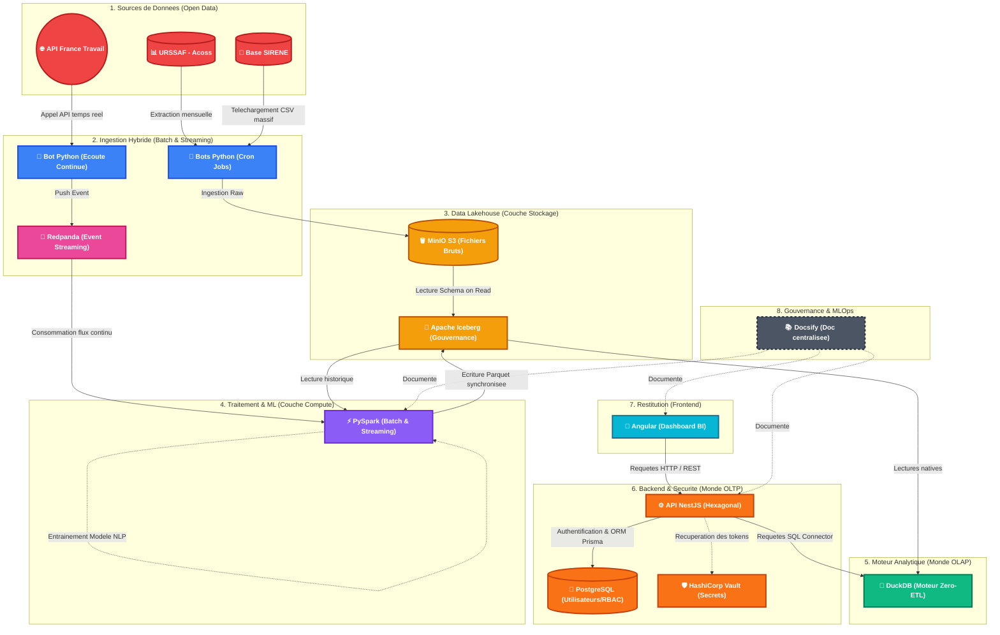

# 🎯 Data Skills Radar - Documentation Centrale

Welcome to the centralized documentation repository for the Data Skills Radar project.
This repository contains the architecture decisions (ADRs), system designs, and global technical guidelines for the entire Decision Support System (DSS).

> **🇫🇷 Language Policy:** All internal documentation, architectural schemas, and guides are written in French to align with the academic and business context of this project.

## 🏗️ Ecosystem Architecture

The Data Skills Radar project is split into several micro-repositories to ensure clear separation of concerns:

- 🎨 **[Frontend UI (`data-skills-radar-app`)](https://github.com/Anon31/data-skills-radar-app):** Angular application acting as the Business Intelligence dashboard.
- ⚙️ **[Backend API (`data-skills-radar-api`)](https://github.com/Anon31/data-skills-radar-api):** NestJS application implementing Hexagonal Architecture to secure data access and manage users.
- 🐘 **[Data Lakehouse (`data-skills-radar-lakehouse`)](https://github.com/Anon31/data-skills-radar-lakehouse):** Python/PySpark infrastructure for Big Data ingestion and processing.
- 📖 **Documentation (This repository):** Powered by Docsify (Upcoming) to serve as the unified technical portal.

## 🎯 Purpose of this repository

Instead of scattering our documentation across multiple repositories, this dedicated space allows us to:
1. Maintain a single source of truth for our global data models (MCD/MLD) and sequence diagrams.
2. Document our infrastructure setup (VPS, Docker Swarm/Compose).
3. Host our CI/CD guidelines and GitOps strategies.

## ⚖️ License
This project is licensed under the MIT License.