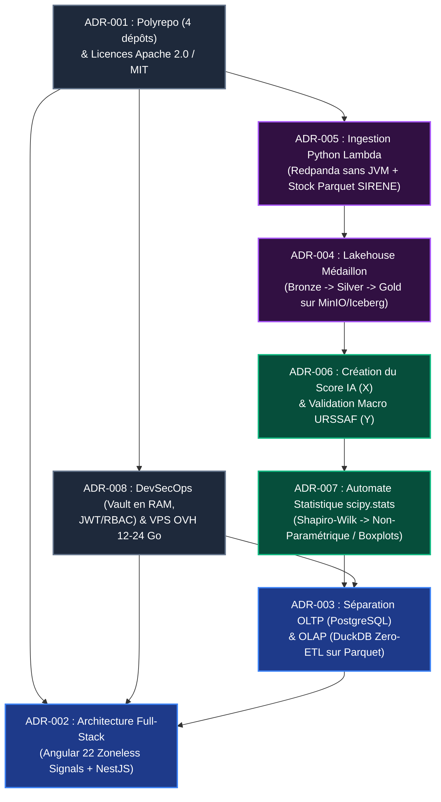

# ⚖️ Registre des Décisions d'Architecture (ADR)

> **Catégorie :** Master ESN81 - Bloc de compétences BC05 (Projet Fil Rouge)  
> **Norme documentaire :** Standard MADR (*Markdown Any Decision Records* — Michael Nygard)  
> **Objectif de ce registre :** Tracer et justifier rationnellement mes choix d'architecture structurants pour **Data Skills Radar**. Chaque fiche ADR documente le problème posé, les alternatives évaluées, ma décision finale et les compromis (*trade-offs*) que j'assume en tant qu'Architecte.

---

## 🧭 Sommaire Exécutif des Décisions (`ADR-001` à `ADR-008`)

| ID | Décision d'Architecture | Périmètre | Statut | Chapitre de référence |
| :--- | :--- | :--- | :---: | :--- |
| **[ADR-001](#-adr-001--topologie-polyrepo-4-depots-git--strategie-de-licences-differenciee)** | Topologie Polyrepo (4 dépôts Git) & Stratégie de Licences Différenciée (`Apache 2.0` vs `MIT`) | 🌍 Gouvernance & GitOps | ✅ Acceptée | [Vue d'ensemble](docs/architecture/01.vue_ensemble) · [Conventions GitOps](docs/cicd/00.conventions_gitops) |
| **[ADR-002](#-adr-002--architecture-web-industrielle-angular-22-zoneless--nestjs-vs-prototypage-data-streamlit)** | Architecture Web Industrielle (`Angular 22 Zoneless` + `NestJS`) vs Prototypage Data (`Streamlit`) | 🎨 Frontend & ⚙️ API | ✅ Acceptée | [Architecture Frontend](docs/frontend/01.architecture_frontend_et_styles) · [Architecture API](docs/api/02_architecture_et_securite) |
| **[ADR-003](#-adr-003--separation-stricte-oltp-postgresql-15--prisma-7-et-olap-duckdb-zero-etl--apache-parquet)** | Séparation Stricte OLTP (`PostgreSQL 15` + `Prisma 7`) et OLAP (`DuckDB Zero-ETL` + `Apache Parquet`) | 🦆 Moteur Analytique & BDD | ✅ Acceptée | [Moteur Analytique DuckDB](docs/lakehouse/07.duckdb_zero_etl) · [BDD OLTP](docs/api/03_base_de_donnees_oltp) |
| **[ADR-004](#-adr-004--architecture-data-lakehouse-medaillon-bronze--silver--gold-sur-minio-s3--apache-iceberg)** | Architecture Data Lakehouse Médaillon (`Bronze` → `Silver` → `Gold`) sur `MinIO S3` & `Apache Iceberg` | 🐘 Data Lakehouse | ✅ Acceptée | [Architecture Medallion](docs/lakehouse/06.architecture_medallion) |
| **[ADR-005](#-adr-005--ingestion-hybride-lambda-en-python--conteneur-redpanda-streaming-sans-jvm--stock-parquet-sirene-batch)** | Ingestion Hybride Lambda en Python : Conteneur `Redpanda` (Streaming sans JVM) & Stock Parquet `SIRENE` (Batch) | 📥 Ingestion & Big Data | ✅ Acceptée | [APIs France Travail](docs/lakehouse/02.strategie_apis_francetravail) · [Base SIRENE V4](docs/lakehouse/03.strategie_apis_insee_sirene) |
| **[ADR-006](#-adr-006--creation-endogene-du-score-dynamique-de-vulnerabilite-ia-x-en-couche-gold--validation-empirique-par-lurssaf-y)** | Création Endogène du Score Dynamique de Vulnérabilité IA (`X`) en Couche Gold & Validation par l'URSSAF (`Y`) | 🔬 Modélisation & Data Science | ✅ Acceptée | [Écosystème OCDE](docs/lakehouse/05.ecosysteme_ocde_et_rapports_ia) · [API URSSAF](docs/lakehouse/04.strategie_apis_urssaf) |
| **[ADR-007](#-adr-007--protocole-darbitrage-statistique-automatise-shapiro-wilk--parametrique-vs-non-parametrique)** | Protocole d'Arbitrage Statistique Automatisé (`Shapiro-Wilk` → Paramétrique vs Non-Paramétrique) | 📐 Statistiques & Dataviz | ✅ Acceptée | [Métriques & Pièges](docs/lakehouse/08.catalogue_metriques_et_pieges) · [Protocole Statistique](docs/lakehouse/09.protocole_tests_statistiques) |
| **[ADR-008](#-adr-008--securite-devsecops-zero-secret-in-code-hashicorp-vault-en-ram--jwt--rbac--dimensionnement-vps)** | Sécurité DevSecOps « Zero-Secret-in-Code » (`HashiCorp Vault` en RAM + `JWT` + `RBAC`) & Dimensionnement VPS | 🛡️ Sécurité & Infrastructure | ✅ Acceptée | [Sécurité RBAC](docs/frontend/03.architecture_technique-rbac) · [Infrastructure VPS](docs/cicd/02.infrastructure_vps) |

---

## 📦 ADR-001 : Topologie Polyrepo (4 dépôts Git) & Stratégie de Licences Différenciée

* **Statut :** ✅ Acceptée
* **Date :** Octobre 2026
* **Périmètre :** Gouvernance GitOps, CI/CD & Propriété Intellectuelle

### 1. Contexte & Problème posé
Mon Système d'Information Décisionnel (**Data Skills Radar**) rassemble quatre sous-systèmes aux langages, cycles de vie et dépendances radicalement différents : un Frontend Web (**Angular 22 / TypeScript**), une API Backend (**NestJS / Node.js 24 / Prisma**), un Data Lakehouse (**Python 3.12 / PySpark / SciPy**) et un portail de documentation (**Docsify / Markdown**). Je devais décider comment organiser le versionnement Git et protéger juridiquement mes algorithmes tout en restant fidèle à l'esprit *Open Source*.

### 2. Options envisagées
* **Option A — Monorepo unique (Nx / Turborepo) :** Regrouper `app`, `api`, `lakehouse` et `docs` dans un seul dépôt Git.
  * *Inconvénient :* Complexifie fortement les pipelines GitHub Actions (mélange d'environnements Node.js 24 et Python/Java PySpark), alourdit le clonage et impose une licence unique à la racine du dépôt.
* **Option B — Polyrepo découplé en 4 dépôts Git spécialisés :** Isoler chaque domaine métier dans son propre dépôt (`data-skills-radar-app`, `data-skills-radar-api`, `data-skills-radar-lakehouse`, `data-skills-radar-docs`).

### 3. Ma Décision d'Architecte
J'ai retenu l'**Option B (Topologie Polyrepo à 4 dépôts)** assortie d'une **stratégie de licences différenciée** :
1. **`Apache 2.0` pour `data-skills-radar-lakehouse` :** Standard de l'industrie Big Data (*Apache Spark*, *Apache Iceberg*, *Apache Parquet*), cette licence inclut une clause explicite de protection des brevets et protège juridiquement ma méthodologie algorithmique de calcul du score **SDSS** et du **Score Dynamique de Vulnérabilité IA**.
2. **`MIT` pour `app`, `api` et `docs` :** Licence ultra-permissive standard de l'écosystème Web/Node.js, favorisant la réutilisation de mes briques d'architecture tout en garantissant ma paternité intellectuelle.

### 4. Conséquences
* **Positives (+) :** Séparation stricte des responsabilités (*Separation of Concerns*), pipelines CI/CD indépendants et rapides (`Release Drafter` dédié par dépôt), droits d'accès granulaires et protection juridique adaptée à chaque couche.
* **Compromis assumés (-) :** Nécessite de maintenir la cohérence des contrats d'interface (DTOs JSON et schémas Parquet Gold) entre les dépôts via ma documentation centrale `data-skills-radar-docs`.

---

## 🎨 ADR-002 : Architecture Web Industrielle (Angular 22 Zoneless + NestJS) vs Prototypage Data (Streamlit)

* **Statut :** ✅ Acceptée
* **Date :** Octobre 2026
* **Périmètre :** Restitution BI, Expérience Utilisateur (UX) & Sécurité Applicative

### 1. Contexte & Problème posé
Pour restituer mes analyses régionales et sectorielles (cartographie de la France, matrices des 4 quadrants, boîtes à moustaches de dispersion et filtres multicritères NAF/ROME), je devais choisir entre un outil de prototypage rapide issu de la Data Science ou une véritable architecture web d'entreprise découplée.

### 2. Options envisagées
* **Option A — Data App monolithique en Python (`Streamlit` ou `Plotly Dash`) :**
  * *Avantage :* Développement très rapide directement en Python au-dessus de DuckDB.
  * *Inconvénient :* Ré-exécution complète du script Python à chaque clic utilisateur, gestion native très limitée de la sécurité (JWT, rôles RBAC, HashiCorp Vault) et couplage fort entre l'interface graphique et le moteur de données.
* **Option B — Architecture Full-Stack Industrielle (`Angular 22 Zoneless` + `API NestJS`) :**
  * *Avantage :* Découplage total Client/Serveur, sécurité DevSecOps de grade bancaire côté API (`Guards`, `RBAC`, `Vault`), et réactivité chirurgicale côté navigateur grâce aux **Angular Signals** sans `zone.js`.

### 3. Ma Décision d'Architecte
J'ai retenu l'**Option B (`Angular 22` + `NestJS`)** :
* Côté Frontend (`data-skills-radar-app`), j'exploite **Angular 22** en mode **100 % Standalone et Zoneless** (`provideZonelessChangeDetection()`), avec `ChangeDetectionStrategy.OnPush` par défaut, les primitives réactives **`signal()` / `computed()` / `httpResource()`**, **Tailwind CSS v4**, **PrimeNG 22** et **Apache ECharts**.
* Côté Backend (`data-skills-radar-api`), **NestJS** agit comme une passerelle sécurisée (*API Gateway*) qui authentifie les requêtes, applique le contrôle d'accès par rôle (`VISITOR`, `USER`, `ADMIN`) et orchestre les requêtes analytiques.

### 4. Conséquences
* **Positives (+) :** Fluidité instantanée lors du filtrage interactif de la carte de France (aucun rechargement de page), étanchéité totale du Data Lakehouse (jamais exposé directement au navigateur), et démonstration d'une maîtrise Full-Stack & Data Engineering complète.
* **Compromis assumés (-) :** Temps de développement initial plus élevé qu'un script Streamlit, compensé par une maintenabilité et une évolutivité de niveau production.

---

## 🦆 ADR-003 : Séparation Stricte OLTP (`PostgreSQL 15` + `Prisma 7`) et OLAP (`DuckDB Zero-ETL` + `Apache Parquet`)

* **Statut :** ✅ Acceptée
* **Date :** Octobre 2026
* **Périmètre :** Base de données transactionnelle & Moteur Analytique BI

### 1. Contexte & Problème posé
Mon API NestJS doit répondre simultanément à deux besoins opposés :
1. **Un besoin transactionnel (OLTP) :** Gérer les comptes utilisateurs, leurs adresses, leurs mots de passe hachés et leurs rôles RBAC (requêtes unitaires lisant ou modifiant une seule ligne : `SELECT * FROM users WHERE id = ...`).
2. **Un besoin analytique massif (OLAP) :** Agréger des millions de lignes d'établissements SIRENE, des centaines de milliers d'offres France Travail et des séries temporelles URSSAF pour calculer des médianes, des quartiles et des corrélations sur quelques colonnes ciblées.

### 2. Options envisagées
* **Option A — Tout stocker dans `PostgreSQL 15` :**
  * *Inconvénient :* PostgreSQL est orienté lignes (*Row-oriented*). Scanner des millions d'enregistrements pour agréger deux colonnes sature les entrées/sorties disque et dégrade les temps de réponse au-delà de plusieurs secondes.
* **Option B — Déployer un serveur Data Warehouse externe (`ClickHouse`, `Snowflake` ou `BigQuery`) :**
  * *Inconvénient :* Coût financier ou empreinte mémoire incompatible avec mon budget VPS, et obligation de développer un pipeline ETL supplémentaire pour copier les données de la couche Gold vers ce serveur.
* **Option C — Architecture Hybride : `PostgreSQL 15 / Prisma 7` (OLTP) + `DuckDB In-Process` lisant `Apache Parquet` (OLAP Zero-ETL) :**
  * *Avantage :* Chaque moteur excelle dans son domaine sans duplication de données.

### 3. Ma Décision d'Architecte
J'ai retenu l'**Option C (Séparation OLTP / OLAP avec DuckDB Zero-ETL)** :
* **Monde OLTP :** **PostgreSQL 15** (interrogé via **Prisma 7** et son pool natif `@prisma/adapter-pg`) est strictement réservé aux utilisateurs, à l'authentification et aux métadonnées applicatives.
* **Monde OLAP :** **DuckDB** (« le SQLite de l'analytique ») est embarqué *In-Process* dans mon API NestJS et interroge directement les fichiers **Apache Parquet** de la couche **Gold** en exploitant l'exécution vectorisée SIMD, l'élagage de colonnes (*Column Pruning*) et la poussée de prédicats (*Predicate Pushdown*).

### 4. Conséquences
* **Positives (+) :** Temps de réponse analytique en quelques millisecondes, **Zero-ETL** (aucune copie ni synchronisation entre la couche Gold et une base SQL), et consommation mémoire minimale (seules les colonnes utiles au graphique demandé sont lues en RAM).
* **Compromis assumés (-) :** DuckDB étant embarqué pour de la lecture analytique rapide sur la couche Gold, toutes les écritures et transformations lourdes restent déléguées en amont à mon pipeline Python / PySpark.

---

## 🐘 ADR-004 : Architecture Data Lakehouse Médaillon (`Bronze` → `Silver` → `Gold`) sur MinIO S3 & Apache Iceberg

* **Statut :** ✅ Acceptée
* **Date :** Octobre 2026
* **Périmètre :** Stockage Big Data, Gouvernance des Données & Conformité RGPD

### 1. Contexte & Problème posé
Je manipule quatre sources Open Data hétérogènes aux formats et fréquences disparates : des flux JSON d'offres d'emploi (`France Travail`), un stock Parquet massif de 39 millions d'établissements (`SIRENE V4`), des séries trimestrielles (`URSSAF`) et des matrices CSV internationales (`OCDE`). Stocker ces fichiers en vrac sans gouvernance transformerait rapidement mon stockage en « marécage de données » (*Data Swamp*) impossible à auditer et risqué vis-à-vis du RGPD.

### 2. Options envisagées
* **Option A — Data Lake plat sur système de fichiers local :** Scripts Python écrivant directement des fichiers CSV/JSON transformés en écrasant les versions précédentes.
  * *Inconvénient :* Perte de la donnée brute originale en cas de bug dans une formule, impossibilité de rejouer l'historique et risque de fuite d'informations personnelles dans les couches finales.
* **Option B — Architecture Data Lakehouse Médaillon (`Bronze` → `Silver` → `Gold`) sur `MinIO S3` gouvernée par `Apache Iceberg` :**
  * *Avantage :* Structuration industrielle en trois couches de raffinage progressif avec support des transactions ACID et du voyage dans le temps (*Time Travel*).

### 3. Ma Décision d'Architecte
J'ai retenu l'**Option B (Architecture Médaillon sur MinIO S3 & Apache Iceberg / Parquet)** :
1. **Couche `Bronze` (Brute & Immuable) :** Archive à l'identique (*Append-Only*) les réponses JSON des APIs et les fichiers stocks téléchargés, partitionnés par date d'ingestion (`ingestion_date=YYYY-MM-DD`).
2. **Couche `Silver` (Nettoyée, Réconciliée & Anonymisée RGPD) :** Applique le typage strict, filtre les établissements actifs (`etatAdministratifEtablissement == 'A'`), purge le marqueur de secret statistique INSEE (`[ND]` → `NULL`), supprime toute donnée nominative individuelle et exécute la réconciliation **Code ROME ↔ SIRET/SIRENE ↔ Code NAF ↔ Score OCDE**.
3. **Couche `Gold` (Agrégée & Décisionnelle) :** Génère les tables Parquet pré-agrégées par secteur NAF et par région, prêtes pour DuckDB, tout en conservant les snapshots temporels Iceberg (`snapshot_quarter`) pour analyser les trajectoires sur plusieurs trimestres sans écraser le passé (*Data Drift*).

### 4. Conséquences
* **Positives (+) :** Reproductibilité totale (capacité à recalculer toute la couche Silver/Gold depuis la couche Bronze si je fais évoluer ma formule du score IA), conformité RGPD par conception (*Privacy by Design* par agrégation statistique), et compatibilité native avec le standard Cloud S3.
* **Compromis assumés (-) :** Triplement logique des étapes du pipeline (Bronze, Silver, Gold), nécessitant un nommage rigoureux et une automatisation propre des jobs PySpark.

---

## 📥 ADR-005 : Ingestion Hybride Lambda en Python : Conteneur Redpanda (Streaming sans JVM) & Stock Parquet SIRENE (Batch)

* **Statut :** ✅ Acceptée
* **Date :** Novembre 2026
* **Périmètre :** Ingestion de Données, Streaming Temps Réel & Optimisation Mémoire

### 1. Contexte & Problème posé
Tous mes scripts de collecte et de traitement dans `data-skills-radar-lakehouse` sont développés **100 % en Python**. Cependant, je fais face à deux défis techniques majeurs lors de l'ingestion :
1. **Pour le flux continu d'offres France Travail (Voie Chaude / Streaming) :** J'ai besoin d'un broker de messages compatible Kafka pour découpler mon bot Python de collecte et mon moteur PySpark Structured Streaming, mais un cluster **Apache Kafka** classique (qui tourne sur une Machine Virtuelle Java / JVM) consomme à lui seul entre 4 et 6 Go de RAM sur un serveur VPS.
2. **Pour la base SIRENE de l'INSEE (Voie Froide / Batch) :** L'API REST SIRENE V4 impose un quota strict (*Rate Limiting*) de **30 requêtes par minute**. Interroger cette API unitairement pour des centaines de milliers d'offres d'emploi provoquerait un blocage immédiat (`HTTP 429 Too Many Requests`). À l'inverse, charger naïvement en mémoire le fichier complet `StockEtablissement.parquet` (**2 Go compressé sur disque, mais ~39 millions de lignes historiques depuis 1973**) fait exploser la RAM au-delà de **15 Go** (*Out-Of-Memory*).

### 2. Options envisagées
* **Option A — Conteneur Apache Kafka (JVM) + Appels API SIRENE à la volée :**
  * *Inconvénient :* Saturation mémoire immédiate du VPS à cause de la JVM de Kafka, et blocage par le quota de 30 req/min de l'API INSEE.
* **Option B — Conteneur Docker `Redpanda` (100 % compatible Kafka, sans JVM) interrogé par mes scripts Python + Stratégie Hybride SIRENE (Stock Parquet filtré à la source + Delta API) :**
  * *Avantage :* Empreinte RAM divisée par 4 pour le broker de streaming et enrichissement SIRENE local ultra-rapide sans consommer de quota API.

### 3. Ma Décision d'Architecte
J'ai retenu l'**Option B** :
1. **Côté Streaming (France Travail) :** Mes bots **Python** publient et consomment les offres d'emploi via les librairies Python Kafka standards en ciblant un conteneur Docker **Redpanda**. Comme le serveur Redpanda est un binaire natif sans JVM Java, il m'offre toute la puissance du protocole Kafka en consommant moins de 500 Mo de RAM sur mon VPS.
2. **Côté Batch (INSEE SIRENE V4) :** Mon pipeline **Python (PySpark / DuckDB)** télécharge le fichier mensuel `StockEtablissement.parquet` (2 Go) et lui applique dès la lecture un **Élagage de Colonnes (*Column Pruning* : 6 colonnes retenues sur plus de 40)** et une **Poussée de Prédicats (*Predicate Pushdown* : `etatAdministratifEtablissement == 'A'`)**. Cela élimine à la volée les ~25 millions d'établissements fermés historiques et réduit l'empreinte RAM de plus de 85 %. L'API REST SIRENE V4 (`30 req/min`) est réservée uniquement au **rattrapage incrémental (Delta)** des entreprises créées dans le mois en cours.

### 4. Conséquences
* **Positives (+) :** Développement **100 % unifié en Python**, résilience totale face aux quotas `HTTP 429` des APIs gouvernementales, et prévention garantie des crashs *Out-Of-Memory* lors du traitement des 39 millions de lignes SIRENE.
* **Compromis assumés (-) :** Exige le téléchargement mensuel automatisé du fichier Stock Parquet SIRENE (2 Go) vers mon bucket MinIO Bronze.

---

## 🔬 ADR-006 : Création Endogène du Score Dynamique de Vulnérabilité IA (`X`) en Couche Gold & Validation Empirique par l'URSSAF (`Y`)

* **Statut :** ✅ Acceptée
* **Date :** Novembre 2026
* **Périmètre :** Modélisation Scientifique, NLP & Croisement Macro-Économique

### 1. Contexte & Problème posé
Les études académiques internationales (OCDE, OIT, OpenAI/Eloundou) publient des scores théoriques d'exposition à l'IA par profession (`ISCO-08` / `SOC`), mais **aucune institution ne fournit un score dynamique d'exposition à l'IA par secteur d'activité économique français (`Code NAF`) ni par région française**, et encore moins un indicateur tenant compte des compétences humaines (*Soft Skills*) réellement exigées par les recruteurs locaux.

### 2. Options envisagées
* **Option A — Utiliser uniquement le score théorique statique de l'OCDE :**
  * *Inconvénient :* Ignore la réalité du terrain français (deux entreprises d'un même métier peuvent avoir des stratégies RH opposées face à l'IA) et ne permet aucun croisement direct avec les statistiques sectorielles (`Code NAF`) de l'URSSAF.
* **Option B — Construire dans notre Lakehouse (couches Silver & Gold) notre propre Score Dynamique Hybride de Vulnérabilité IA par Secteur NAF et par Région (`Variable Indépendante X`), puis le confronter à l'API URSSAF (`Variable Dépendante Y`) :**
  * *Avantage :* Crée une véritable valeur ajoutée scientifique et décisionnelle inédite en France.

### 3. Ma Décision d'Architecte
J'ai retenu l'**Option B** :
1. **Création de la Variable Indépendante (`X`) par mon Lakehouse :** En couche **Silver** et **Gold**, mon moteur PySpark croise l'indice théorique de capacité IA de l'OCDE (`CGj`), la densité de *Soft Skills* extraite par NLP des offres France Travail (`SDSS` via `ROMEO v2` — *« Le Bouclier Humain »*), et le **Code NAF** exact de l'établissement recruteur issu de **SIRENE V4** pour calculer le **Score Dynamique de Vulnérabilité IA (`0` à `100`)** selon la formule :
   > **`Score_Vulnerabilite_IA (Secteur NAF, Région) = Exposition_Theorique_OCDE (CGj) × (1 / (1 + Densite_Soft_Skills_SDSS))`**
2. **Validation par la Variable Dépendante (`Y` — API URSSAF) :** Une fois ce score créé par mon Lakehouse, j'utilise les séries trimestrielles de l'**API Open Data URSSAF (`na38` et `na88`)** sur les effectifs salariés et la masse salariale comme **juge de paix macro-économique** pour classer chaque secteur dans ma **Matrice des 4 Quadrants Stratégiques** (*Destruction Nette*, *Mutation & Augmentation IA*, *Croissance Protégée*, *Contraction Hors-IA*).

### 4. Conséquences
* **Positives (+) :** Positionne **Data Skills Radar** comme un véritable instrument de recherche empirique capable de vérifier mes deux hypothèses scientifiques (déclin de l'exécution routinière vs prime au bouclier *Soft Skills*), tout en respectant pleinement les CGU des fournisseurs Open Data grâce à la création d'indicateurs agrégés inédits.
* **Compromis assumés (-) :** Implique de maintenir la table de passage (*Crosswalk*) `ISCO-08 ↔ ROME 4.0 ↔ NAF Rév. 2` et de prendre en compte le décalage temporel (*Time-Lag* de 1 à 4 trimestres) entre la publication d'une offre d'emploi et son impact macro-économique URSSAF.

---

## 📐 ADR-007 : Protocole d'Arbitrage Statistique Automatisé (`Shapiro-Wilk` → Paramétrique vs Non-Paramétrique)

* **Statut :** ✅ Acceptée
* **Date :** Novembre 2026
* **Périmètre :** Rigueur Statistique (`scipy.stats`) & Représentation Graphique (Dataviz)

### 1. Contexte & Problème posé
Dans un Système d'Information Décisionnel, afficher une différence de croissance d'emploi entre deux groupes de secteurs NAF ou comparer des moyennes entre les **13 régions françaises** sans test statistique préalable expose à deux erreurs graves :
1. Prendre du simple bruit aléatoire pour une tendance économique réelle (absence de contrôle de la **`p-value`** au seuil de risque **`alpha = 0.05`**).
2. Utiliser des **moyennes arithmétiques** et des **tests paramétriques (`t de Student`, `ANOVA`)** sur de petits échantillons (**`n = 13 régions <= 30`**) ou sur des données économiques fortement asymétriques (où un secteur géant comme l'intérim écrase les autres).

### 2. Options envisagées
* **Option A — Approche BI naïve (Moyennes arithmétiques et graphiques en barres simples partout) :**
  * *Inconvénient :* Fausse l'interprétation dès qu'un secteur présente une valeur extrême (*outlier*) et viole les conditions mathématiques d'application des tests paramétriques lorsque `n <= 30` ou que la loi normale n'est pas respectée.
* **Option B — Intégration d'un Automate d'Arbitrage Statistique (`scipy.stats`) en couche Gold gouvernant le choix des tests et des graphiques :**
  * *Avantage :* Garantit que chaque comparaison publiée dans la couche Gold est mathématiquement valide et accompagnée de son badge de significativité (`p < 0.05`).

### 3. Ma Décision d'Architecte
J'ai retenu l'**Option B** en intégrant `scipy>=1.14.0` dans mon Lakehouse et en codifiant l'arbre de décision statistique suivant (issu du référentiel *ESN Castres — Statistiques avec R et Python*) :
1. **Vérification automatique de la taille (`n > 30`) et de la Normalité (`scipy.stats.shapiro`) :**
   * Si **`n > 30`** ET que le test de **Shapiro-Wilk donne `p > 0.05`** (distribution normale confirmée), mon pipeline applique la voie **Paramétrique (« Le Chronomètre »)** : **Moyenne + Écart-type**, test **`t de Student`** (2 groupes) ou **`ANOVA`** (> 2 groupes).
   * Dès que **`n <= 30`** (comme pour nos **`n = 13 régions`**) OU que **Shapiro-Wilk donne `p < 0.05`** (distribution asymétrique sur nos 88 divisions NAF), mon pipeline bascule automatiquement vers la voie **Non-Paramétrique (« Le Classement » par les rangs)** :
     * **2 groupes :** Test de **`Wilcoxon`** (`scipy.stats.wilcoxon` pour mesures appariées Avant/Après sur les mêmes NAF) ou **`Mann-Whitney`** (`scipy.stats.mannwhitneyu` pour groupes indépendants).
     * **> 2 groupes :** Test de **`Friedman`** (`scipy.stats.friedmanchisquare` pour suivi temporel apparié sur `>= 3` trimestres) ou **`Kruskal-Wallis`** (`scipy.stats.kruskal` pour comparer nos 4 quadrants ou nos 13 régions).
2. **Gouvernance visuelle des graphiques (Apache ECharts) :** Toute comparaison non-paramétrique est obligatoirement restituée sous forme de **Boîte à moustaches (*Boxplot* : Médiane `Q2`, Quartiles `Q1`/`Q3`, `Min`/`Max`)** plutôt que par un diagramme en barres de moyennes trompeur.

### 4. Conséquences
* **Positives (+) :** Crédibilité scientifique irréprochable devant un jury académique ou des décideurs publics, insensibilité aux valeurs aberrantes (*outliers*), et affichage transparent de la `p-value` et du nom du test directement dans l'interface Angular.
* **Compromis assumés (-) :** Ajoute une étape d'évaluation statistique (`run_scientific_test()`) lors de la génération des tables de la couche Gold.

---

## 🛡️ ADR-008 : Sécurité DevSecOps « Zero-Secret-in-Code » (HashiCorp Vault en RAM + JWT + RBAC) & Dimensionnement VPS

* **Statut :** ✅ Acceptée
* **Date :** Octobre 2026
* **Périmètre :** Cybersécurité, Gestion des Secrets, Contrôle d'Accès & Infrastructure Cloud

### 1. Contexte & Problème posé
Mon écosystème manipule des secrets critiques (clés OAuth2 `client_id` / `client_secret` de France Travail et de l'INSEE, clé de signature `JWT_SECRET`, identifiants PostgreSQL et MinIO S3) et doit être hébergé en production sur un serveur VPS tout en faisant tourner simultanément PostgreSQL, Vault, NestJS, Redpanda, MinIO et PySpark sans saturer la mémoire vive (RAM).

### 2. Options envisagées
* **Option A — Fichiers `.env` statiques en production sur un petit VPS d'entrée de gamme (2 à 4 Go de RAM) :**
  * *Inconvénient :* Risque élevé de fuite de secrets sur le disque du serveur, et crash *Out-Of-Memory (OOM)* immédiat au démarrage simultané des conteneurs Data et Backend sur 4 Go de RAM.
* **Option B — Architecture DevSecOps avec `HashiCorp Vault` (injection en RAM), verrouillage global `JWT + RBAC` et hébergement conteneurisé borné (`Cgroups`) sur VPS OVHcloud 12 à 24 Go de RAM :**
  * *Avantage :* Aucun secret en clair sur le disque en production et dimensionnement matériel adapté à une architecture Lambda.

### 3. Ma Décision d'Architecte
J'ai retenu l'**Option B** :
1. **Gestion des Secrets (`HashiCorp Vault`) :** Au démarrage de mon API NestJS (`main.ts`) et de mes jobs d'ingestion Python, les secrets de production sont récupérés depuis **HashiCorp Vault** et injectés directement dans la mémoire vive (**RAM**) du processus, avec bascule automatique (*Fallback*) sur le fichier `.env` local uniquement en environnement de développement.
2. **Verrouillage par défaut (`Zero-Trust API`) :** Le `JwtAuthGuard` et le `RolesGuard` sont appliqués globalement sur toute l'API NestJS (toutes les routes sont fermées par défaut sauf mention explicite `@Public()`), couplés aux rôles stricts `VISITOR`, `USER` et `ADMIN` côté Angular (`authGuard`, `adminGuard`).
3. **Dimensionnement VPS (`OVHcloud VPS-3 12 Go RAM` / `VPS-4 24 Go RAM`) :** J'écarte les VPS de moins de 8 Go de RAM et j'applique des limites mémoire strictes (`mem_limit` Docker) à chaque conteneur pour faire cohabiter sereinement le monde OLTP, le broker Redpanda et le Lakehouse.

### 4. Conséquences
* **Positives (+) :** Protection maximale des clés API gouvernementales et des jetons JWT, conformité aux meilleures pratiques DevSecOps (*Shift-Left Security*), et haute disponibilité du démonstrateur 24h/24 et 7j/7.
* **Compromis assumés (-) :** Nécessite l'administration et le déverrouillage (*Unseal*) du conteneur HashiCorp Vault lors des déploiements de production.
