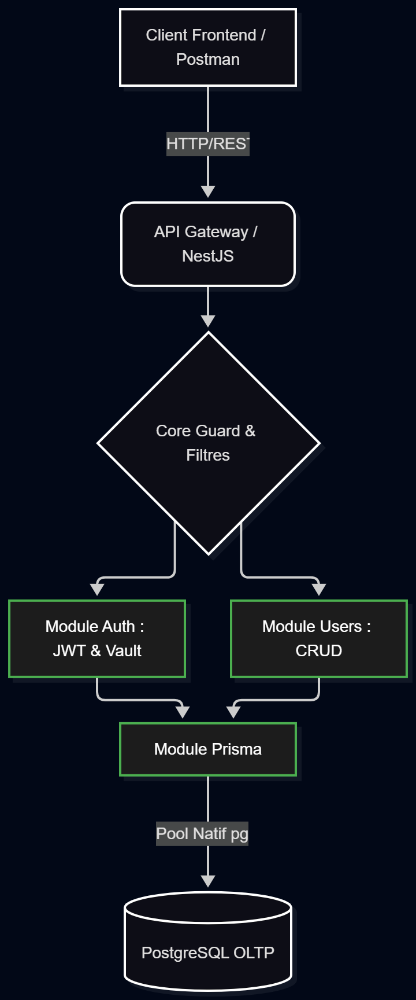
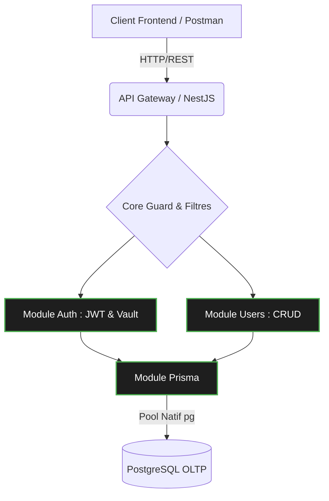

# 🛡️ Architecture & Sécurité - Data Skills Radar API

Ce document détaille l'organisation structurelle du backend et les mécanismes DevSecOps implémentés pour garantir la protection des données, la gestion des secrets et le contrôle d'accès.

## 1. Architecture Modulaire (NestJS / ESM)

Le projet suit une organisation stricte par domaine, facilitant la maintenabilité et la séparation des responsabilités. Le code est nativement compilé en modules ECMAScript (ESM).

*   **`src/core/`** : Cœur de l'application et composants globaux. Contient les filtres d'exceptions (ex: Prisma), les gardiens (`Guards`), et les décorateurs personnalisés de sécurité (`@Public`, `@Roles`).
*   **`src/shared/`** : Ressources transverses partagées entre plusieurs modules. Comprend les interfaces communes (ex: `ICurrentUser`) et les DTOs génériques (`CreateAddressDto`).
*   **`src/prisma/`** : Module isolé responsable de la connexion à la base de données via le pool natif `pg`.
*   **`src/modules/`** : Domaines métiers isolés. Chaque dossier (`auth/`, `users/`) encapsule ses propres contrôleurs, services, DTOs et stratégies.

## 2. Gestion des Secrets (HashiCorp Vault)

Dans une approche *Shift-Left*, les données sensibles ne sont jamais inscrites en dur ou persistées inutilement.

*   **Injection en RAM :** Au démarrage de l'application (`main.ts`), une fonction asynchrone s'interface avec **HashiCorp Vault** pour récupérer les secrets de production (identifiants BDD, clés JWT) et les injecter directement dans la mémoire (RAM) du processus Node.js.
*   **Mode Dégradé (Local) :** Si l'instance Vault est injoignable (environnement de développement), l'application bascule automatiquement sur les variables d'environnement locales définies dans le fichier `.env`.

## 3. Authentification (JWT) et Contrôle d'Accès (RBAC)

La sécurisation des routes repose sur un couplage entre `Passport.js` et un système de contrôle d'accès basé sur les rôles (RBAC).

*   **Chiffrement des mots de passe :** Utilisation de `bcryptjs` (compatible multi-plateformes sans compilation requise) avec un salt de 10 tours.
*   **Stratégie JWT :** À la connexion, un `access_token` chiffré (HMAC SHA-256) est généré. Son *payload* contient l'UUID de l'utilisateur, son rôle et son email.
*   **Protection par défaut :** Le `JwtAuthGuard` est injecté globalement. Toutes les routes de l'API sont verrouillées par défaut.
*   **Décorateurs personnalisés :**
    *   `@Public()` : Surcharge le Guard global pour autoriser les accès non authentifiés (ex: `/auth/login`).
    *   `@Roles(Role.ADMIN)` : Restreint l'accès à une route spécifique aux porteurs d'un rôle autorisé. Traité par le `RolesGuard` en aval de la validation JWT.

## 4. Extraction Sécurisée du Contexte Utilisateur

Une fois le jeton JWT validé, les informations du profil sont injectées dans l'objet de requête HTTP. Le décorateur `@Request() req` permet aux contrôleurs d'extraire l'utilisateur courant (`req.user.userId`) sans jamais exposer ou faire transiter des UUIDs sensibles via l'URL pour les opérations personnelles (ex: modification de son propre mot de passe).