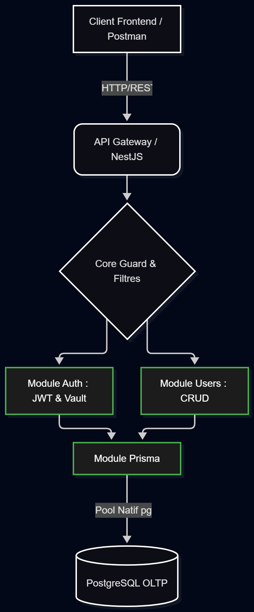
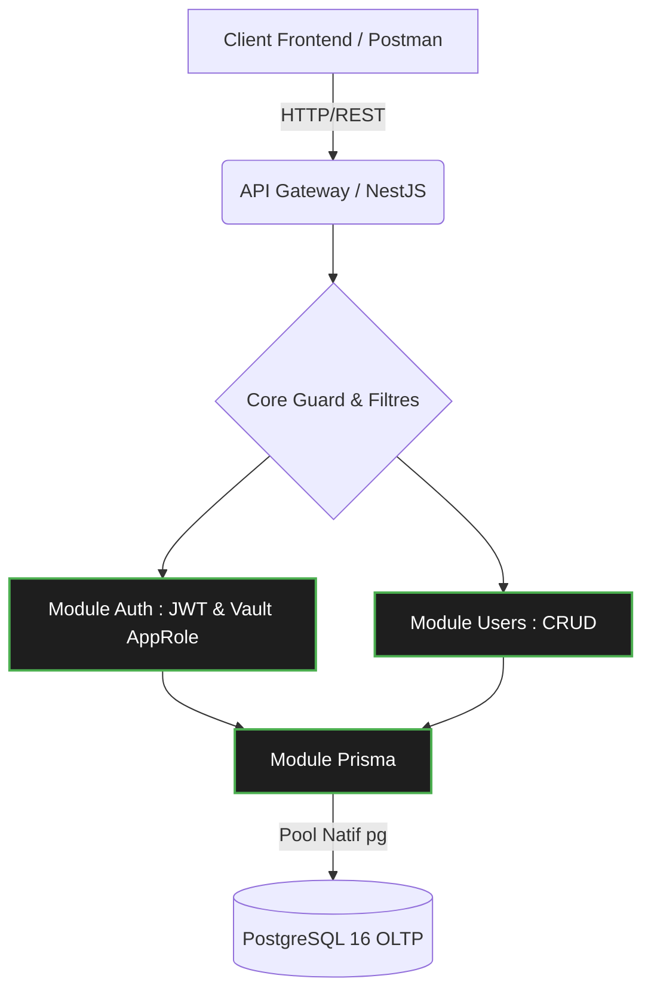

# 🛡️ Architecture & Sécurité - Data Skills Radar API

Ce document détaille l'organisation structurelle du backend et les mécanismes DevSecOps implémentés pour garantir la protection des données, la gestion des secrets et le contrôle d'accès.

---

## 1. Architecture Modulaire (NestJS / ESM)

Le projet suit une organisation stricte par domaine, facilitant la maintenabilité et la séparation des responsabilités. Le code est nativement compilé en modules ECMAScript (ESM) sur Node.js 24.

*   **`src/core/`** : Cœur de l'application et composants globaux. Contient les filtres d'exceptions (ex: Prisma), les gardiens (`Guards`), et les décorateurs personnalisés de sécurité (`@Public`, `@Roles`).
*   **`src/shared/`** : Ressources transverses partagées entre plusieurs modules. Comprend les interfaces communes (ex: `ICurrentUser`) et les DTOs génériques (`CreateAddressDto`).
*   **`src/prisma/`** : Module isolé responsable de la connexion à la base de données via le pool natif `pg`.
*   **`src/modules/`** : Domaines métiers isolés. Chaque dossier (`auth/`, `users/`) encapsule ses propres contrôleurs, services, DTOs et stratégies.

---

## 2. Gestion des Secrets (HashiCorp Vault & AppRole Machine-to-Machine)

Dans une approche *Shift-Left Security & Zéro-Trust*, les données sensibles (identifiants PostgreSQL, clés S3 OVH, secrets JWT, clés OAuth2) ne sont jamais inscrites en dur dans le code ni persistées en clair dans des fichiers `.env` sur le serveur.

*   **Déploiement Hardened & Scellement de Shamir (Production VPS) :** Sur le VPS OVH, **HashiCorp Vault 1.15** tourne avec un stockage chiffré sur disque, verrouillage mémoire `IPC_LOCK` et partage de clé maître de **Shamir** (quorum de 3 clés `Unseal` sur 5). Le moteur **`KV-v2`** héberge les secrets compartimentés par environnement (`secret/data/dataskillsradar/<NODE_ENV>/backend`) protégés par une politique de moindre privilège en lecture seule (`dsr-read-policy`).
*   **Authentification Machine-to-Machine (`AppRole`) :** L'API NestJS ne possède jamais de Token Root. Au démarrage (`main.ts`), elle s'authentifie auprès de Vault via le couple **`ROLE_ID`** (identifiant public du rôle `dsr-api-role`) et **`SECRET_ID`** (secret cryptographique rotatif) pour obtenir un token temporaire (`TTL 1h`) et injecter ses secrets directement dans la mémoire vive (**RAM**) du processus Node.js.
*   **Expérience Développeur Locale (`init-vault.sh`) & Mode Dégradé :** En développement local, le script d'amorçage automatique **`./init-vault.sh`** configure le conteneur Vault Dev et force des identifiants AppRole statiques (`local-dev-role-id` / `local-dev-secret-id`). Si Vault est éteint, l'application bascule sur les variables locales du fichier `.env`.

> [!TIP]
> **Guide Opérationnel Complet :** Retrouvez l'intégralité des fichiers de configuration (`vault.json`, `init-vault.sh`, commandes d'`unseal`, rotation `vault kv patch`) dans le chapitre **[3. Socle de Sécurité & Zéro-Trust (Vault, AppRole, Tunnel SSH & DX)](docs/cicd/03.socle_securite_zero_trust)**.

---

## 3. Authentification (JWT) et Contrôle d'Accès (RBAC)

La sécurisation des routes repose sur un couplage entre `Passport.js` et un système de contrôle d'accès basé sur les rôles (RBAC).

*   **Chiffrement des mots de passe :** Utilisation de `bcryptjs` (compatible multi-plateformes sans compilation requise) avec un salt de 10 tours.
*   **Stratégie JWT :** À la connexion, un `access_token` chiffré (HMAC SHA-256) est généré. Son *payload* contient l'UUID de l'utilisateur, son rôle et son email.
*   **Protection par défaut :** Le `JwtAuthGuard` est injecté globalement. Toutes les routes de l'API sont verrouillées par défaut.
*   **Décorateurs personnalisés :**
    *   `@Public()` : Surcharge le Guard global pour autoriser les accès non authentifiés (ex: `/auth/login`).
    *   `@Roles(Role.ADMIN)` : Restreint l'accès à une route spécifique aux porteurs d'un rôle autorisé. Traité par le `RolesGuard` en aval de la validation JWT.

---

## 4. Extraction Sécurisée du Contexte Utilisateur

Une fois le jeton JWT validé, les informations du profil sont injectées dans l'objet de requête HTTP. Le décorateur `@Request() req` permet aux contrôleurs d'extraire l'utilisateur courant (`req.user.userId`) sans jamais exposer ou faire transiter des UUIDs sensibles via l'URL pour les opérations personnelles (ex: modification de son propre mot de passe).
