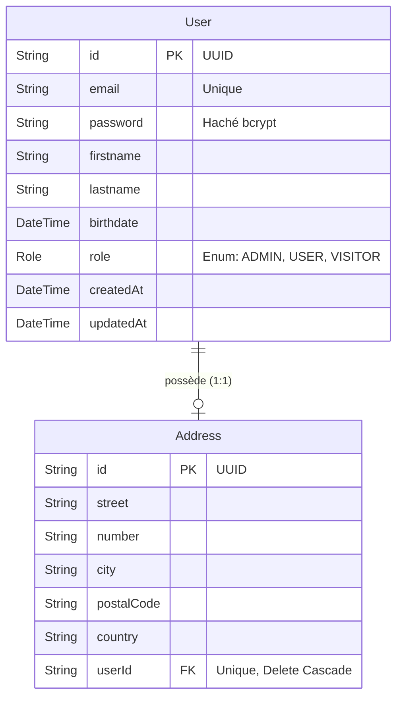

# 🗄️ Base de Données OLTP - Data Skills Radar API

Ce document décrit l'implémentation de la couche de persistance transactionnelle (OLTP) utilisant PostgreSQL et l'ORM Prisma, optimisée pour un environnement Node.js avec modules natifs (ESM).


## 1. Modèle de Données et Schéma Prisma

Le schéma relationnel, centralisé dans le fichier `prisma/schema.prisma`, structure les entités nécessaires à la gestion des identités et des profils.



**Détail des tables et concepts clés :**

*   **Identifiants UUID :** Toutes les tables utilisent des identifiants uniques universels (`@id @default(uuid())`). Ce choix architectural empêche l'énumération prédictive des enregistrements via les endpoints d'API (une faille courante avec les entiers auto-incrémentés) et facilite la réplication ou la migration future vers des bases de données distribuées.
*   **Table `User` :** Entité racine pour l'authentification. Le champ `email` dispose d'une contrainte d'unicité stricte au niveau de la base. Le champ `role` s'appuie sur une énumération native PostgreSQL pour verrouiller les valeurs autorisées (`ADMIN`, `USER`, `VISITOR`), empêchant toute insertion invalide.
*   **Table `Address` :** Isolée pour normaliser la structure des données de localisation. Elle maintient une relation stricte un-à-un (`1:1`) avec `User` via la clé étrangère unique `userId`.
*   **Intégrité Référentielle (Cascade) :** La contrainte `onDelete: Cascade` est configurée sur la relation. La suppression d'un utilisateur purge automatiquement et instantanément son adresse associée de la base de données, empêchant toute création de données orphelines.

## 2. Intégration du Pool PostgreSQL Natif

Pour maximiser les performances sous forte charge et garantir la compatibilité avec l'architecture ESM, le projet s'interface directement avec le driver natif `pg` via le connecteur `@prisma/adapter-pg`.

Cette approche délègue la gestion du pool de connexions à une librairie robuste et éprouvée, instanciée dans le `PrismaService` :

```typescript
import pg from 'pg';
import { PrismaPg } from '@prisma/adapter-pg';

const { Pool } = pg;
const pool = new Pool({ connectionString: process.env.DATABASE_URL });
const adapter = new PrismaPg(pool);
```

## 3. Commandes de Migration et Dépannage CLI

La gestion du cycle de vie du schéma s'effectue via l'interface en ligne de commande de Prisma.

*   **Générer et appliquer une migration :**
    `npx prisma migrate dev --name <nom_de_la_migration>`
    Synchronise le schéma Prisma avec la base de données en générant un fichier SQL de migration.
*   **Réinitialisation complète (Hard Reset) :**
    `npx prisma migrate reset`
    Détruit le schéma actuel, supprime toutes les données, rejoue l'historique complet des migrations depuis zéro et exécute automatiquement le script de peuplement.
*   **Peuplement initial (Seeding) :**
    `npx prisma db seed`
    Force l'exécution du script `prisma/seed.ts` pour injecter les profils utilisateurs de base nécessaires aux tests de contrôle d'accès.