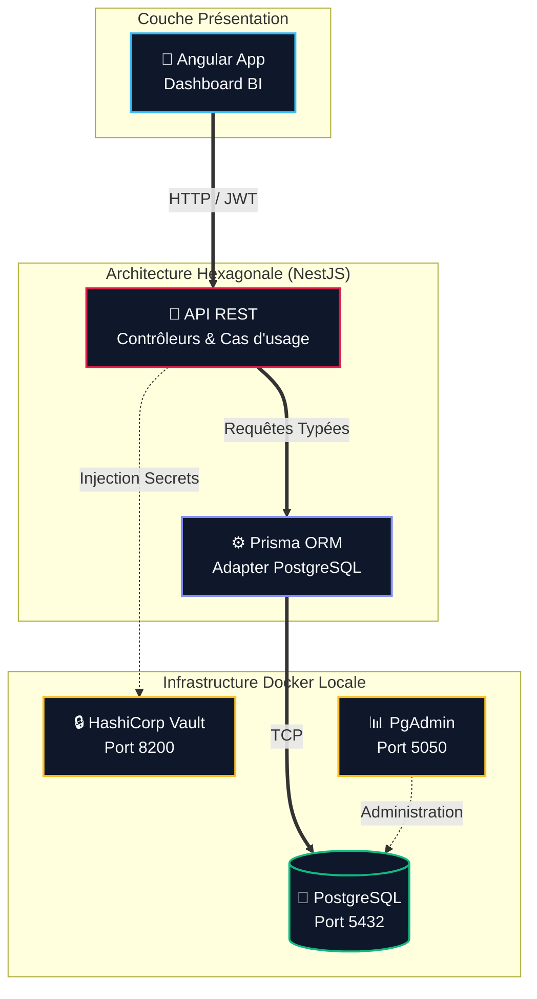

# ⚙️ Infrastructure Backend & ORM (Prisma)

Ce document détaille la configuration de la couche de persistance de l'API REST `data-skills-radar-api`, fonctionnant sur une stack Node.js/NestJS en architecture hexagonale, couplée à PostgreSQL via Docker et Prisma ORM.

## 1. Cartographie de l'Infrastructure

Voici le flux d'accès aux données, du client frontend jusqu'à la base de données conteneurisée :



## 2. Infrastructure Locale (Docker Compose)

L'environnement de développement repose sur des conteneurs isolés gérés via le fichier `docker-compose.yml` situé à la racine de l'API.

*   **PostgreSQL (Port 5432) :** Base de données relationnelle principale.
*   **HashiCorp Vault (Port 8200) :** Gestionnaire de secrets (prêt pour l'intégration NestJS).
*   **PgAdmin (Port 5050) :** Interface graphique d'administration.

### 🔌 Connexion à PgAdmin
L'interface est accessible sur `http://localhost:5050` (Identifiant: `admin@dataskillsradar.com` / Mdp: `admin`).
Pour enregistrer le serveur local, utilisez les paramètres suivants dans l'onglet "Connexion" :
*   **Nom d'hôte / Adresse :** `db` *(nom du service Docker dans le réseau bridge)*
*   **Port :** `5432`
*   **Base de données de maintenance :** `data_skills_radar_db`
*   **Identifiant :** `dsr_admin`
*   **Mot de passe :** `dsr_password`

## 3. Décisions Architecturales

### Identifiants UUID Natifs
Au lieu des traditionnels entiers auto-incrémentés, toutes les clés primaires utilisent le standard **UUID (Universally Unique Identifier)** géré nativement par PostgreSQL via le tag `@db.Uuid`.
*   **Sécurité :** Rend impossible les attaques par énumération (IDOR) sur les endpoints REST.
*   **Systèmes Distribués :** Garantit l'absence de conflits de clés primaires lors de futures fusions de données issues de la couche Lakehouse (PySpark).

### Énumérations PostgreSQL
Les contraintes métiers (Rôles, Niveau d'impact IA, Typologies de compétences issues du framework de l'OCDE) sont définies via des types `ENUM` créés directement dans le moteur de base de données. Cela assure une intégrité absolue de la donnée, indépendamment des validations du backend.

### Verrouillage sur Prisma 7
La version 8 de Prisma (Release Candidate) modifiant drastiquement les standards de l'ORM (suppression du `schema.prisma` au profit de l'IA), ce projet est volontairement verrouillé sur **Prisma 7**. L'API utilise `@prisma/adapter-pg` et le module natif `pg` pour garantir la stabilité de la connexion, avec une configuration explicite déportée dans le fichier `prisma.config.ts`.

## 4. Guide des Commandes Prisma (Cheat Sheet)

Toutes ces commandes doivent être exécutées à la racine du projet API.

### Évolution du Schéma
Lorsque vous modifiez le fichier `prisma/schema.prisma` (ajout d'une table, d'une colonne ou d'une énumération) :

**1. Appliquer les changements et générer les types :**
```bash
npx prisma migrate dev --name <nom_descriptif>
```
*Cette commande crée le fichier SQL de migration, met à jour PostgreSQL, et re-génère le client TypeScript (`@prisma/client`).*

**2. Remise à zéro complète (Reset de l'environnement) :**
En cas de corruption des données de test ou de restructuration majeure des relations :
```bash
npx prisma migrate reset
```
⚠️ **Cette commande détruit toutes les données de la base**. Elle supprime le schéma public, rejoue toutes les migrations depuis zéro, et **exécute automatiquement le script `seed.ts`** pour réinjecter le jeu d'essai initial.

### Commandes Utiles Diverses

*   **Lancer uniquement le script de Seed (sans reset) :**
    ```bash
    npx prisma db seed
    ```
    *Utile après un ajout manuel d'utilisateurs dans `prisma/seed.ts`.*

*   **Régénérer le client TypeScript manuellement :**
    ```bash
    npx prisma generate
    ```
    *À utiliser si l'éditeur affiche des erreurs de typage sur `PrismaClient` suite à un nettoyage des `node_modules`.*

*   **Ouvrir Prisma Studio :**
    ```bash
    npx prisma studio
    ```
    *Lance une interface web locale sur `http://localhost:5555` pour consulter et modifier rapidement les données sans passer par PgAdmin.*