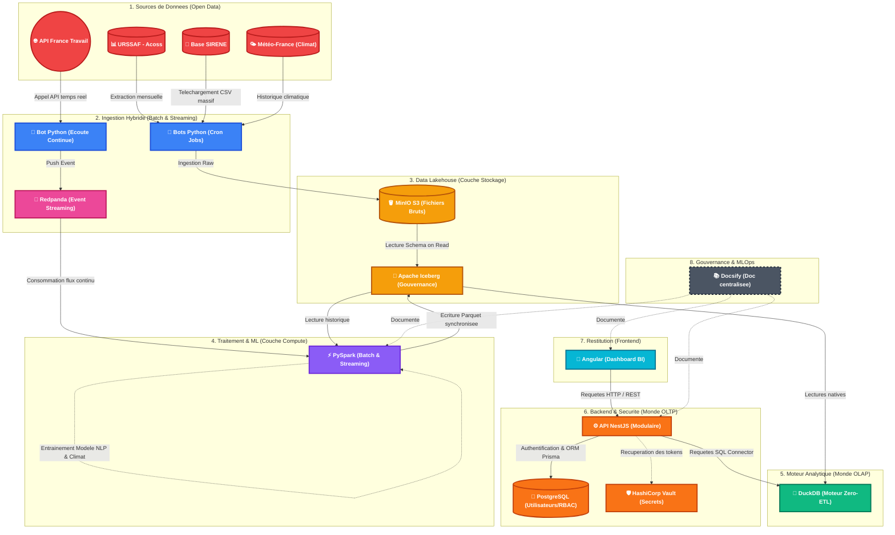

# 🌍 Système d'Information Décisionnel (SID) — Data Skills Radar

*Analyse prédictive de la mutation des emplois et des compétences face à l'automatisation par l'Intelligence Artificielle et aux chocs climatiques.*

> **Catégorie :** Master ESN81 - Bloc de compétences BC05 (Projet Fil Rouge)  
> **Version :** 1.1 (Revue de la Littérature, Double Vulnérabilité IA/Climat, Licences & Comparatifs)  
> **Date :** Octobre 2026

---

## 🎯 1. Contexte, Problématique & Vision

* **Mon contexte :** L'essor fulgurant de l'Intelligence Artificielle générative (LLM) banalise l'exécution technique et cognitive routinière, bouleversant la valeur historique des compétences sur le marché du travail et modifiant en profondeur les dynamiques de recrutement. En parallèle, le réchauffement climatique et les événements météorologiques extrêmes imposent une restructuration profonde des secteurs économiques à l'échelle locale.
* **Ma problématique (Question métier) :** *Comment anticiper les mutations du marché du travail français face à l'IA et aux transitions climatiques ? Quels secteurs d'activité sont condamnés à détruire des emplois, et lesquels pivotent avec succès vers de nouvelles compétences (notamment les sciences humaines et les Soft Skills) ?*
* **Justification de mon sujet :** Si de nombreux rapports macro-économiques évaluent théoriquement l'exposition des métiers à l'IA, les décideurs locaux (Régions, DRH, opérateurs de compétences) manquent d'un outil décisionnel dynamique capable de croiser **en continu** l'évolution sémantique réelle des offres d'emploi avec la santé économique effective des entreprises françaises (effectifs et défaillances) et la vulnérabilité climatique des territoires.
* **Ma vision (La solution) :** Je vais créer un Système d'Information Décisionnel (SID) prédictif croisant les dynamiques économiques sectorielles (URSSAF, SIRENE), l'analyse sémantique (NLP) des offres d'emploi (France Travail) et les données climatologiques (Météo-France). Cet outil permettra aux décideurs (RH, Régions) d'identifier les secteurs en danger à l'échelle locale et d'anticiper les besoins en reconversion professionnelle.

---

## 🔬 2. Mes Hypothèses de Recherche (Le cadre scientifique)

Pour garantir la rigueur scientifique de ma démarche, je vais tester empiriquement deux hypothèses principales :

1. **Hypothèse 1 (Le déclin de l'exécution technique) :** Les secteurs économiques (codes NAF) dont les offres d'emploi restent figées sur des compétences d'exécution technique ou routinière subissent une destruction d'emplois ou une fermeture d'entreprises plus rapide que la moyenne nationale, un phénomène amplifié dans les bassins d'emploi soumis à de fortes contraintes climatiques.
2. **Hypothèse 2 (La prime aux Sciences Humaines / Le bouclier humain) :** Les secteurs qui résistent ou créent de l'emploi face à l'IA montrent une évolution sémantique forte de leurs offres d'emploi, caractérisée par une augmentation des exigences en *Soft Skills* (éthique, discernement, pensée systémique, empathie, négociation, résolution de problèmes complexes).

* **Ma Variable indépendante (X) :** L'évolution sémantique du texte des offres d'emploi et la densité de compétences humaines/techniques (extraites par NLP via l'API France Travail), pondérées par le score d'exposition théorique à l'IA (OCDE/DARES) et l'historique des températures extrêmes (Météo-France).
* **Ma Variable dépendante (Y) :** Le volume net de créations/fermetures d'entreprises (Base SIRENE - INSEE) et l'évolution des effectifs salariés et de la masse salariale par secteur (URSSAF / Acoss).

---

## 📚 3. Ma Revue de la Littérature & État de l'Art

Ma démarche s'appuie sur les travaux académiques, institutionnels et professionnels les plus récents concernant l'impact des technologies d'IA sur le marché du travail et la revalorisation des compétences humaines :

### 3.1. Études de référence sur des thématiques proches

1. **Eloundou, Manning, Mishkin & Rock (OpenAI / University of Pennsylvania, 2023) — *« GPTs are GPTs: An Early Look at the Labor Market Impact Potential of Large Language Models »***
    * 🔗 [Consulter l'étude (ResearchGate / arXiv)](https://www.researchgate.net/publication/369369163_GPTs_are_GPTs_An_Early_Look_at_the_Labor_Market_Impact_Potential_of_Large_Language_Models)
    * **Apport pour mon projet :** Démontre que contrairement aux vagues d'automatisation robotique précédentes (qui touchaient les tâches manuelles), les LLM impactent principalement les métiers tertiaires et cognitifs à revenus élevés : environ **80 %** des travailleurs ont au moins **10 %** de leurs tâches exposées, et **19 %** voient plus de **50 %** de leurs tâches directement impactées.

2. **Gmyrek, Berg & Bescond (Organisation Internationale du Travail - OIT / ILO, 2023 & mise à jour OIT/NASK 2025) — *« Generative AI and Jobs: A Global Analysis of Potential Effects on Job Quantity and Quality »***
    * 🔗 [Consulter la publication officielle de l'OIT (DOI: 10.54394/FHEM8239)](https://www.ilo.org/fr/resource/news/ia-generative-et-emploi-une-analyse-globale-des-effets-potentiels-sur-la)
    * **Apport pour mon projet :** Introduit une distinction fondamentale entre le **potentiel d'automatisation** (substitution pure, touchant fortement les fonctions de support administratif et de saisie) et le **potentiel d'augmentation** (transformation du métier où l'IA complète l'humain). L'étude souligne que la survie et la qualité d'un emploi dépendent de sa capacité à basculer vers des tâches à forte valeur relationnelle et cognitive complexe.

3. **Acemoglu, Autor, Hazell & Restrepo (NBER Working Paper, 2022) — *« Artificial Intelligence and Jobs: Evidence from Online Vacancies »***
    * 🔗 [Consulter le papier du NBER (w28257)](https://www.nber.org/papers/w28257)
    * **Apport pour mon projet :** C'est l'étude empirique la plus proche de mon architecture. Les auteurs analysent des millions d'offres d'emploi en ligne pour observer comment les établissements fortement exposés à l'IA modifient la structure des compétences exigées lors du recrutement, mettant en évidence une recomposition rapide des profils recherchés avant même que l'impact ne soit visible dans les statistiques macro-économiques globales.

4. **Elkhalladi, Lakhmour & Dahbi (Revue Linguistique et Référentiels Interculturels, Juin 2025) — *« L'impact de l'intelligence artificielle sur le développement des soft skills dans les humanités numériques : Enjeux et opportunités »***
    * 🔗 [Université Mohammed V Rabat & Université Cadi Ayyad Marrakech (ISSN: 2658-9206)](https://revues.imist.ma/)
    * **Apport pour mon projet :** Cette étude bibliographique récente (appuyée sur Scopus, Web of Science et les travaux de l'UNESCO de Shiohira, 2021, ainsi que de Westover, 2024) démontre que face à la montée en puissance de l'IA générative, les compétences non techniques (*Soft Skills* : **pensée critique, créativité, collaboration et communication**) deviennent le pivot central de l'employabilité. Citant Johanna Drucker (2021) et Jean-Guy Meunier (2017), les auteurs rappellent que l'IA ne doit pas remplacer l'interprétation critique des sciences humaines mais la compléter. Cela consolide scientifiquement mon **Hypothèse 2** sur la prime aux sciences humaines.

5. **OCDE (2024/2026), DARES / France Stratégie & Observatoires de la Formation Professionnelle (Lefebvre Dalloz / LearnPerfect)**
    * 🔗 [Mesure d'exposition à l'IA de l'OCDE](https://www.oecd.org/fr/publications/mesure-d-exposition-a-l-ocde_bfd65896-fr.html) | 🔗 [Programme d'études DARES](https://dares.travail-emploi.gouv.fr/publication/programme-annuel-de-travail-en-2025) | 🔗 [Analyse Lefebvre Dalloz sur les Soft Skills à l'ère de l'IA](https://formation.lefebvre-dalloz.fr/actualite/quelles-sont-les-soft-skills-essentielles-developper-dans-lere-de-lintelligence-artificielle) | 🔗 [Étude LearnPerfect sur les compétences humaines](https://www.learnperfect.fr/blog/soft-skills/competences-soft-skills-ere-ia/)
    * **Apport pour mon projet :** Me fournit la taxonomie européenne et française reliant l'automatisation des tâches à la revalorisation stratégique des compétences transversales (intelligence émotionnelle, éthique, pensée critique, adaptabilité et leadership), qui servent de base au dictionnaire NLP de mon moteur PySpark.

### 3.2. Analyse des méthodologies que je transpose

L'analyse de ces travaux révèle trois piliers méthodologiques que je transpose directement dans mon Système d'Information Décisionnel :

* **L'approche granulaire par les tâches (*Task-Based Framework*) :** Plutôt que de considérer un métier comme un bloc monolithique, la littérature (Autor, OIT, Eloundou) décompose chaque profession en tâches (cognitives routinières, cognitives complexes, manuelles). Dans mon SID, je reprends cette taxonomie pour qualifier les compétences extraites.
* **L'analyse sémantique (NLP) sur les offres d'emploi en flux :** À l'image des travaux d'Acemoglu et al. sur les données *Burning Glass*, l'analyse textuelle des annonces constitue un **indicateur avancé** (*leading indicator*) de la mutation économique. Je l'industrialise sur le marché français via l'API France Travail et le calcul d'Embeddings sous PySpark.
* **L'évaluation hybride (Scores théoriques x Données empiriques) :** La littérature croise systématiquement un indice d'exposition a priori avec des séries temporelles d'emploi. Mon projet apporte une innovation d'ingénierie en automatisant ce croisement entre la donnée froide (stocks URSSAF/SIRENE/Météo-France) et la donnée chaude (streaming Redpanda).

---

## 👥 4. Pour qui je construis ce SID (Utilisateurs Cibles)

* **Les DRH & Acteurs de l'emploi (France Travail, APEC, OPCO) :** Pour les aider à adapter les référentiels de formation et anticiper la pénurie de profils cognitifs/humains.
* **Les Décideurs publics (Régions/Agglomérations) :** Pour leur permettre d'anticiper l'effondrement d'un secteur d'activité local face au double choc IA et climatique, et d'allouer des budgets de formation ou de reconversion de manière ciblée.

---

## 🗺️ 5. Schéma de mon Architecture (C4 Model)

Voici la représentation visuelle du pipeline de mon projet, de l'ingestion de la donnée jusqu'à la consommation par l'utilisateur final, incluant ma brique de documentation centralisée.

---

## ⚖️ 6. Mon Écosystème Applicatif & Ma Propriété Intellectuelle (Choix des Licences)

Pour garantir une séparation stricte des responsabilités (*Separation of Concerns*) et faciliter le déploiement indépendant de chaque brique (CI/CD), j'ai découpé mon projet **Data Skills Radar** en **4 dépôts GitHub distincts**.

Définir la licence *Open Source* avant d'écrire la première ligne de code est une pratique d'Architecte que je tiens à respecter. J'ai opté pour une approche différenciée selon la nature technique de chacun de mes dépôts :

1. 🐘 **Le Backend Big Data & Moteur IA — [`data-skills-radar-lakehouse`](https://github.com/Anon31/data-skills-radar-lakehouse)**
    * **Licence choisie : `Apache 2.0`**
    * **Ma justification :** C'est le standard de l'industrie pour les gros projets Big Data. Elle autorise les mêmes libertés que la licence MIT, mais rajoute une sécurité juridique stricte sur les brevets (*protection algorithmique* sur mes pipelines PySpark et mon calcul du score **SDSS**) et oblige à indiquer explicitement les modifications apportées aux fichiers. C'est également un clin d'œil assumé à ma Stack technologique (*Apache Spark*, *Apache Iceberg*, *Apache Parquet*).

2. 🎨 **Le Frontend Dashboard BI — [`data-skills-radar-app`](https://github.com/Anon31/data-skills-radar-app)**
    * **Licence choisie : `MIT`**
    * **Ma justification :** C'est la licence la plus simple, populaire et permissive. C'est le standard absolu de la communauté web (UI / Angular). Elle indique simplement : *"Faites ce que vous voulez de ce code, mais laissez mon nom dessus"*.

3. ⚙️ **L'API Backend & Sécurité — [`data-skills-radar-api`](https://github.com/Anon31/data-skills-radar-api)**
    * **Licence choisie : `MIT`**
    * **Ma justification :** En totale cohérence avec l'écosystème Node.js et le framework NestJS (lui-même sous licence MIT), ce choix favorise la réutilisabilité de mon socle d'architecture modulaire (authentification JWT, RBAC sous Prisma/PostgreSQL, connecteur analytique DuckDB et intégration HashiCorp Vault) tout en garantissant ma paternité sur le code.

4. 📚 **Le Portail de Documentation Centrale — [`data-skills-radar-docs`](https://github.com/Anon31/data-skills-radar-docs)** *(🌐 [Mon Portail Web Docsify](https://anon31.github.io/data-skills-radar-docs/#))*
    * **Licence choisie : `MIT`**
    * **Ma justification :** Permet le partage ouvert de ma démarche *Docs-as-Code*, de mes schémas d'architecture (C4 / Mermaid) et de mes décisions techniques (ADR) auprès de la communauté académique et des acteurs publics, tout en protégeant l'attribution de mes travaux de recherche.

---

## 🗂️ 7. Mes Sources de Données & Variables (Data Mapping)

Pour que le croisement de mes téraoctets de données fonctionne, ma clé de voûte relationnelle sera le **Code NAF** (Secteur d'activité) et le **Code ROME** (Métier). Voici le détail de mes sources :

1. **Les Données "Exposition IA" (Le chaînon manquant) :**
    * **Source :** Open Data de l'OCDE ou de la DARES (Études sur l'automatisation des tâches).
    * **Donnée extraite :** Score d'exposition à l'IA par catégorie socio-professionnelle ou métier.

2. **URSSAF / Acoss (Macro-économie et masse salariale) :**
    * C'est ici que je trouverai les séries temporelles sur les effectifs salariés du secteur privé, classés par région et par code NAF (Secteur d'activité).
    * **Portail principal :** [https://open.urssaf.fr/explore/](https://open.urssaf.fr/explore/)
    * **Jeu de données ciblé :** *"Effectifs salariés et masse salariale du secteur privé par secteur d'activité"*.
    * **Format d'export :** CSV ou API REST (idéal pour automatiser avec mes scripts Python en approche Batch).

3. **France Travail / Dares (Offres d'emploi et NLP) :**
    * Pour analyser le texte des annonces et extraire les *Soft Skills*, je passerai par le portail développeur de France Travail.
    * **Portail développeur :** [https://francetravail.io/](https://francetravail.io/)
    * **API ciblée :** L'API *"Offres d'emploi v2"*.
    * **Méthode d'ingestion (Temps Réel via Redpanda) :** Je me suis créé un compte gratuit pour obtenir un "Client ID" et générer un token d'accès OAuth2. Contrairement aux autres sources massives, mon script d'écoute continu récupèrera le JSON (description, compétences requises, code métier ROME) et poussera chaque nouvelle annonce comme un événement dans un Topic Redpanda dès sa publication.

4. **Base SIRENE de l'INSEE (Créations et disparitions d'entreprises) :**
    * C'est le fichier de référence pour mesurer le dynamisme ou l'effondrement d'un secteur. C'est un fichier massif (plusieurs dizaines de Go au format CSV), parfait pour éprouver mes traitements PySpark ou DuckDB !
    * **Portail principal :** [https://www.data.gouv.fr/fr/datasets/base-sirene-des-entreprises/](https://www.data.gouv.fr/fr/datasets/base-sirene-des-entreprises/)
    * **Jeu de données ciblé :** Le fichier `StockEtablissement` (pour l'état actuel) et les *"Fichiers de mises à jour"* mensuels.
    * **Format d'export :** ZIP contenant de gigantesques CSV.

5. **Météo-France (Couplage Climat & Emploi - IVCE) :**
    * Pour intégrer la dimension climatique (Indice de Vulnérabilité Climatique et Économique - IVCE) et mesurer le double choc IA + réchauffement climatique sur les bassins d'emploi.
    * **Portail principal :** [https://meteo.data.gouv.fr/](https://meteo.data.gouv.fr/)
    * **Jeu de données ciblé :** *"Données climatologiques de base - quotidiennes"* pour avoir l'historique des températures extrêmes (sécheresses, canicules) par station et par département.

---

## 🏗️ 8. Mon Architecture Technique (Modern Data Stack - BC05)

Puisque ce projet est mon terrain d'entraînement (bac à sable) pour maîtriser les concepts avancés de la *Modern Data Stack*, j'ai fait le choix audacieux de déployer une **Architecture Lambda**. Cela me permet de manipuler simultanément les deux grands paradigmes de la data : le traitement par lots (**Batch**) pour l'historique, et le flux en temps réel (**Event Streaming**) pour les données dynamiques.

Voici les 6 piliers de mon pipeline de données :

1. 📥 **L'Ingestion Hybride (Batch & Streaming) :**
    * *La voie "Froide" (Batch) :* Mes scripts Python téléchargent mensuellement les gigantesques fichiers Open Data (URSSAF, SIRENE, Météo-France) et les déversent directement dans mon stockage objet.
    * *La voie "Chaude" (Streaming) :* J'utilise **Redpanda** (l'alternative C++ ultra-légère à Kafka). Un bot Python écoute l'API France Travail en continu et pousse chaque nouvelle offre d'emploi comme un "événement" instantané dans un Topic Redpanda.

2. 🪣 **Le Stockage (Data Lakehouse) :**
    * *Mes technologies :* **MinIO (S3)** couplé à **Apache Iceberg** (et le catalogue **Nessie**).
    * *En clair :* C'est la fondation de mon approche ELT. MinIO est mon réservoir infini. Iceberg vient par-dessus structurer ces fichiers bruts pour garantir qu'il n'y ait aucune corruption (transactions ACID) lorsque mes flux Batch et Streaming écrivent en même temps.

3. 🧠 **Traitement & NLP (Le moteur unifié) :**
    * *Ma technologie :* Cluster **PySpark** (Batch et Structured Streaming).
    * *En clair :* Spark est le cœur de mon intelligence. Il lit mes données historiques d'un côté, et "écoute" Redpanda de l'autre. Il nettoie les textes et transforme les compétences des offres d'emploi en **Embeddings** (vecteurs mathématiques) pour mon analyse NLP *Soft Skills* et calcule les corrélations climatiques.

4. ⚡ **Moteur BI (Le Zero-ETL vectorisé) :**
    * *Ma technologie :* **DuckDB** lisant le format **Apache Parquet**.
    * *En clair :* Pour ne pas saturer mon serveur, je fais du Zero-ETL avec DuckDB. Grâce à la "lecture sélective" du format Parquet (*Column Pruning*), DuckDB ne télécharge depuis MinIO que la stricte colonne nécessaire à mon calcul, offrant une vitesse de réponse instantanée.

5. 📊 **Backend & Restitution (L'interface utilisateur) :**
    * *Mes technologies :* **API NestJS** (PostgreSQL / Prisma / Vault) et **Angular** (Dashboard BI).
    * *En clair :* Je développe un tableau de bord interactif sécurisé avec une cartographie de la France. Les décideurs pourront observer la destruction d'emplois (l'historique) et voir "poper" les nouvelles tendances de compétences en temps quasi-réel (le flux Redpanda).

6. 📚 **Documentation (Gouvernance et Docs-as-Code) :**
    * *Ma technologie :* **Docsify**.
    * *En clair :* J'utilise Docsify pour générer ma documentation technique dynamique et versionnée. Cela centralise mes choix d'architecture (Batch vs Streaming) et mon dictionnaire de données, répondant à l'exigence de maintenabilité industrielle (C34).

---

## 📈 9. Mes Métriques et Indicateurs (De l'observation à la prédiction)

Je vais construire mon SID sur 3 niveaux analytiques :

* **A. NIVEAU 1 : L'OBSERVATION (Historique & Temps Réel)**
    * *Mes indicateurs :* Taux de création/destruction d'emplois sur le long terme (URSSAF / SIRENE) croisé avec le *"Live Trend IA"*, un compteur alimenté en temps réel par Redpanda mesurant l'apparition de termes techniques IA à la minute sur France Travail.

* **B. NIVEAU 2 : LA CORRÉLATION (Le bouclier Humain)**
    * *Mon indicateur :* Le **Score de Densité "Soft Skills" (SDSS)**.
    * *Ma méthode :* Ratio calculé par Spark mesurant la part des compétences humaines face aux compétences techniques :
      > **`SDSS = (Volume des Compétences Humaines & Transversales) / (Volume des Compétences Techniques d'Exécution)`**
    * *Mon objectif :* Vérifier empiriquement mon Hypothèse 2 : à niveau d'exposition IA égal, les secteurs exposés à l'IA mais ayant un fort **SDSS** ferment-ils moins d'entreprises et maintiennent-ils mieux leur masse salariale ?

* **C. NIVEAU 3 : LA PRÉDICTION (L'outil de Forecasting)**
    * *Mon outil :* Modèle de Machine Learning sur données temporelles.
    * *Ma méthode :* Utilisation des historiques sous Spark pour prédire à horizon **+2 ans** la croissance ou l'effondrement des effectifs d'un Code NAF dans un département, en utilisant l'exposition à l'IA, le score **SDSS** et l'indice climatique (Météo-France) comme variables prédictives.

---

## ⚠️ 10. Analyse des Risques liés aux Données, Limites & Gouvernance RGPD

### 10.1. Risques identifiés avec les données que je manipule

L'exploitation croisée de sources hétérogènes (France Travail, URSSAF, SIRENE, OCDE/DARES, Météo-France) présente 5 risques majeurs que j'ai anticipés dans mon architecture :

1. **Biais de représentativité (Biais de sélection France Travail) :**
    * *Le risque :* Toutes les embauches ne passent pas par France Travail (certains secteurs de cadres recrutent majoritairement via l'APEC ou LinkedIn).
    * *Ma mitigation :* Pondération et redressement statistique via les données de l'URSSAF, qui couvrent de manière exhaustive l'emploi salarié privé grâce à la Déclaration Sociale Nominative (DSN).

2. **Bruit sémantique et "Buzzwords RH" dans les annonces :**
    * *Le risque :* Les offres d'emploi contiennent souvent des formules génériques ("dynamique", "esprit d'équipe") qui peuvent fausser la détection des véritables *Soft Skills* complexes.
    * *Ma mitigation :* Nettoyage strict en couche Silver (liste de *stop-words* RH spécifiques) et utilisation d'Embeddings contextuels sous PySpark plutôt qu'un simple comptage de mots-clés.

3. **Asymétrie des référentiels de jointure (Code ROME vs Code NAF) :**
    * *Le risque :* France Travail qualifie des *métiers* (Code ROME) tandis que l'URSSAF et SIRENE qualifient des *secteurs d'activité d'entreprises* (Code NAF). Un même métier (ex: comptable) existe dans tous les secteurs.
    * *Ma mitigation :* Exploitation du code NAF de l'entreprise recruteuse lorsqu'il est renseigné dans le JSON de l'offre France Travail, complété par la matrice de passage pondérée DARES (**ROME ↔ NAF**).

4. **Asynchronicité temporelle (Temps réel vs Batch) :**
    * *Le risque :* Décalage de fréquence entre le flux continu des offres d'emploi (à la minute) et l'inertie des statistiques URSSAF/SIRENE (mensuelles ou trimestrielles).
    * *Ma mitigation :* Agrégation du flux temps réel par fenêtres temporelles glissantes (*Time Windowing*) en couche Gold pour aligner la granularité temporelle avant l'entraînement du modèle de Machine Learning.

5. **Volumétrie critique (Risque d'Out-Of-Memory) :**
    * *Le risque :* Le fichier `StockEtablissement` de la base SIRENE dépasse plusieurs dizaines de gigaoctets.
    * *Ma mitigation :* Conversion immédiate en format colonnaire compressé **Apache Parquet / Iceberg** et requêtage vectorisé via **DuckDB** (*Column Pruning*).

### 10.2.🚧 Mes limites & Ma méthodologie scientifique assumées

Pour garantir la rigueur de ma démarche scientifique, j'assume les limites suivantes :
* **Prédiction vs Création :** Mon modèle prédira l'évolution (croissance/déclin) de secteurs existants (codes NAF), mais je n'ai pas la prétention d'inventer par algorithme les intitulés de métiers de demain qui n'existent pas encore.
* **Macro-économie :** J'assume le fait que les politiques fiscales et les chocs externes (comme de futures pandémies ou crises géopolitiques) restent stables dans mon modèle, pour me concentrer purement sur l'évolution tendancielle des compétences face à l'IA et aux réalités climatiques.

### 10.3. 🛡️ Gouvernance, RGPD et Création de Valeur (Agrégation)

Puisque l'ambition finale de mon projet est d'être ouvert et accessible à tous les citoyens français, mon architecture des données repose sur un principe strict d'agrégation. Mon SID ne sera en aucun cas un simple "annuaire" recopiant les offres d'emploi, mais un véritable moteur d'analyse macro-économique.

* 🔒 **Conformité RGPD & Anonymisation (Le respect de la vie privée) :**
    * *La contrainte :* Les données brutes (les textes des annonces France Travail ou les données d'entreprises individuelles SIRENE) peuvent contenir des informations sensibles, des noms de dirigeants ou des coordonnées de contact.
    * *Ma solution architecturale :* Mes moteurs de calcul (Spark et DuckDB) "écraseront" systématiquement le détail individuel au profit de la statistique globale (ex: calcul de pourcentages d'apparition de compétences, sommes d'effectifs par région). La donnée brute ne quittera jamais mon stockage sécurisé (MinIO/S3 en couche Bronze), et aucune donnée identifiable ne sera exposée sur mon tableau de bord final (couche Gold).

* ⚖️ **Respect des Conditions Légales (CGU des API) :**
    * *La contrainte :* Aspirer des données depuis l'API de France Travail pour construire un site concurrent qui affiche simplement les mêmes annonces est interdit (plagiat et pillage de base de données).
    * *Ma solution de Création de Valeur :* En agrégeant les données par secteurs (Codes NAF) et par métiers (Codes ROME) croisées avec les effectifs de l'URSSAF, je crée une nouvelle valeur analytique inédite. Je passe d'une "liste d'offres" à un "Indicateur de mutation des compétences face à l'IA". Cette transformation justifie légalement mon utilisation de l'Open Data et protège mon projet d'un point de vue juridique.

---

## 🖥️ 11. Mon Interface de Restitution (Frontend & Dataviz)

Pour matérialiser mes analyses et rendre mon outil décisionnel accessible, je vais développer une interface visuelle interactive incluant une cartographie de la France. Lors de ma phase de conception initiale, j'ai arbitré entre deux approches :

* **Option 1 (L'approche Data Rapide - Prototypage) :** Utilisation de *Streamlit*. C'est la continuité logique de mon pipeline Python, permettant de générer rapidement des cartes interactives (via Folium ou PyDeck) directement branchées sur mon moteur DuckDB.
* **Option 2 (Mon choix retenu : L'approche Architecture Full-Stack Industrielle) :** Développement d'une application **Angular** (exploitant la réactivité des *Signals* pour les filtres) couplée à mon **API Backend NestJS** sécurisée interrogeant DuckDB. Cela prouve ma maîtrise complète de bout en bout, de l'ingestion Big Data jusqu'à l'expérience utilisateur web (avec Leaflet pour la cartographie) et la sécurité applicative (RBAC, JWT, HashiCorp Vault).

| Critères d'architecture | Option 1 : Streamlit (Data App) | Option 2 : Angular + NestJS (Mon choix retenu) |
| :--- | :--- | :--- |
| **Positionnement** | Idéal pour un PoC rapide (Data Science pure). | Standard industriel pour une application web d'entreprise à grande échelle. |
| **Sécurité & RBAC** | Très limité nativement (gestion complexe des rôles et JWT). | Architecture robuste : Guards NestJS, JWT, RBAC granulaire (Admin, User, Visitor) et HashiCorp Vault. |
| **Performance & Réactivité** | Rechargement complet du script Python à chaque interaction utilisateur. | Ultra-fluide grâce au rendu côté client (SPA) et aux **Angular Signals** pour le filtrage dynamique de la carte. |
| **Découplage (Séparation)** | Couplage fort entre l'interface visuelle et les requêtes de données. | Séparation stricte Frontend (`app`) / Backend (`api`) garantissant la protection des accès au Lakehouse. |
| **Démonstration Master** | Montre des compétences centrées sur Python. | **Prouve une maîtrise Full-Stack et Data Engineering complète de bout en bout.** |

---

## ☁️ 12. Ma Stratégie d'Hébergement (Le choix du VPS)

Pour déployer mon architecture (basée sur des conteneurs Docker), je dois anticiper les contraintes matérielles. L'écosystème Big Data (notamment Apache Spark et le catalogue Nessie écrit en Java/Quarkus) est extrêmement gourmand en mémoire vive (RAM).

De plus, mon choix d'une Architecture Lambda (Batch + Streaming) impacte mon "Run" : l'intégration de Redpanda (bien qu'ultra-léger car codé en C++) et de mon script d'écoute France Travail oblige mon serveur à tourner **24h/24 et 7j/7** pour ne rater aucun événement.

Voici mon analyse des différentes gammes de serveurs VPS (chez OVHcloud) appliquées à mon contexte :

* ⚠️ **Offres d'entrée de gamme (Starter / Value / Essential - 2 à 4 Go de RAM) :**
    * *Mon diagnostic :* Totalement incompatibles avec mon projet. La JVM (Machine Virtuelle Java) de Nessie et de Spark sature rapidement la mémoire. Sur un serveur de 4 Go, le simple démarrage simultané de MinIO, Nessie, Spark et Redpanda déclenchera des erreurs *Out of Memory* (OOM) fatales.
* ✅ **Offre Milieu de Gamme — OVH VPS-3 (6 vCores, 12 Go de RAM, 100 Go SSD NVMe, 2 Gbit/s) à 10,40 € HT/mois (12,48 € TTC/mois) :**
    * *Mon diagnostic :* C'est l'offre idéale pour le Minimum Viable Product (MVP) de mon hébergement. Avec 12 Go de RAM (au-dessus du seuil critique des 8 Go), je peux faire tourner ma stack Docker complète (PostgreSQL, Vault, NestJS, Redpanda, MinIO et Spark) en bornant strictement l'utilisation mémoire de mes conteneurs (via `mem_limit` et les variables Java `-Xms` / `-Xmx`). C'est un excellent compromis pour lancer le développement en production sans exploser mon budget.
* 🚀 **Offre Haut de Gamme — OVH VPS-4 (8 vCores, 24 Go de RAM, 200 Go SSD NVMe, 3 Gbit/s) à 19,96 € HT/mois (23,95 € TTC/mois) :**
    * *Mon diagnostic :* C'est la zone de confort absolu pour mon analyse Big Data. Comme mes datasets SIRENE et URSSAF dépassent plusieurs dizaines de gigaoctets, ces 24 Go de RAM et 8 vCores permettront à Spark de distribuer les calculs et le NLP en mémoire sans faire de *Disk Spilling* (débordement sur le disque NVMe, très lent par rapport à la RAM).

**Ma Décision d'Architecte :**
Je débute mes développements et tests locaux sur mon ordinateur personnel (en configurant WSL2 à 8 Go de RAM minimum sous Windows). Lors du passage en production, j'arbitrerai directement entre le **VPS-3 (12 Go RAM)** et le **VPS-4 (24 Go RAM)** chez OVHcloud selon la charge mémoire réelle observée lors de mes traitements PySpark, tout en appliquant des limites strictes (*Cgroups*) sur mes conteneurs Docker pour garantir la stabilité du démonstrateur.

Pour ne pas saturer le disque dur NVMe (100 à 200 Go) de ce VPS avec mes téraoctets de données historiques, j'appliquerai le paradigme du "découplage" : mon VPS sera dédié au calcul et au Streaming (Redpanda/Spark/API), tandis que le stockage massif reposera de manière déportée sur un Object Storage (S3).

---

## 🚀 13. Mes Évolutions Futures & Innovations Intégrées (V2)

Si le développement de mon périmètre initial (MVP) est achevé dans les délais impartis, je pousserai l'innovation technologique sur ces deux axes majeurs :

1. 🌍 **Croisement Météo-Sensible (L'Indice IA + Climat - IVCE) :**
    * *Le concept :* J'intègre l'API et les jeux de données Open Data de **Météo-France** directement dans ma couche d'ingestion Batch.
    * *L'objectif :* Croiser la variation des emplois sectoriels et l'exposition à l'IA avec l'historique des événements climatiques extrêmes (sécheresses, canicules) sur un maillage géographique fin, créant ainsi un indicateur hybride évaluant la **double vulnérabilité des territoires** (Choc technologique IA + Choc climatique) face au marché de l'emploi.

2. 🧠 **Base de Données Vectorielle et RAG (L'IA de pointe) :**
    * *Le concept :* J'ajouterai une base de données vectorielle (comme `pgvector` dans mon PostgreSQL ou *Milvus*) à mon architecture pour stocker les Embeddings (vecteurs mathématiques) des offres d'emploi générés par Spark.
    * *L'objectif :* Permettre une recherche sémantique ultra-puissante depuis mon dashboard (ex: filtrer directement les *"métiers nécessitant de l'empathie face aux crises"*) et ouvrir la porte à un système de question-réponse par IA (RAG) pour les décideurs.

---

## 🎓 14. Mon Alignement Référentiel (Validation RNCP BC05)

J'ai conçu ce projet sur-mesure pour valider l'ensemble des compétences de mon bloc :
- [x] **[C27]** Architecture Data Warehouse / Data Lake (MinIO + Iceberg).
- [x] **[C28/C29/C30]** Processus ETL, Big Data (PySpark, Parquet) et restitution BI (DuckDB + Angular).
- [x] **[C31]** Automatisation RPA (Bots de collecte URSSAF/INSEE/Météo-France) et ingestion continue (Event Streaming via Redpanda).
- [x] **[C32]** Machine learning : Modèles prédictifs de forecasting (Séries temporelles) pour anticiper l'évolution de l'emploi.
- [x] **[C33/C34/C35]** Monitoring, documentation technique (Docsify) et mesure d'impact.