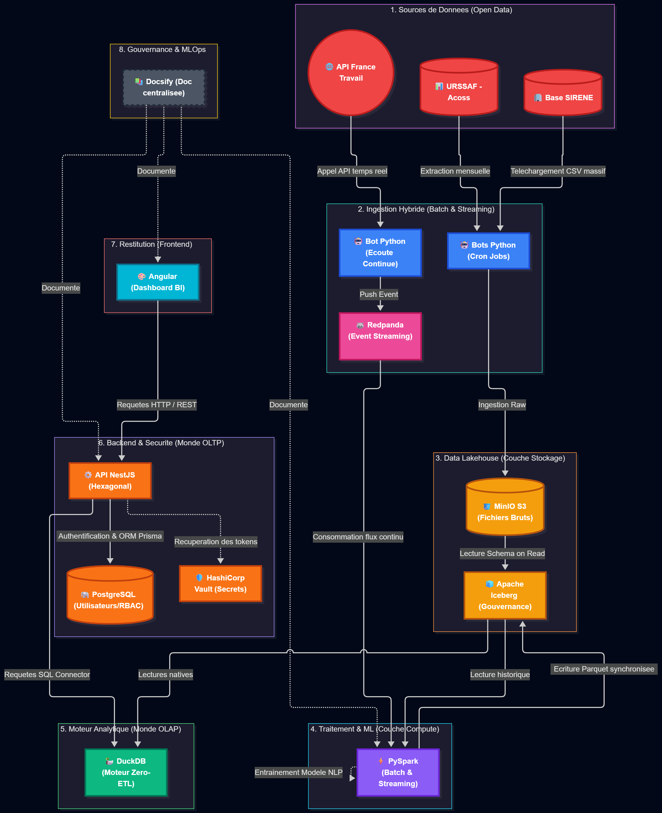
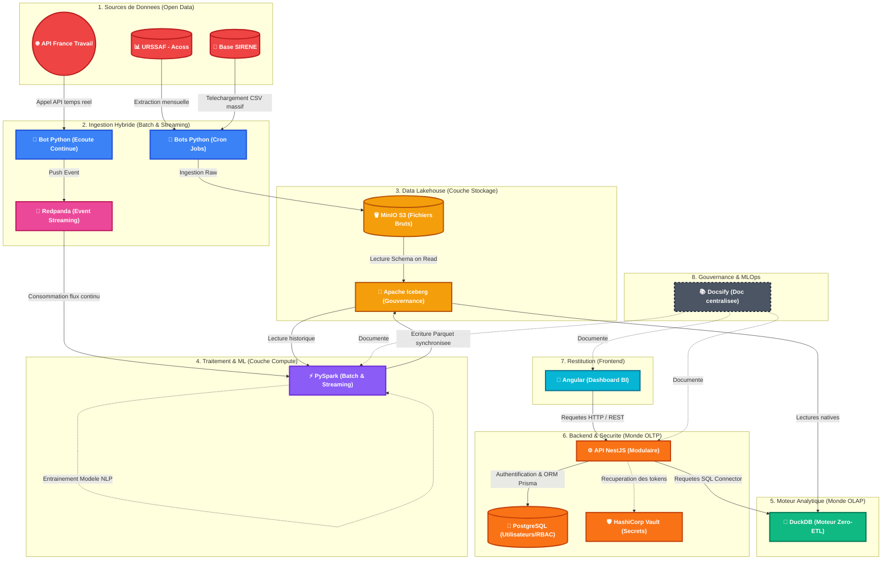

# 🌍 Système d'Information Décisionnel (SID) — Data Skills Radar

*Analyse prédictive de la mutation des emplois et des compétences face à l'automatisation par l'Intelligence Artificielle.*

> **Catégorie :** Master ESN81 - Bloc de compétences BC05 (Projet Fil Rouge)  
> **Version :** 1.1 (Fusion intégrale MVP + Revue de la Littérature & Analyse des Risques)  
> **Date :** Octobre 2026

---

## 🎯 1. Contexte, Problématique & Vision

* **Mon contexte :** L'essor fulgurant de l'Intelligence Artificielle générative (LLM) banalise l'exécution technique et cognitive routinière, bouleversant la valeur historique des compétences sur le marché du travail et modifiant en profondeur les dynamiques de recrutement.
* **Ma problématique (Question métier) :** *Comment anticiper les mutations du marché du travail français face à l'IA ? Quels secteurs d'activité sont condamnés à détruire des emplois, et lesquels pivotent avec succès vers de nouvelles compétences (notamment les sciences humaines et les Soft Skills) ?*
* **Justification du sujet :** Si de nombreuses études macro-économiques évaluent théoriquement l'exposition des métiers à l'IA, les acteurs territoriaux (Régions, DRH, opérateurs de compétences) manquent d'un outil décisionnel dynamique capable de croiser **en continu** l'évolution sémantique réelle des offres d'emploi avec la santé économique effective des entreprises françaises (effectifs et défaillances).
* **Ma vision (La solution) :** Créer un Système d'Information Décisionnel (SID) prédictif croisant les dynamiques économiques sectorielles (URSSAF, SIRENE) et l'analyse sémantique (NLP) des offres d'emploi (France Travail). Cet outil permettra aux décideurs d'identifier les secteurs en danger à l'échelle locale et d'anticiper les besoins en reconversion professionnelle.

---

## 🔬 2. Mes Hypothèses de Recherche (Le cadre scientifique)

Pour garantir la rigueur scientifique de ma démarche, ce SID vise à tester empiriquement deux hypothèses principales :

1. **Hypothèse 1 (Le déclin de l'exécution technique) :** Les secteurs économiques (codes NAF) dont les offres d'emploi restent figées sur des compétences d'exécution technique ou routinière subissent une destruction d'emplois ou une fermeture d'entreprises plus rapide que la moyenne nationale.
2. **Hypothèse 2 (La prime aux Sciences Humaines / Le bouclier humain) :** Les secteurs qui résistent ou créent de l'emploi malgré une forte exposition à l'IA montrent une évolution sémantique forte de leurs offres d'emploi, caractérisée par une augmentation des exigences en *Soft Skills* (éthique, discernement, pensée systémique, empathie, négociation).

* **Variable indépendante ($X$) :** L'évolution sémantique du texte des offres d'emploi et la densité de compétences humaines/techniques (extraites par NLP via l'API France Travail), pondérées par le score d'exposition théorique à l'IA (OCDE/DARES).
* **Variable dépendante ($Y$) :** Le volume net de créations/fermetures d'entreprises (Base SIRENE - INSEE) et l'évolution des effectifs salariés et de la masse salariale par secteur (URSSAF / Acoss).

---

## 📚 3. Revue de la Littérature & État de l'Art

Notre démarche s'appuie sur les travaux académiques et institutionnels les plus récents concernant l'impact des technologies d'IA sur le marché du travail :

### 3.1. Études de référence sur des thématiques proches

1. **Eloundou, Manning, Mishkin & Rock (OpenAI / University of Pennsylvania, 2023) — *« GPTs are GPTs: An Early Look at the Labor Market Impact Potential of Large Language Models »***
    * 🔗 [Consulter l'étude (ResearchGate / arXiv)](https://www.researchgate.net/publication/369369163_GPTs_are_GPTs_An_Early_Look_at_the_Labor_Market_Impact_Potential_of_Large_Language_Models)
    * **Apport :** Démontre que contrairement aux vagues d'automatisation robotique précédentes (qui touchaient les tâches manuelles), les LLM impactent principalement les métiers tertiaires et cognitifs à revenus élevés : environ $80\%$ des travailleurs ont au moins 10% de leurs tâches exposées, et 19% voient plus de 50% de leurs tâches directement impactées.

2. **Gmyrek, Berg & Bescond (Organisation Internationale du Travail - OIT / ILO, 2023 & mise à jour OIT/NASK 2025) — *« Generative AI and Jobs: A Global Analysis of Potential Effects on Job Quantity and Quality »***
    * 🔗 [Consulter la publication officielle de l'OIT (DOI: 10.54394/FHEM8239)](https://www.ilo.org/fr/resource/news/ia-generative-et-emploi-une-analyse-globale-des-effets-potentiels-sur-la)
    * **Apport :** Introduit une distinction fondamentale entre le **potentiel d'automatisation** (substitution pure, touchant fortement les fonctions de support administratif et de saisie) et le **potentiel d'augmentation** (transformation du métier où l'IA complète l'humain). L'étude souligne que la survie et la qualité d'un emploi dépendent de sa capacité à basculer vers des tâches à forte valeur relationnelle et cognitive complexe.

3. **Acemoglu, Autor, Hazell & Restrepo (NBER Working Paper, 2022) — *« Artificial Intelligence and Jobs: Evidence from Online Vacancies »***
    * 🔗 [Consulter le papier du NBER (w28257)](https://www.nber.org/papers/w28257)
    * **Apport :** C'est l'étude empirique la plus proche de notre architecture. Les auteurs analysent des millions d'offres d'emploi en ligne pour observer comment les établissements fortement exposés à l'IA modifient la structure des compétences exigées lors du recrutement, mettant en évidence une recomposition rapide des profils recherchés avant même que l'impact ne soit visible dans les statistiques macro-économiques globales.

4. **OCDE (2024/2026) & DARES / France Stratégie — *« Mesure d'exposition à l'IA de l'OCDE » & Programme d'études DARES***
    * 🔗 [Publication OCDE sur la mesure d'exposition à l'IA](https://www.oecd.org/fr/publications/mesure-d-exposition-a-l-ia-de-l-ocde_bfd65896-fr.html) | 🔗 [Chantiers DARES sur les transformations du travail](https://dares.travail-emploi.gouv.fr/publication/programme-annuel-de-travail-en-2025)
    * **Apport :** Fournit la taxonomie européenne et française reliant l'automatisation des tâches à la revalorisation stratégique des compétences transversales (*Soft Skills* : résolution de problèmes complexes, esprit critique, coopération).

### 3.2. Analyse des méthodologies utilisées dans la littérature

L'analyse de ces travaux révèle trois piliers méthodologiques que nous transposons dans notre Système d'Information Décisionnel :

* **L'approche granulaire par les tâches (*Task-Based Framework*) :** Plutôt que de considérer un métier comme un bloc monolithique, la littérature (Autor, OIT, Eloundou) décompose chaque profession en tâches (cognitives routinières, cognitives complexes, manuelles). Dans notre SID, nous reprenons cette taxonomie pour qualifier les compétences extraites.
* **L'analyse sémantique (NLP) sur les offres d'emploi en flux :** À l'image des travaux d'Acemoglu et al. sur les données *Burning Glass*, l'analyse textuelle des annonces constitue un **indicateur avancé** (*leading indicator*) de la mutation économique. Nous l'industrialisons sur le marché français via l'API France Travail et le calcul d'Embeddings sous PySpark.
* **L'évaluation hybride (Scores théoriques $\times$ Données empiriques) :** La littérature croise systématiquement un indice d'exposition a priori avec des séries temporelles d'emploi. Notre projet apporte une innovation d'ingénierie en automatisant ce croisement entre la donnée froide (stocks URSSAF/SIRENE) et la donnée chaude (streaming Redpanda).

---

## 👥 4. Pour qui je construis ce SID (Utilisateurs Cibles)

* **Les DRH & Acteurs de l'emploi (France Travail, APEC, OPCO) :** Pour les aider à adapter les référentiels de formation continue et anticiper la pénurie de profils hybrides (cognitifs/humains).
* **Les Décideurs publics (Régions, Agglomérations, Ministères) :** Pour leur permettre d'anticiper l'effondrement ou la mutation d'un secteur d'activité sur un bassin d'emploi précis et d'allouer les budgets de reconversion de manière ciblée.

---

## 🗺️ 5. Schéma de l'Architecture (C4 Model)

Voici la représentation visuelle du pipeline de mon projet, de l'ingestion de la donnée jusqu'à la consommation par l'utilisateur final, démontrant la séparation stricte entre le monde analytique (OLAP) et le monde transactionnel (OLTP).

---

## 🗂️ 6. Mes Sources de Données & Variables (Data Mapping)

Pour que le croisement de mes jeux de données fonctionne à grande échelle, ma clé de voûte relationnelle sera le **Code NAF** (Secteur d'activité) et le **Code ROME** (Métier). Voici le détail de mes sources :

1. **Les Données "Exposition IA" (Le chaînon manquant) :**
    * **Source :** Open Data de l'OCDE et de la DARES (études sur l'automatisation des tâches).
    * **Donnée extraite :** Score d'exposition à l'IA par catégorie socio-professionnelle ou code métier.

2. **URSSAF / Acoss (Macro-économie et masse salariale) :**
    * C'est ici que je récupère les séries temporelles sur les effectifs salariés du secteur privé, classés par région/département et par code NAF.
    * **Portail principal :** [https://open.urssaf.fr/explore/](https://open.urssaf.fr/explore/)
    * **Jeu de données ciblé :** *"Effectifs salariés et masse salariale du secteur privé par secteur d'activité"*.
    * **Format d'export :** CSV ou API REST (idéal pour automatiser la collecte avec mes scripts Python en approche Batch).

3. **France Travail / Dares (Offres d'emploi et NLP) :**
    * Pour analyser le texte des annonces et extraire l'évolution des *Soft Skills*, je passe par le portail développeur officiel.
    * **Portail développeur :** [https://francetravail.io/](https://francetravail.io/)
    * **API ciblée :** API *"Offres d'emploi v2"*.
    * **Méthode d'ingestion (Temps Réel via Redpanda) :** Authentification OAuth2 (Client ID / Token). Contrairement aux sources historiques massives, un script d'écoute continu récupère le flux JSON (description du poste, compétences exigées, code ROME, code NAF de l'entreprise) et pousse chaque nouvelle annonce comme un événement dans un Topic Redpanda dès sa publication.

4. **Base SIRENE de l'INSEE (Créations et disparitions d'entreprises) :**
    * C'est le fichier de référence pour mesurer le dynamisme ou l'effondrement d'un secteur économique. Il s'agit d'un fichier massif (plusieurs dizaines de Go au format CSV), parfait pour éprouver mes traitements distribués PySpark et le requêtage DuckDB.
    * **Portail principal :** [https://www.data.gouv.fr/fr/datasets/base-sirene-des-entreprises/](https://www.data.gouv.fr/fr/datasets/base-sirene-des-entreprises/)
    * **Jeu de données ciblé :** Fichier `StockEtablissement` (état initial) et fichiers de mises à jour mensuels.
    * **Format d'export :** Archives ZIP contenant de volumineux fichiers CSV.

5. **Météo-France (Bonus V2 - Indice Climat) :**
    * Prévu pour l'intégration de la dimension climatique (Indice de Vulnérabilité Climatique et Économique - IVCE).
    * **Portail principal :** [https://meteo.data.gouv.fr/](https://meteo.data.gouv.fr/)
    * **Jeu de données ciblé :** *"Données climatologiques de base - quotidiennes"* pour l'historique des températures extrêmes par station.

---

## 🏗️ 7. Mon Architecture Technique (Modern Data Stack - BC05)

Puisque ce projet est mon terrain d'application pour maîtriser les concepts avancés de la *Modern Data Stack*, j'ai fait le choix architectural de déployer une **Architecture Lambda**. Cela me permet de manipuler simultanément les deux grands paradigmes de l'ingénierie des données : le traitement par lots (**Batch**) pour l'historique massif, et le flux en temps réel (**Event Streaming**) pour les données dynamiques.

Voici les 6 piliers de mon pipeline de données :

1. **L'Ingestion Hybride (Batch & Streaming) :**
    * *La voie "Froide" (Batch) :* Mes scripts Python téléchargent mensuellement les fichiers Open Data volumineux (URSSAF, SIRENE) et les déversent directement dans mon stockage objet (Couche Bronze).
    * *La voie "Chaude" (Streaming) :* J'utilise **Redpanda** (l'alternative C++ ultra-légère et compatible Kafka, sans JVM). Un bot Python écoute l'API France Travail en continu et pousse chaque nouvelle offre d'emploi comme un événement instantané dans un Topic Redpanda.
2. **Le Stockage (Data Lakehouse) :**
    * *Mes technologies :* **MinIO (S3)** couplé à **Apache Iceberg** (et le catalogue **Nessie**).
    * *En clair :* C'est la fondation de mon approche ELT structurée en architecture Médaillon (Bronze, Silver, Gold). MinIO est mon réservoir S3. Apache Iceberg vient par-dessus structurer ces fichiers Parquet pour garantir l'intégrité des données (**transactions ACID**, *Time Travel*) lorsque mes flux Batch et Streaming écrivent simultanément.
3. **Traitement & NLP (Le moteur unifié) :**
    * *Ma technologie :* Cluster **PySpark** (Batch et Structured Streaming).
    * *En clair :* Spark est le cœur de mon intelligence analytique. Il lit mes données historiques d'un côté, et consomme les flux Redpanda de l'autre. Il nettoie les textes et transforme les compétences des offres d'emploi en *Embeddings* (vecteurs mathématiques) pour mon analyse NLP des *Soft Skills*.
4. **Moteur BI (Le Zero-ETL vectorisé) :**
    * *Ma technologie :* **DuckDB** lisant nativement le format **Apache Parquet**.
    * *En clair :* Pour ne pas saturer la mémoire de mon serveur PostgreSQL avec des téraoctets de données analytiques, mon API interroge directement la couche Gold via DuckDB. Grâce à la lecture sélective du format colonnaire Parquet (*Column Pruning* et *Predicate Pushdown*), DuckDB ne lit depuis MinIO que les colonnes strictement nécessaires au calcul, offrant un temps de réponse quasi instantané.
5. **Backend Sécurisé & Restitution (Monde OLTP & Frontend) :**
    * *Mes technologies :* **API NestJS** (couplée à **PostgreSQL / Prisma 7** et **HashiCorp Vault**) + **Frontend Angular**.
    * *En clair :* L'API NestJS protège l'accès aux données (authentification JWT, contrôle d'accès RBAC avec UUIDs natifs, gestion des secrets sous Vault) et orchestre les requêtes analytiques DuckDB pour alimenter un tableau de bord interactif Angular incluant une cartographie de la France.
6. **Documentation (Gouvernance et Docs-as-Code) :**
    * *Ma technologie :* **Docsify** déployé en CI/CD sur GitHub Pages.
    * *En clair :* Génère une documentation technique dynamique et versionnée qui centralise mes choix d'architecture (ADR), mes guides d'implémentation et mon dictionnaire de données, répondant à l'exigence de maintenabilité industrielle (`C34`).

---

## 📈 8. Mes Métriques et Indicateurs (De l'observation à la prédiction)

Le SID est structuré autour de **3 niveaux analytiques** progressifs :

### A. Niveau 1 : L'Observation (Historique & Temps Réel)
* **Indicateurs :** Taux de création/destruction nette d'emplois et d'établissements sur le long terme (URSSAF / SIRENE) croisé avec le **"Live Trend IA"**, un compteur alimenté en temps réel par Redpanda mesurant l'apparition de termes liés à l'IA et à l'automatisation sur France Travail.

### B. Niveau 2 : La Corrélation (Le bouclier Humain)
* **Indicateur :** Le **Score de Densité "Soft Skills" ($SDSS$)**.
* **Méthode :** Ratio calculé par PySpark défini par :
  $$SDSS = \frac{\text{Volume de compétences humaines et transversales}}{\text{Volume de compétences d'exécution technique}}$$
* **Objectif :** Vérifier empiriquement l'Hypothèse 2 : à niveau d'exposition IA égal, les secteurs (codes NAF) affichant un fort $SDSS$ subissent-ils moins de fermetures d'entreprises et maintiennent-ils mieux leur masse salariale ?

### C. Niveau 3 : La Prédiction (L'outil de Forecasting)
* **Outil :** Modèle de Machine Learning sur séries temporelles.
* **Méthode :** Exploitation des historiques sous Spark ML / Python pour prédire à horizon $+2\text{ ans}$ la croissance ou le déclin des effectifs d'un Code NAF au sein d'un département, en utilisant le score d'exposition à l'IA et la dynamique du $SDSS$ comme variables explicatives.

---

## ⚠️ 9. Analyse des Risques liés aux Données, Limites Scientifiques & Gouvernance (RGPD)

L'exploitation de données massives, hétérogènes et ouvertes comporte des risques méthodologiques, techniques et légaux que nous avons identifiés et anticipés dès la phase de conception :

### 9.1. Risques Techniques et Méthodologiques sur les Données Manipulées
1. **Biais de représentativité (Biais de sélection sur l'API France Travail) :**
    * *Le risque :* Toutes les offres d'emploi en France ne transitent pas par France Travail (les postes de cadres supérieurs ou de la Tech sont souvent sur-représentés sur l'APEC ou LinkedIn, tandis que certains métiers recrutent par cooptation).
    * *Mitigation :* Utilisation des données d'effectifs réels de l'URSSAF (qui couvrent l'intégralité du secteur privé français via la Déclaration Sociale Nominative - DSN) pour redresser et pondérer l'analyse par secteur.
2. **Bruit sémantique et "Buzzwords" RH (Qualité du NLP) :**
    * *Le risque :* Les offres d'emploi contiennent de nombreuses formules génériques ("dynamique", "rigoureux", "esprit d'équipe") ou sont parfois elles-mêmes générées par des LLM, ce qui peut fausser artificiellement le Score de Densité Soft Skills ($SDSS$).
    * *Mitigation :* Nettoyage strict en couche Silver (suppression des *stop-words* RH génériques) et utilisation d'Embeddings contextuels capables de distinguer une compétence métier réelle d'une formule de politesse standardisée.
3. **Asymétrie de maillage entre référentiels (Code ROME vs Code NAF) :**
    * *Le risque :* Les offres d'emploi (France Travail) et l'exposition IA sont rattachées à un **métier** (Code ROME), tandis que la santé économique (URSSAF, SIRENE) est rattachée au **secteur d'activité de l'entreprise** (Code NAF). Or, un même métier (ex: comptable) s'exerce dans de multiples secteurs NAF.
    * *Mitigation :* Utilisation de tables de passage pondérées (matrices de correspondance ROME $\leftrightarrow$ NAF de la DARES) et extraction directe du code NAF de l'entreprise recruteuse lorsqu'il est renseigné dans le payload JSON de l'API France Travail.
4. **Asynchronicité temporelle (Latence des données macro-économiques) :**
    * *Le risque :* Le flux France Travail est capté en temps réel (seconde/minute), tandis que les mises à jour SIRENE et URSSAF ont une périodicité mensuelle ou trimestrielle.
    * *Mitigation :* Agrégation temporelle dans la couche Gold (fenêtres glissantes mensuelles et trimestrielles) pour aligner les séries temporelles avant l'entraînement du modèle de *Forecasting*.
5. **Risque volumétrique et corruption des écritures concurrentes :**
    * *Le risque :* Le fichier `StockEtablissement` de la base SIRENE pèse plusieurs dizaines de gigaoctets (risque de crash *Out Of Memory* - OOM), et l'écriture simultanée Batch/Streaming peut corrompre les fichiers Parquet.
    * *Mitigation :* Adoption du format **Apache Iceberg** garantissant les transactions ACID sur S3, partitionnement géographique/temporel, et lecture vectorisée *Zero-ETL* via **DuckDB**.

### 9.2. Limites & Méthodologie Scientifique
* **Prédiction vs Création de nouveaux métiers :** Notre modèle prédira l'évolution (croissance, mutation ou déclin) de secteurs et métiers existants (codes NAF/ROME), mais n'a pas la prétention d'inventer par algorithme les intitulés de métiers futurs qui n'existent pas encore.
* **Hypothèse macro-économique (*Ceteris Paribus*) :** Le modèle postule une stabilité relative des politiques fiscales et l'absence de chocs exogènes majeurs imprévisibles (pandémies, conflits géopolitiques) afin d'isoler l'effet tendanciel de la mutation des compétences face à l'IA.

### 9.3. Gouvernance, Conformité RGPD et Respect des CGU
Puisque ce SID a vocation à être un outil d'aide à la décision éthique et conforme à la réglementation européenne, son architecture applique le principe de *Privacy by Design* :

* **Conformité RGPD & Anonymisation par agrégation :**
    * *La contrainte :* Les données brutes (textes d'annonces contenant parfois le nom ou l'email d'un recruteur, ou données SIRENE d'entreprises individuelles) peuvent contenir des Données à Caractère Personnel (DCP).
    * *Ma solution architecturale :* Les moteurs PySpark et DuckDB **écrasent systématiquement le détail individuel** lors du passage en couche Gold au profit de la statistique globale (pourcentages d'apparition de compétences, sommes d'effectifs par région/NAF). La donnée brute reste confinée dans le stockage sécurisé (`MinIO S3` protégé par `HashiCorp Vault`), et aucune donnée nominative ou individuelle n'est exposée par l'API.
* **Respect des Conditions Générales d'Utilisation (CGU & Droit des bases de données) :**
    * *La contrainte :* Aspirer les offres de l'API France Travail pour republier les annonces sur un site tiers est illégal (extraction substantielle et concurrence déloyale).
    * *Ma solution de Création de Valeur :* Le SID ne réaffiche jamais les offres d'emploi. En agrégeant les vecteurs sémantiques par Codes NAF/ROME et en les croisant avec les effectifs URSSAF, nous créons une **information dérivée inédite** (Indicateur de mutation des compétences), respectant pleinement l'esprit et la lettre des licences Open Data (Licence Ouverte Etalab 2.0).

---

## 🚀 10. Mes Évolutions Futures (Bonus - V2)

Si le développement du périmètre initial (MVP) est finalisé en avance sur le planning, deux itérations majeures sont prévues :

1. **Croisement Météo-Sensible (L'Indice IA + Climat / IVCE) :**
    * *Le concept :* Intégration de l'API Open Data de Météo-France.
    * *L'objectif :* Croiser la vulnérabilité des emplois face à l'IA avec l'historique des événements climatiques extrêmes (sécheresses, canicules) sur un maillage géographique fin, créant un indicateur hybride évaluant la **double vulnérabilité (numérique et écologique)** des territoires.
2. **Base de Données Vectorielle et RAG (Assistant Décisionnel IA) :**
    * *Le concept :* Ajout d'une extension vectorielle (`pgvector` sur PostgreSQL ou Milvus) pour indexer les *Embeddings* générés par PySpark.
    * *L'objectif :* Permettre une recherche sémantique directe depuis le dashboard (ex: *"Quels métiers du Tarn développent le plus de compétences d'accompagnement humain ?"*) et proposer un système de *Retrieval-Augmented Generation* (RAG) permettant aux décideurs publics d'interroger les tendances statistiques en langage naturel.

---

## 🎨 11. Mon Interface de Restitution (Frontend & Dataviz)

Pour matérialiser ces analyses et rendre le SID exploitable par des décideurs non-techniciens, j'ai arbitré entre deux approches d'implémentation :

* *Option 1 (Approche Data Rapide - Écartée pour le produit final) :* Prototype sous Streamlit branché sur DuckDB.
* **Option 2 (Approche Architecture Full-Stack Industrielle - Retenue) :** Développement d'une application **Angular** (exploitant la réactivité des *Signals* pour les filtres analytiques et **Leaflet** pour la cartographie interactive des départements) couplée à une **API Backend NestJS** sécurisée (PostgreSQL/Prisma pour le RBAC, et connecteur natif **DuckDB** pour l'analytique). Ce choix démontre une maîtrise complète de bout en bout, de l'ingénierie Big Data jusqu'au génie logiciel web.

---

## 🎓 12. Mon Alignement Référentiel (Validation RNCP BC05)

Ce projet a été conçu sur-mesure pour valider l'ensemble des compétences du bloc **BC05** :

* [x] **`[C27]`** Architecture Data Warehouse / Data Lakehouse (MinIO S3 + Apache Iceberg + Architecture Medallion).
* [x] **`[C28 / C29 / C30]`** Processus ELT, traitements Big Data (PySpark, Apache Parquet, DuckDB) et restitution BI (Angular).
* [x] **`[C31]`** Automatisation RPA (Bots de collecte Batch URSSAF/SIRENE) et ingestion continue en temps réel (Event Streaming via Redpanda).
* [x] **`[C32]`** Machine Learning : Analyse NLP (Embeddings) et modèles prédictifs de *Forecasting* (Séries temporelles) pour anticiper l'évolution de l'emploi.
* [x] **`[C33 / C34 / C35]`** Monitoring, gouvernance RGPD, documentation technique centralisée (Docsify CI/CD) et mesure d'impact métier.

---

## ☁️ 13. Stratégie d'Hébergement (Le choix du VPS)

Pour déployer cette architecture conteneurisée (Docker), les contraintes matérielles de l'écosystème Big Data (notamment la JVM d'Apache Spark et du catalogue Nessie) ainsi que l'écoute continue $24\text{h}/24$ et $7\text{j}/7$ du flux Redpanda ont fait l'objet d'un dimensionnement précis :

* **Offres d'entrée de gamme (Starter / Value — $2\text{ à }4\text{ Go}$ de RAM) :**
    * *Diagnostic :* **Incompatibles.** La JVM de Spark et de Nessie sature immédiatement la mémoire. Le démarrage simultané de MinIO, Nessie, Spark, PostgreSQL et Redpanda sur $4\text{ Go}$ provoque des erreurs fatales *Out of Memory* (OOM Killer).
* **Offre Milieu de Gamme (Comfort — $4\text{ vCores}$, $8\text{ Go}$ de RAM) :**
    * *Diagnostic :* **Cible MVP.** Permet de faire tourner la stack Docker complète à condition de borner strictement l'allocation mémoire de chaque conteneur (`mem_limit` Docker / Cgroups et paramètres JVM `-Xms` / `-Xmx`).
* **Offre Haut de Gamme (Elite — $8\text{ vCores}$, $16\text{ à }32\text{ Go}$ de RAM) :**
    * *Diagnostic :* **Zone de confort optimale.** Permet à Spark de distribuer les calculs sur les dizaines de gigaoctets de la base SIRENE en mémoire vive sans subir de *Disk Spilling* (débordement sur disque NVMe qui ralentit les traitements).

**Ma Décision d'Architecte :**
Les développements et tests locaux sont réalisés sous environnement **WSL2** ($8\text{ à }16\text{ Go}$ de RAM alloués) avec Docker Compose. En production, l'architecture appliquera un **découplage strict Compute / Storage** : le VPS (calibré entre $8\text{ Go}$ et $16\text{ Go}$ de RAM avec limites Cgroups) sera dédié au calcul (Spark, Redpanda, API NestJS, DuckDB), tandis que le stockage massif des fichiers Parquet/Iceberg reposera sur un Object Storage S3 déporté.