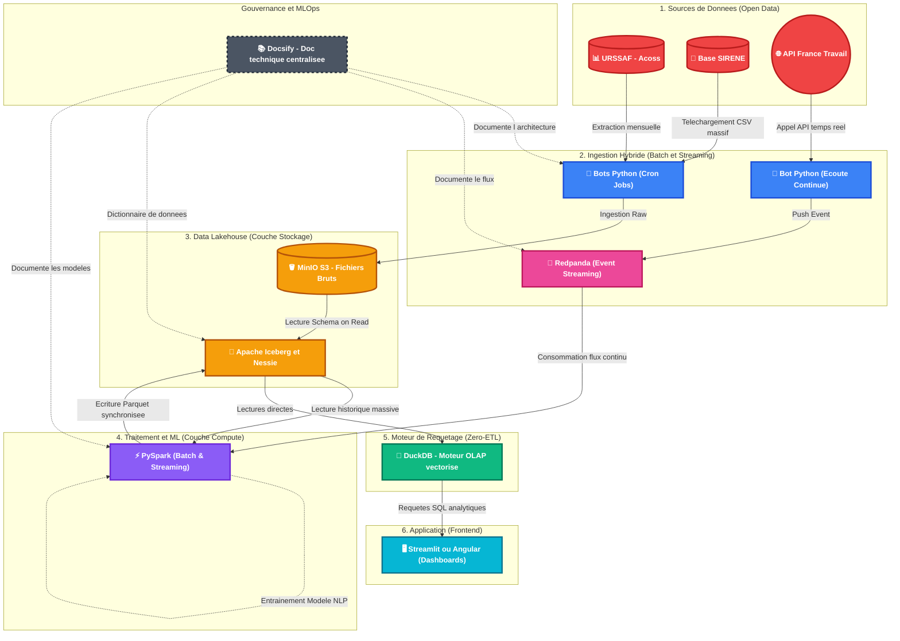

# 🌍 Système d'Information Décisionnel (SID)
*Analyse prédictive de la mutation des emplois face à l'automatisation par l'Intelligence Artificielle.*

> **Version :** 1.0 (Recentrage MVP + Option Climat)  
> **Date :** Septembre 2026

---

## 🎯 Contexte, Problématique & Vision

*   **Mon contexte :** L'IA générative banalise l'exécution technique, bouleversant la valeur historique des compétences sur le marché du travail et modifiant en profondeur les dynamiques de recrutement.
*   **Ma problématique :** Comment anticiper les mutations du marché du travail face à l'IA ? Quels secteurs d'activité sont condamnés à détruire des emplois, et lesquels pivotent avec succès vers de nouvelles compétences (notamment les sciences humaines/soft skills) ?
*   **Ma vision (La solution) :** Je vais créer un Système d'Information Décisionnel (SID) prédictif croisant les dynamiques économiques sectorielles et l'analyse sémantique des offres d'emploi. Cet outil permettra aux décideurs (RH, Régions) d'identifier les secteurs en danger et d'anticiper les besoins en reconversion professionnelle.

## 🔬 Mes Hypothèses de Recherche

Pour garantir la rigueur de ma démarche, je vais tester deux hypothèses principales :

1.  **Le déclin de l'exécution technique :** Les secteurs économiques (codes NAF) dont les offres d'emploi restent figées sur des compétences d'exécution technique subissent une destruction d'emplois ou une fermeture d'entreprises plus rapide que la moyenne nationale.
2.  **La prime aux Sciences Humaines :** Les secteurs qui résistent ou créent de l'emploi face à l'IA montrent une évolution sémantique forte de leurs offres d'emploi, avec une augmentation des exigences en "Soft Skills" (éthique, discernement, pensée systémique, empathie).
    *   *Variable indépendante :* L'évolution sémantique du texte des offres d'emploi (NLP via France Travail).
    *   *Variable dépendante :* Le volume de créations/fermetures d'entreprises (SIRENE) et l'évolution de la masse salariale par secteur (URSSAF).

## 👥 Utilisateurs Cibles

*   **Les DRH & Acteurs de l'emploi (France Travail, APEC) :** Pour les aider à adapter les référentiels de formation et anticiper la pénurie de profils cognitifs/humains.
*   **Les Décideurs publics (Régions/Agglomérations) :** Pour leur permettre d'anticiper l'effondrement d'un secteur d'activité local et d'allouer des budgets de formation ou de reconversion de manière ciblée.

---

## 🗺️ Schéma de l'Architecture (C4 Model)

Voici la représentation visuelle du pipeline de mon projet, de l'ingestion de la donnée jusqu'à la consommation par l'utilisateur final.

---

## 🗂️ Sources de Données & Variables

Ma clé de voûte relationnelle sera le Code NAF (Secteur d'activité) et le Code ROME (Métier).

1.  **Données "Exposition IA" :** Open Data de l'OCDE/DARES. Score d'exposition à l'IA par catégorie.
2.  **URSSAF / Acoss :** Macro-économie et masse salariale par région et code NAF.
3.  **France Travail (API) :** Offres d'emploi et extraction NLP des "Soft Skills" en temps réel (via Redpanda).
4.  **Base SIRENE (INSEE) :** Créations et disparitions d'entreprises pour mesurer le dynamisme d'un secteur.
5.  **Météo-France (Bonus V2) :** Données climatologiques pour l'Indice IA + Climat.

## 🏗️ Architecture Technique (Modern Data Stack)

J'ai fait le choix audacieux d'une **Architecture Lambda**, manipulant simultanément le traitement par lots (Batch) pour l'historique, et le flux en temps réel (Event Streaming).

*   **Ingestion Hybride :** Voie Froide (Scripts Python + S3) et Voie Chaude (Redpanda pour l'API France Travail).
*   **Data Lakehouse :** MinIO (S3) couplé à Apache Iceberg (transactions ACID).
*   **Traitement & NLP :** Cluster PySpark (calcul d'Embeddings et Soft Skills).
*   **Moteur BI (Zero-ETL) :** DuckDB lisant nativement le format Apache Parquet.
*   **Restitution :** Streamlit ou Angular.

## 🎓 Alignement Référentiel (Validation RNCP BC05)

Ce projet est conçu sur-mesure pour valider mes compétences :
- [x] **[C27]** Architecture Data Warehouse / Data Lake (MinIO + Iceberg).
- [x] **[C28/C29/C30]** Processus ETL, Big Data (PySpark, Parquet) et restitution BI.
- [x] **[C31]** Automatisation RPA et ingestion continue (Event Streaming via Redpanda).
- [x] **[C32]** Machine learning : Modèles prédictifs de forecasting.
- [x] **[C33/C34/C35]** Monitoring, documentation technique (Docsify) et mesure d'impact.

## ☁️ Stratégie d'Hébergement (VPS)

Pour soutenir la JVM de Spark et Nessie, l'application nécessitera un VPS "Milieu/Haut de gamme" (Minimum 8 Go de RAM, idéalement 16 Go). Les tests locaux se feront sous WSL2. Un découplage strict sera appliqué : le VPS pour le Compute (Spark/Redpanda), et un Object Storage déporté (S3) pour la donnée massive.