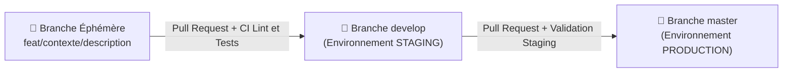

# 🌳 0. Conventions GitOps & Workflow

> **Objectif de ce chapitre :** Documenter mes standards de gestion de versions, l'architecture de mes branches Git, ma convention de nommage **Conventional Commits** en français et la taxonomie des labels utilisés par mes automatisations GitHub Actions (`pr-labeler` et `Release Drafter`) sur les 4 dépôts de **Data Skills Radar**.

---

## 🏗️ 1. Architecture des Branches & Flux de Travail

J'applique un workflow **Git Flow simplifié** et strictement aligné sur mes environnements d'hébergement OVHcloud :

*   **`master`** : Branche de **Production** (`https://app.dataskills.thomasnoel.dev`, `https://api.dataskills.thomasnoel.dev`, `https://docs.dataskills.thomasnoel.dev`). Code stable, testé, audité et déployé automatiquement sur les conteneurs de production.
*   **`develop`** : Branche d'**Intégration / Staging** (`https://staging.dataskills.thomasnoel.dev`, `https://api-staging.dataskills.thomasnoel.dev`). Toutes mes branches de fonctionnalités y sont fusionnées par Pull Request pour validation en conditions réelles avant passage en production.

### Format de mes branches éphémères :
Toute évolution est développée sur une branche dédiée au format **`type/contexte/description-courte`** (en `kebab-case`) :
*   *Exemples :* `feat/dashboard/france-map`, `fix/api/vault-approle`, `cicd/deploy/vps`, `docs/lakehouse/statistiques`.

---

## 🧪 2. Convention des Commits (*Conventional Commits*)

L'ensemble de mes 4 dépôts respecte le standard industriel **[Conventional Commits](https://www.conventionalcommits.org/)** avec une règle linguistique stricte : **toutes les descriptions de commits et titres de Pull Requests sont rédigés en français**.

**Structure officielle :** `type(scope): description` (en minuscules, sans point final).

| Type | Usage dans mon projet | Impact SemVer (`Release Drafter`) | Exemple concret |
| :--- | :--- | :---: | :--- |
| **`feat`** | Nouvelle fonctionnalité métier ou technique | `MINOR` (`0.X.0`) | `feat(users): ajout de la gestion des profils avec httpResource` |
| **`fix`** | Correction de bug ou d'anomalie | `PATCH` (`0.0.X`) | `fix(nginx): résolution du routage try_files pour la sidebar docsify` |
| **`docs`** | Création ou mise à jour documentaire | `PATCH` (`0.0.X`) | `docs(adr): rédaction complète du registre des 8 décisions d'architecture` |
| **`style`** | Formatage, CSS, Design System, Linting | `PATCH` (`0.0.X`) | `style(theme): harmonisation bimodale Electric Teal et Cyber Amber` |
| **`refactor`** | Amélioration interne du code sans changer le comportement | `PATCH` (`0.0.X`) | `refactor(auth): migration vers l'injection par fonction inject()` |
| **`test`** | Ajout ou correction de tests unitaires / intégration | `PATCH` (`0.0.X`) | `test(users): couverture à 100 % du service utilisateur sous Vitest` |
| **`cicd`** / **`ci`** | Pipelines GitHub Actions, Dockerfiles, scripts DevOps | `PATCH` (`0.0.X`) | `cicd(deploy): automatisation du déploiement SSH vers le VPS OVH` |
| **`chore`** | Maintenance, dépendances, configuration d'outils | `PATCH` (`0.0.X`) | `chore(deps): mise à niveau vers Angular 22 et Node.js 24` |

---

## 🏷️ 3. Catalogue des Labels GitHub (Issues & Pull Requests)

Mes tickets (*Issues*) et mes *Pull Requests* sont catégorisés automatiquement à l'ouverture grâce à l'analyse du préfixe Conventional Commits par mon workflow `Release Drafter` :

*   `feature` : Nouvelle fonctionnalité ou amélioration majeure (`feat:`).
*   `fix` / `bug` : Correction d'une anomalie fonctionnelle ou technique (`fix:`).
*   `docs` / `documentation` : Enrichissement du portail Docsify ou des README (`docs:`).
*   `cicd` : Modification des workflows GitHub Actions, Dockerfiles ou scripts VPS (`ci:`, `cicd:`).
*   `refactor` : Restructuration interne de l'architecture logicielle (`refactor:`).
*   `style` : Retouches visuelles, Tailwind CSS v4, PrimeNG 22 ou formatage Prettier (`style:`).
*   `test` : Ajout ou fiabilisation des suites de tests Vitest / PyTest (`test:`).
*   `chore` : Tâches de maintenance et mises à jour de dépendances (`chore:`).
*   `major` : Changement majeur introduisant une rupture de compatibilité (`BREAKING CHANGE`).
*   `duplicate` / `question` : Qualification manuelle lors du triage des issues.
