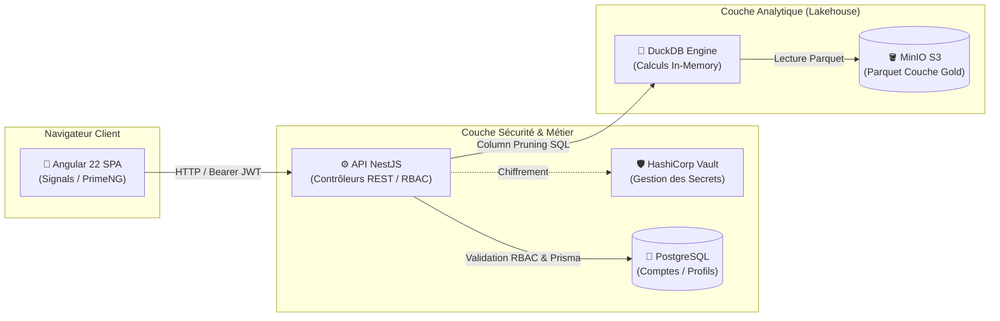

# 🏗️ Architecture Frontend & Fondations Techniques

**Version :** 2.0 (Angular 22 / Zoneless / Tailwind v4)  
**Mise à jour :** Octobre 2026

Ce document définit les fondations architecturales et la structuration logicielle de l'application **Data Skills Radar** (`data-skills-radar-app`), conçue comme un Système d'Aide à la Décision (SAD / BI) haute performance.

---

## 🚀 1. Paradigme & Stack Technologique

L'application est construite sur un socle technique moderne orienté réactivité fine et performance d'exécution :

* **Framework :** **Angular 22+** en mode *Single Page Application* (SPA).
* **Détection de Changement Zoneless :** Désactivation de `zone.js` au profit de `provideZonelessChangeDetection()`. La réactivité repose exclusivement sur les **Angular Signals** (`signal()`, `computed()`, `effect()`), éliminant la surcharge des cycles de détection globaux.
* **Architecture 100 % Standalone :** Aucun `NgModule`. Tous les composants, directives et pipes sont déclarés `standalone: true` et importent explicitement leurs dépendances via le tableau `imports`.
* **Typage Strict :** TypeScript configuré en mode strict avec vérification systématique des templates (`strictTemplates: true`, `isolatedModules: true`).
* **Moteur Graphique & Styles :** Couplage natif entre **Tailwind CSS v4** et **PrimeNG 22** via un preset personnalisé (`DsrTheme`).

---

## 🌐 2. Architecture Client-Serveur & Flux de Données

L'application s'intègre au sein d'une architecture globale distribuée en trois couches :



### Principes Clés :
1. **Séparation Stricte OLTP / OLAP :** L'application cliente ne dialogue jamais directement avec le stockage brut S3 ni avec les bases analytiques. Toutes les interactions transitent par l'API NestJS (`data-skills-radar-api`) protégée par jetons **JWT**.
2. **Calcul Analytique Déporté (Zero-ETL) :** Lorsque l'utilisateur ajuste les filtres (NAF, régions, compétences), le backend exécute des requêtes SQL via **DuckDB** directement sur les fichiers Apache Parquet stockés dans MinIO S3. Seuls les agrégats JSON légers sont transmis au frontend.
3. **Réactivité Locale (Signals) :** Dès réception des payloads de l'API, les signaux Angular mettent à jour instantanément la cartographie et les tableaux de bord décisionnels.

---

## 📁 3. Arborescence du Code Source

Le projet respecte une organisation modulaire par domaine d'impact :

```text
src/
├── app/
│   ├── core/                        # Singleton & services transversaux applicatifs
│   │   ├── constants/               # Constantes d'API et configuration système
│   │   ├── enums/                   # Énumérations strictes (RoleEnum, etc.)
│   │   │   ├── model/               # Interfaces des dictionnaires d'énumérations
│   │   │   ├── pipe/                # EnumsDynamicPipe (traduction dynamique)
│   │   │   └── service/             # EnumsDataService (chargement via APP_INITIALIZER)
│   │   ├── guards/                  # Gardes de routage (authGuard, adminGuard)
│   │   ├── interceptors/            # Intercepteurs HTTP (token, loading, error)
│   │   ├── models/                  # Modèles transverses (SystemStatus, etc.)
│   │   ├── pages/                   # Pages globales (ex: PageNotFoundComponent)
│   │   └── services/                # Services centraux (AuthService, SessionService, etc.)
│   ├── features/                    # Modules fonctionnels métier (Lazy-loaded)
│   │   ├── auth/                    # Module d'authentification (Login, formulaires)
│   │   ├── home/                    # Tableau de bord principal (Dashboard BI)
│   │   └── users/                   # Gestion des utilisateurs (CRUD, rôles)
│   ├── layout/                      # Enveloppe visuelle (Shell) de l'application
│   │   ├── components/              # Header, Sidebar, Footer, Navigation
│   │   └── main-layout/             # Composant layout conteneur
│   ├── shared/                      # Éléments réutilisables (Composants UI, Pipes, Modèles)
│   ├── app.config.ts                # Configuration globale des providers Angular
│   └── app.routes.ts                # Table de routage racine
├── environments/                    # Variables d'environnement (Dev / Prod)
└── styles/                          # Charte graphique globale et presets
    ├── css/                         # Feuilles de styles utilitaires (_base.css, _radar.css)
    └── theme/                       # Preset PrimeNG DsrTheme (Light & Dark)
```

---

## ⚡ 4. Directives d'Implémentation Angular 22

* **Injection de Dépendances :** Utilisation systématique de la fonction `inject()` au niveau des champs de classe au détriment des constructeurs verbeux.
* **Communication de Composants :**
  * Entrées : `input.required<T>()` ou `input<T>()` produisant des signaux en lecture seule.
  * Sorties : `output<T>()` remplaçant `@Output() EventEmitter`.
* **Flux Asynchrones :** Conversion des flux RxJS HTTP vers des signaux réactifs au niveau des composants lorsque c'est pertinent, avec désinscription automatique gérée par le framework.
