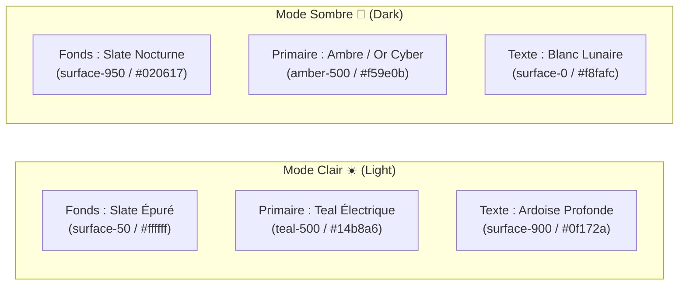

# 🎨 Design System, PrimeNG 22 & Tailwind CSS v4

**Version :** 2.0 (Tailwind v4 / PrimeNG v22 / DsrTheme)  
**Mise à jour :** Octobre 2026

Ce document spécifie la charte visuelle "Web 3.0 / Deeptech" de l'application **Data Skills Radar** et détaille l'intégration technique entre **Tailwind CSS v4** et **PrimeNG 22**.

---

## 🌌 1. Identité Visuelle & Thématique Bimodale

L'interface décisionnelle offre une expérience visuelle contrastée, reposant sur une alternance sémantique des teintes d'accentuation selon le mode d'affichage :



### Justification Ergonomique :
* **Le mode clair (Teal) :** Offre une lisibilité maximale pour l'analyse bureautique en plein jour.
* **Le mode sombre (Ambre) :** Réduit la fatigue visuelle lors des sessions d'analyse prolongées et confère un aspect "Fintech / Salle de marché" aux graphiques de tendances.

---

## 🛠️ 2. Intégration Technique (Tailwind v4 & PrimeNG 22)

La cohabitation entre un framework utilitaire (Tailwind) et une suite de composants riches (PrimeNG) est articulée autour de trois piliers majeurs :

### A. Couches CSS (`cssLayer`)
Dans [`src/app/app.config.ts`](file:///mnt/d/Workspace/.FIL%20ROUGE/data-skills-radar-app/src/app/app.config.ts), PrimeNG est configuré pour encapsuler ses sélecteurs dans une couche dédiée :

```typescript
providePrimeNG({
    theme: {
        preset: DsrTheme,
        options: {
            darkModeSelector: '.dark',
            cssLayer: {
                name: 'primeng',
                order: 'theme, base, primeng', // Priorité assurée sans écrasement
            },
        },
    },
    ripple: true,
})
```

### B. Point d'entrée CSS minimaliste (`src/styles.css`)
Tailwind v4 utilise les directives modernes d'importation :

```css
@import "tailwindcss";
@import "tailwindcss-primeui";
@import "primeicons/primeicons.css";
@import "./styles/css/dataskillsradar.css";

/* Force Tailwind v4 à utiliser la classe .dark plutôt que les préférences du système */
@custom-variant dark (&:where(.dark, .dark *));
```

### C. Le Preset Centralisé (`DsrTheme`)
Défini dans `src/styles/theme/dsr-theme.ts` via la fonction `definePreset()`, il configure :
1. Les palettes de couleurs dynamiques (Teal pour le jour, Amber pour la nuit).
2. Les surfaces sémantiques basées sur la palette `slate`.
3. Le style personnalisé des composants natifs (ex: modales translucides, p-toast avec bordures néon).

---

## 🔮 3. Effets Visuels : Glassmorphism & Animations

L'application abandonne le design plat traditionnel au profit d'une interface en relief :

### A. Panneaux de Verre (*Glassmorphism*)
Tous les conteneurs analytiques et cartes du tableau de bord appliquent l'effet verre poli :
```html
<div class="glass-panel rounded-2xl p-6 backdrop-blur-md bg-surface-0/80 dark:bg-surface-900/80 border border-surface-200/50 dark:border-surface-800/50 shadow-xl">
    <!-- Contenu de la métrique -->
</div>
```

### B. Animations Cycliques Radar (`src/styles/css/_radar.css`)
Pour renforcer l'analogie avec un radar décisionnel, plusieurs animations CSS sont injectées dans le thème Tailwind :
* **`radar-spin` (8s) :** Rotation lente du balayeur d'ondes sur le logo de l'en-tête.
* **`ripple` (3s) :** Onde concentrique simulant la détection périodique de nouveaux signaux de compétences.
* **`wave-move` (15s) :** Ondes lumineuses diffuses traversant discrètement l'arrière-plan de l'application.

---

## 🔤 4. Typographie & Iconographie

* **Typographie Principale :** **Space Grotesk** (Google Fonts). Elle offre des terminaisons géométriques affirmées, particulièrement percutantes pour les métriques chiffrées et compteurs statistiques.
* **Icônes :**
  * **Google Material Symbols (Outlined) :** Utilisé pour la structure applicative (menus, actions de navigation, indicateurs de statut).
  * **PrimeIcons :** Utilisé pour les contrôles internes des composants PrimeNG (tris de tableaux, fermetures de modales, pagination).
