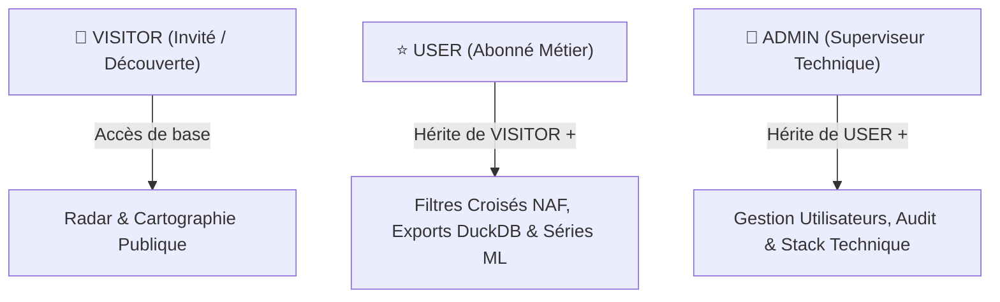
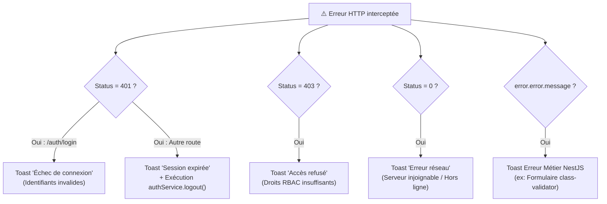

# ⚙️ Sécurité, Authentification & Modèle RBAC

**Version :** 2.0 (Refonte Source Unique de Vérité & RBAC Invité)  
**Mise à jour :** Octobre 2026

Ce document détaille l'architecture de sécurité du frontend : gestion de l'identité, persistance des sessions, contrôle d'accès basé sur les rôles (**RBAC**) et interception des erreurs réseau.

---

## 🏛️ 1. Séparation Stricte des Responsabilités (SRP)

Pour éliminer toute désynchronisation d'état, l'architecture sépare nettement l'identité utilisateur des préférences graphiques :

| Domaine | Service Responsable | État Réactif (Signals) | Stockage Persistant | Rôle Métier |
| :--- | :--- | :--- | :--- | :--- |
| **Authentification & Identité** | `AuthService` | `userConnected`<br>`isAuthenticated` | `localStorage` :<br>`JWT_TOKEN`, `USER_DATA` | Unique source de vérité pour le profil connecté, les tokens JWT et la session invité. |
| **Préférences d'Interface** | `SessionService` | `isDarkMode`<br>`isSidebarOpen` | `localStorage` :<br>`dsr_dark_mode`<br>`dsr_sidebar_open` | Thème sombre/clair et rétractation du menu latéral. |

> [!NOTE]
> `SessionService` ne stocke plus aucune donnée utilisateur. Toute l'identité est centralisée dans `AuthService`.

---

## 👥 2. Les Rôles Système (`RoleEnum`)

Le système applique un modèle SaaS Freemium formalisé par l'énumération TypeScript [`RoleEnum`](file:///mnt/d/Workspace/.FIL%20ROUGE/data-skills-radar-app/src/app/core/enums/role.enum.ts) :

```typescript
export enum RoleEnum {
    ADMIN = 'ADMIN',      // Administrateur technique & Data Architect
    USER = 'USER',        // Utilisateur abonné (Client Premium)
    VISITOR = 'VISITOR',  // Visiteur public ou prospect non connecté
}
```



---

## 🎟️ 3. Gestion de la Session Invité (`loginAsGuest`)

Pour permettre aux prospects de découvrir la plateforme sans friction préalable, l'application propose un flux **"Visiter sans inscription"** :

1. **Création d'une session virtuelle :** [`LoginComponent`](file:///mnt/d/Workspace/.FIL%20ROUGE/data-skills-radar-app/src/app/features/auth/pages/login/login.component.ts) appelle `AuthService.loginAsGuest()`.
2. **Initialisation sans jeton :** Aucun appel API n'est requis. Un objet `IAuthUser` virtuel avec le rôle `RoleEnum.VISITOR` est injecté dans le signal `userConnectedSignal` et persisté dans `USER_DATA`.
3. **Passage des gardes :** [`authGuard`](file:///mnt/d/Workspace/.FIL%20ROUGE/data-skills-radar-app/src/app/core/guards/auth-guard.ts) vérifie que `userConnected() !== null`. L'invité franchit la garde et accède au tableau de bord.
4. **Restauration au rechargement :** Lors du boot (`loadToken()`), si aucun token JWT n'est présent mais que `USER_DATA` contient `role: VISITOR`, la session invité est automatiquement restaurée.
5. **Déconnexion sécurisée :** [`AuthService.logout()`](file:///mnt/d/Workspace/.FIL%20ROUGE/data-skills-radar-app/src/app/core/services/auth.service.ts) détecte l'absence de token JWT et réinitialise l'état local sans solliciter inutilement l'endpoint `/auth/logout`.

---

## 🛡️ 4. Matrice des Permissions Réactives (`PermissionService`)

[`PermissionService`](file:///mnt/d/Workspace/.FIL%20ROUGE/data-skills-radar-app/src/app/core/services/permission.service.ts) expose des signaux calculés (`computed`) injectables directement dans les templates Angular via `@if` :

```typescript
// Rôles
isAdmin = computed(() => this.currentRole() === RoleEnum.ADMIN);
isUser = computed(() => this.currentRole() === RoleEnum.USER);
isVisitor = computed(() => this.currentRole() === RoleEnum.VISITOR);

// Permissions Métier
canViewBasicRadar = computed(() => this.currentRole() !== null);
canUseAdvancedFilters = computed(() => this.isAdmin() || this.isUser());
canExportDuckDB = computed(() => this.isAdmin() || this.isUser());
canConfigureDataStack = computed(() => this.isAdmin());
```

---

## 🚦 5. Guards de Routage

* **`authGuard` :** Sécurise l'ensemble du layout applicatif (`mainLayoutRoutes`). Il vérifie la présence d'un utilisateur connecté (authentifié ou invité). En cas d'accès anonyme non autorisé, il affiche un toast d'erreur et redirige vers `/connexion`.
* **`adminGuard` :** Protège spécifiquement les routes d'administration (`/utilisateurs`, `/configuration`). Il vérifie `permissionService.canConfigureDataStack()`. En cas de refus, l'utilisateur est redirigé vers le tableau de bord avec une alerte de sécurité.

---

## 📡 6. Interception Centralisée des Erreurs (`errorInterceptor`)

L'intercepteur HTTP centralise l'affichage des notifications Toast et sécurise le cycle de vie du jeton :



> [!TIP]
> Grâce à cette centralisation, les composants (comme `LoginFormComponent`) n'affichent plus de toasts d'erreur redondants dans leurs souscriptions locales.
