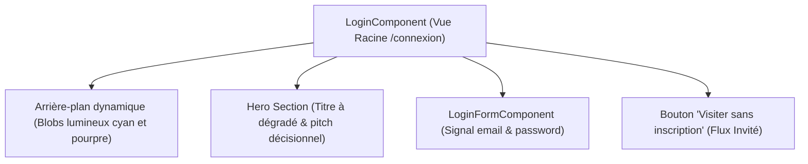

# 🖥 Spécifications UI (Vues & Composants Majeurs)

**Version :** 2.0 (Alignement Implémentation v22 / Tailwind v4)  
**Mise à jour :** Octobre 2026

Ce document formalise les spécifications visuelles et ergonomiques des vues clés de l'application **Data Skills Radar**.

---

## 🚪 1. Page d'Accueil & Connexion (`LoginComponent`)

Cette page sert à la fois de vitrine technologique pour le projet et de portail d'accès sécurisé :

### Éléments Clés :
* **Arrière-plan Dynamique :** Deux "Blobs" floutés à 100px (`blur-[100px]`) en fond d'écran créent une ambiance cyber/deeptech sans impacter les performances de défilement.
* **Formulaire Réactif (`LoginFormComponent`) :** Utilise les composants PrimeNG `InputTextModule` et `IftaLabel` intégrés avec des signaux de saisie `email` et `password`.
* **Flux Invité Direct :** Le bouton secondaire *"Visiter sans inscription"* permet d'accéder au tableau de bord avec une session virtuelle sans avoir à saisir d'identifiants.

---

## 📊 2. Tableau de Bord Décisionnel (`DashboardComponent`)

Accessible via la route `/tableau-de-bord`, il s'organise en grille réactive (`grid-cols-1 md:grid-cols-3 gap-6`) :

### A. Cartes Métriques KPI (Glassmorphism)
Chaque indicateur macro-économique est encadré dans un panneau translucide (`backdrop-blur-md`, `bg-surface-0/80 dark:bg-surface-900/80`) :
1. **Compétences en Mutation :** Compteur en typographie `Space Grotesk` avec badge d'évolution en pourcentage.
2. **Métiers sous Tension IA :** Indicateur de criticité coloré selon la sévérité (`FORT`, `MOYEN`, `FAIBLE`).
3. **Volume d'Emplois Analysés :** Données volumétriques consolidées issues du Data Lakehouse.

### B. Contrôle d'Accès Visuel aux Données
Le dashboard adapte ses visualisations au niveau de privilèges grâce aux signaux de `PermissionService` :
* **Visiteurs :** Visualisent la cartographie macro et les moyennes régionales.
* **Abonnés (`USER`) & Admins :** Accèdent aux filtres fins par secteur d'activité (Codes NAF) et aux exports de données Parquet via DuckDB.

---

## 🌓 3. Basculeur de Thème Flottant (`ToggleDarkModeComponent`)

Pour offrir un contrôle immédiat du confort visuel quel que soit l'écran actif :
* **Positionnement :** Épinglé en bas à droite de l'écran (`fixed bottom-6 right-6 z-50`).
* **Interaction :** Déclenche `sessionService.toggleTheme()`, basculant instantanément les classes `.dark` sur la racine du document HTML et synchronisant la préférence dans le `localStorage`.
* **Animations :** Transition fluide de rotation et de fondu entre l'icône Soleil ☀️ et Lune 🌙.
