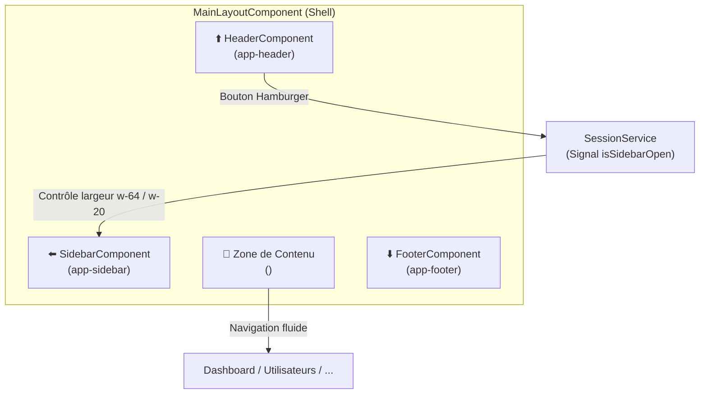
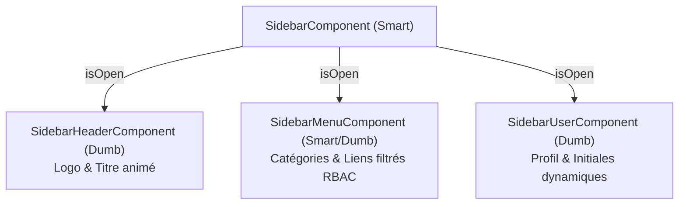

# 📐 Architecture du Layout & Navigation Réactive

**Version :** 2.0 (Synchronisation SessionService & Navigation RBAC)  
**Mise à jour :** Octobre 2026

Ce document décrit l'architecture du conteneur applicatif principal (`MainLayoutComponent`) ainsi que la gestion de la navigation et de l'état réactif de la barre latérale.

---

## 🏛️ 1. Vue d'ensemble du Shell Applicatif

Le layout global fournit une enveloppe cohérente pour toutes les pages protégées de l'application :



* **Zoneless & Transitions CSS :** La transition d'ouverture/fermeture du menu s'effectue via des classes utilitaires Tailwind fluides (`transition-all duration-300`, `w-64` ouverte ⇄ `w-20` repliée).

---

## 📂 2. Sidebar Component : Architecture Smart / Dumb

Le composant conteneur [`SidebarComponent`](file:///mnt/d/Workspace/.FIL%20ROUGE/data-skills-radar-app/src/app/layout/components/sidebar/sidebar.component.ts) délègue l'affichage à trois sous-composants dédiés via des signaux en entrée (`input.required<boolean>()`) :



### A. Centralisation de l'État dans `SessionService`
Plutôt que de maintenir un état local isolé, `SidebarComponent` est directement synchronisé avec le service central :
```typescript
@Component({ ... })
export class SidebarComponent {
    private readonly sessionService = inject(SessionService);

    // Signal réactif en lecture seule connecté au stockage localStorage
    public readonly isOpen = this.sessionService.isSidebarOpen;

    public toggle(): void {
        this.sessionService.toggleSidebar();
    }
}
```

### B. Contrôle d'Accès RBAC dans le Menu (`SidebarMenuComponent`)
La visibilité des catégories de navigation est réactive via un Signal `computed()` exploitant [`PermissionService`](file:///mnt/d/Workspace/.FIL%20ROUGE/data-skills-radar-app/src/app/core/services/permission.service.ts) :
* Pour un utilisateur standard ou un invité (`RoleEnum.VISITOR`), seule la catégorie **Général** est visible.
* Pour un administrateur (`RoleEnum.ADMIN`), la catégorie **Administration** (`/utilisateurs`, `/configuration`) apparaît automatiquement.

### C. Gestion des Modules en Roadmap (Option A - Zéro 404)
Pour présenter la richesse fonctionnelle du projet sans frustrer l'utilisateur par des pages 404 :
* Les modules non encore implémentés (`/matrice`, `/indicateurs`, `/laboratoire`, `/configuration`) sont configurés avec `disabled: true` et `badge: 'Bientôt'`.
* **Rendu HTML :** Ils ne génèrent aucune balise `<a>` avec `routerLink`, mais un conteneur non interactif (`cursor-not-allowed select-none`) accompagné d'un pill badge discret et d'une infobulle (`title`).

---

## 🔝 3. Header Component (En-tête Supérieure)

Situé en haut du layout (`sticky top-0 z-50 backdrop-blur-md`), l'en-tête offre les fonctionnalités suivantes :

1. **Bouton Hamburger :** Déclenche l'ouverture/fermeture du menu latéral directement via `sessionService.toggleSidebar()`.
2. **Badge Utilisateur :** Affiche le prénom et le nom de l'utilisateur avec son rôle en majuscules dans un composant `<p-chip>` translucide.
3. **Bouton de Déconnexion :** Exécute `authService.logout()`. Pour un utilisateur classique, cela détruit le jeton et appelle l'API ; pour un invité virtuel, cela réinitialise instantanément l'état local avant de rediriger vers `/connexion`.

---

## 👤 4. Sidebar User Component (Carte Profil)

Ancré au bas du menu latéral, il s'actualise automatiquement en observant le signal `AuthService.userConnected` :
* **Initiales Calculées :** Extraction automatique de la première lettre du prénom et du nom (ex: "TP" pour Thomas Pesquet), avec repli sur `"--"` si inexistant.
* **Libellé de Rôle :** Affiche le rôle en majuscule ou `"GUEST"` par défaut.
* **Repli Fluide :** En mode replié (`isOpen() === false`), seul l'avatar carré avec les initiales reste visible, optimisant l'espace visuel.
