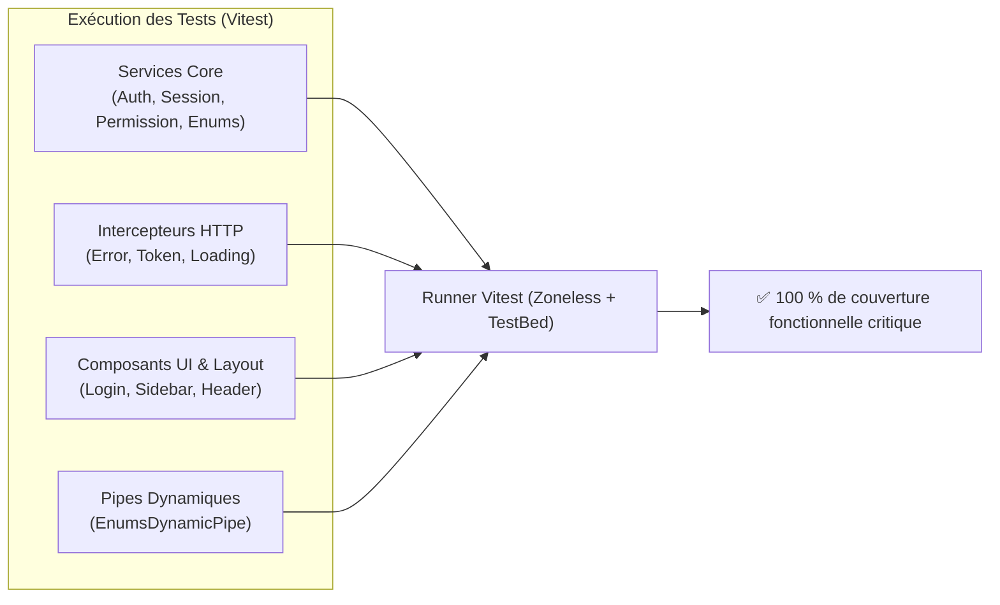
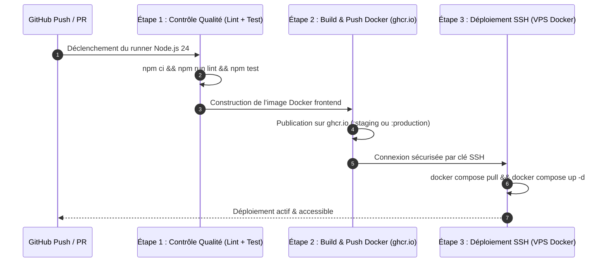

# 🏭 CI/CD, Qualité Logicielle & Stratégie de Test

**Version :** 2.0 (Vitest / ESLint / GitHub Actions)  
**Mise à jour :** Octobre 2026

Ce document détaille les pratiques DevOps, l'intégration continue, la suite de tests automatisés et le déploiement conteneurisé de l'application **Data Skills Radar**.

---

## 🧪 1. Stratégie de Test Unitaire (Vitest)

L'application a migré vers **Vitest** au détriment de Karma/Jasmine, offrant des temps d'exécution divisés par 5 et une compatibilité native avec les ES Modules et Angular 22 :

### Bonnes Pratiques Appliquées :
1. **Contexte d'Injection (`TestBed`) :** Tous les services et pipes exploitant `inject()` sont instanciés via `TestBed.inject()` ou encapsulés dans un contexte d'injection (`TestBed.runInInjectionContext()`).
2. **Neutralisation des Effets de Bord :** Les tests vérifiant le comportement lors d'erreurs (ex: parsing JSON corrompu) espionnent `console.error` via `vi.spyOn(console, 'error').mockImplementation(() => undefined)` pour garantir une sortie de terminal irréprochable.
3. **Isolation RxJS :** Les flux d'erreur simulés dans les composants intègrent systématiquement un callback d'erreur pour éviter les exceptions non capturées (`Uncaught Exception`).

---

## 🔍 2. Analyse Statique & Linting (ESLint)

Le contrôle qualité est automatisé via `eslint.config.mjs` associant :
* `@angular-eslint` : Respect des conventions de sélecteurs (`app-` kebab-case pour les composants, camelCase pour les directives).
* `typescript-eslint` : Typage strict avec désactivation ciblée des règles bloquantes pour les tests (section `CI/CD UNBLOCKER`).
* `Prettier` : Formatage automatique et harmonisation des fins de lignes (`endOfLine: 'auto'`).

---

## 🤝 3. Conventions GitOps & Pull Requests

Pour garantir un historique propre et permettre la génération automatisée des notes de version (Changelog), le projet applique strictement les **Conventional Commits** :

* **Langue :** Français obligatoire pour tous les messages de commit et titres de PR.
* **Format :** `<type>(<scope optionnel>): <description>`
* **Types Autorisés :**
  * `feat` : Nouvelle fonctionnalité
  * `fix` : Correction de bug
  * `docs` : Documentation
  * `style` : Formatage ou retouches CSS
  * `refactor` : Restructuration sans modification de comportement
  * `test` : Tests unitaires ou d'intégration
  * `chore` : Dépendances ou configuration de build
  * `ci` / `cicd` : Pipelines d'automatisation

---

## 🚀 4. Pipeline de Déploiement Conteneurisé (`deploy.yml`)

Le workflow GitHub Actions s'exécute à chaque fusion vers `develop` (Staging) ou `master` (Production) :

### Matrice d'Isolation des Environnements sur VPS :

| Environnement | Branche Git | Port Front-end | Fichier d'environnement |
| :--- | :--- | :--- | :--- |
| **Staging (Intégration)** | `develop` | `4201` | `.env.staging` |
| **Production** | `master` | `4202` | `.env.production` |
