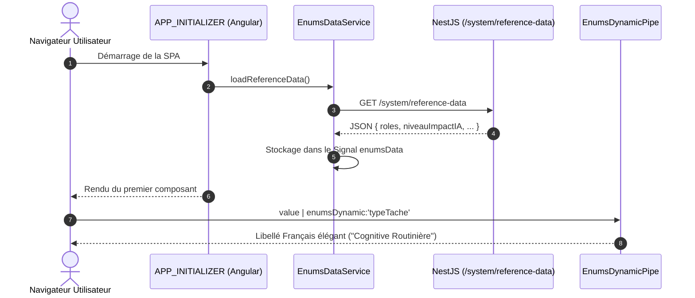
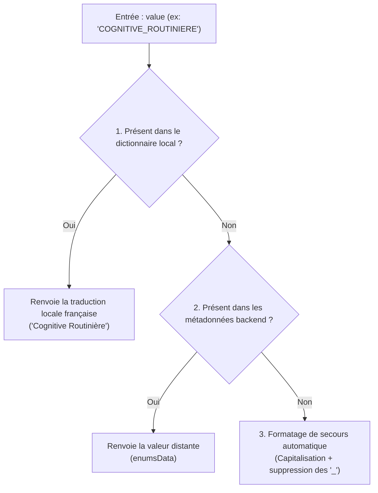

# 📚 Référentiels Métier & Énumérations Dynamiques

**Version :** 1.0  
**Mise à jour :** Octobre 2026

Ce document formalise la gestion des dictionnaires de référence et des énumérations entre l'API NestJS et l'interface Angular, garantissant une cohérence sémantique absolue entre la base de données PostgreSQL, le Data Lakehouse et l'IHM.

---

## 🎯 1. Pourquoi des Énumérations Dynamiques ?

Dans un système décisionnel complexe, les valeurs d'énumérations (types de tâches, tendances d'emploi, niveaux d'impact) évoluent avec les modèles d'intelligence artificielle et les réglementations statistiques.

Plutôt que de figer les libellés en dur dans le code frontend ou de risquer des désynchronisations avec le schéma Prisma, **Data Skills Radar** implémente un pattern de **synchronisation dynamique au démarrage**.



---

## 🗄️ 2. Les Énumérations Métier Partagées

Les énumérations sont initialement définies dans le schéma Prisma du backend (`data-skills-radar-api`) et exposées telles quelles :

| Énumération | Clés Définies | Description Métier |
| :--- | :--- | :--- |
| **`Role`** | `ADMIN`, `USER`, `VISITOR` | Niveaux d'accréditation et abonnements du SaaS. |
| **`NiveauImpactIA`** | `FORT`, `MOYEN`, `FAIBLE`, `INCONNU` | Estimation de l'intensité de mutation d'un métier par les LLM et l'automatisation. |
| **`CategorieCompetence`** | `TECHNIQUE`, `COMPORTEMENTALE`, `OUTIL`, `CERTIFICATION` | Classification sémantique des compétences (Hard Skills vs Soft Skills). |
| **`TypeTache`** | `COGNITIVE_ROUTINIERE`, `COGNITIVE_COMPLEXE`,<br>`MANUELLE_ROUTINIERE`, `MANUELLE_COMPLEXE` | Typologie d'activité inspirée des travaux de recherche en économie du travail (modèle Autor-Levy-Murnane). |
| **`TendanceEmploi`** | `EN_CROISSANCE`, `EN_DECLIN`,<br>`EN_MUTATION`, `STABLE` | Indicateur prédictif de volume d'offres d'emploi calculé par le pipeline PySpark. |

---

## 🚀 3. Chargement Frontend (`EnumsDataService`)

Le service [`EnumsDataService`](file:///mnt/d/Workspace/.FIL%20ROUGE/data-skills-radar-app/src/app/core/enums/service/enums-data.service.ts) interroge l'endpoint public `/system/reference-data` lors de l'initialisation de l'application :

```typescript
@Injectable({ providedIn: 'root' })
export class EnumsDataService {
    private http = inject(HttpClient);
    private enumsDataSignal = signal<EnumReferenceData | null>(null);

    // Signal exposé en lecture seule aux composants et pipes
    readonly enumsData = this.enumsDataSignal.asReadonly();

    loadReferenceData(): Observable<void> {
        return this.http.get<EnumReferenceData>(`${environment.API_URL}/system/reference-data`).pipe(
            tap((data) => this.enumsDataSignal.set(data)),
            map(() => void 0),
            catchError((err) => {
                console.error('❌ Erreur critique : Impossible de charger les enums', err);
                return of(void 0); // Empêche le blocage total de l'IHM
            }),
        );
    }
}
```

---

## 🏷️ 4. Traduction & Rendu UI (`EnumsDynamicPipe`)

Pour afficher des libellés soignés dans les tableaux, badges et graphiques, le pipe standalone `enumsDynamic` applique une stratégie d'évaluation à trois niveaux de repli :



### Exemple d'utilisation dans les Templates :

```html
<!-- Badge d'impact IA sur une carte de compétence -->
<span class="px-2.5 py-1 rounded-full text-xs font-semibold bg-amber-500/10 text-amber-500 border border-amber-500/30">
    {{ metier.niveauImpact | enumsDynamic:'niveauImpactIA' }}
</span>

<!-- Affichage du type de tâche -->
<p class="text-sm text-surface-500">
    Type d'activité : {{ tache.type | enumsDynamic:'typeTache' }}
</p>
```

---

## 🆔 5. Cohérence des Identifiants (UUID)

Dans le cadre de l'alignement avec la base PostgreSQL pilotée par Prisma :
* Tous les identifiants primaires (`IUserDto.id`, `IAddressDto.id`) sont typés sous forme de chaînes de caractères représentant des **UUID v4** (`string`).
* Les clés étrangères (ex: `IAddressDto.userId`) sont également alignées en `string` (UUID), assurant une parfaite interopérabilité sans conversion parasite entre l'IHM et l'API.
