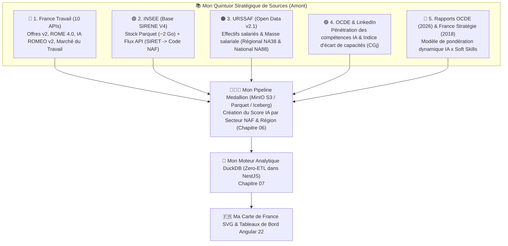

# 🧭 Mon Guide de Développement Étape par Étape : Du « Quintuor » d'APIs à la Carte de France

> **Objectif de ce document :** Ce premier chapitre constitue mon **carnet de route méthodologique et technique**. Il détaille comment j'articule mon **« Quintuor Stratégique »** de sources de données et comment je construis la chaîne décisionnelle complète de **Data Skills Radar** selon une démarche **Bottom-Up (de la source de données brute jusqu'à l'interface utilisateur)** en **5 étapes progressives**.

---

## 🎯 1. Mon « Quintuor Stratégique » de Sources de Données

Mon architecture Lakehouse s'appuie sur la convergence de **5 piliers complémentaires** (documentés en détail dans les chapitres `02` à `05`) pour **créer notre propre Score Dynamique d'Exposition / Vulnérabilité à l'IA par secteur d'activité (Code NAF) et par région française**, puis le confronter à la réalité macro-économique de l'emploi :

1.  🔵 **[Écosystème France Travail (Chapitre 02)](docs/lakehouse/02.strategie_apis_francetravail)** : Fournit la matière première temps réel (les offres d'emploi v2), les dictionnaires sémantiques (**ROME 4.0**), le moteur NLP IA (**ROMEO v2**) et les statistiques de tension (**Marché du travail**).
2.  🟢 **[Écosystème INSEE — Base SIRENE V4 (Chapitre 03)](docs/lakehouse/03.strategie_apis_insee_sirene)** : Contextualise chaque offre d'emploi (via son numéro SIRET) en l'associant à la taille réelle de l'entreprise, à sa région et surtout à son **Code NAF exact** grâce à une approche hybride **Stock Parquet + Flux API**.
3.  🟠 **[Écosystème URSSAF — Open Data (Chapitre 04)](docs/lakehouse/04.strategie_apis_urssaf)** : Constitue ma **vérité terrain macro-économique (Variable Dépendante Y)** en mesurant l'évolution réelle de la masse salariale et des effectifs salariés du secteur privé (au niveau régional `NA38` et national `NA88`), afin d'y confronter le score d'exposition IA sectoriel et régional créé par mon Lakehouse.
4.  🟣 **[Écosystème OCDE / LinkedIn & Rapports IA (Chapitre 05)](docs/lakehouse/05.ecosysteme_ocde_et_rapports_ia)** : Fournit l'**Indice d'écart de capacités de l'IA (`CGj`)** par profession théorique sur 9 domaines (Rapport OCDE Mai/Juillet 2026) et le cadre méthodologique *Task-Based* (Rapport France Stratégie), à partir desquels mon Lakehouse **construit en couche Gold notre propre score dynamique de vulnérabilité IA par secteur NAF et par région** en le pondérant par la densité réelle de *Soft Skills* (**SDSS**).

---

## 🧪 2. Mes 5 Étapes de Développement Séquentielles

### Étape 1 — Qualifier et tester mes connecteurs et fichiers sources (`src/ingestion/test_apis.py`)
*   **Mon objectif :** Vérifier la connectivité et les schémas de mes sources avant d'industrialiser les traitements :
    1.  Test OAuth2 (`client_credentials`) et extraction d'offres en direct sur l'API **France Travail v2** (avec respect du *throttling*).
    2.  Inspection des métadonnées colonnaires de mon fichier **Stock SIRENE Parquet** (`data/raw/sirene/`) et validation de mes accès **API INSEE Sirene V4**.
    3.  Extraction d'échantillons régionaux (`na38`) et nationaux (`na88`) sur l'API **URSSAF Open Data** (avec `exclude=geom`).

### Étape 2 — Déployer mon infrastructure locale Docker (`MinIO` & `Redpanda`)
*   **Mon objectif :** Lancer localement mon stockage objet **MinIO S3** (`http://localhost:9001`, buckets `bronze`, `silver`, `gold`) et mon broker de streaming **Redpanda** (`http://localhost:8080`, topic `raw.job.offers`).

### Étape 3 — Construire mon Pipeline Médaillon (`Bronze` → `Silver` → `Gold`)
*   **Mon objectif :** Croiser mes sources selon l'**[Architecture Medallion (Chapitre 06)](docs/lakehouse/06.architecture_medallion)** :
    *   En **Silver** : Nettoyage, jointure `SIRET ↔ Code NAF` (SIRENE), mapping `SOC → ROME 4.0`, extraction des *Soft Skills* via **ROMEO v2**, isolation des anomalies dans `silver/errors_dlq.parquet` et calcul du **Score SDSS**.
    *   En **Gold** : **Création et calcul par mon Lakehouse du Score Dynamique d'Exposition / Vulnérabilité IA par secteur NAF et par région française (Variable X)**, confrontation avec les séries d'effectifs et de masse salariale **URSSAF (Variable Y)**, et génération des tables `regional_employment.parquet` (13 régions métropolitaines) et `naf_ai_matrix.parquet`.

### Étape 4 — Exposer la couche Gold via `DuckDB` dans `data-skills-radar-api`
*   **Mon objectif :** Implémenter mon `DuckDbService` (voir **[Chapitre 07 — DuckDB Zero-ETL](docs/lakehouse/07.duckdb_zero_etl)**) dans NestJS pour servir `GET /api/analytics/france-map` (`@Public()`) et `GET /api/analytics/regions/:code/naf` (`@Roles(Role.USER, Role.ADMIN)`).

### Étape 5 — Développer ma Carte de France SVG/GeoJSON dans `data-skills-radar-app`
*   **Mon objectif :** Consommer `GET /api/analytics/france-map` via `httpResource()` dans Angular 22 (Zoneless, `OnPush` par défaut) et colorer dynamiquement les 13 régions selon mon thème bimodal (*Electric Teal* / *Cyber Amber*).
