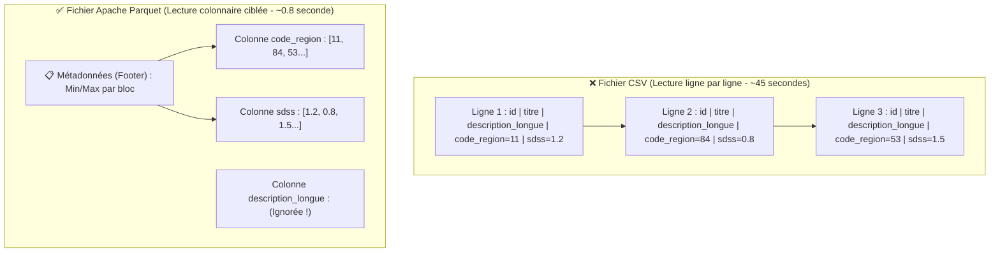
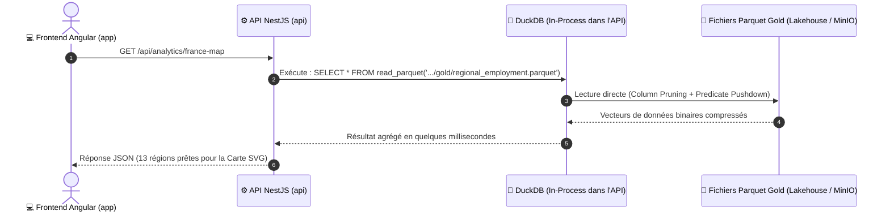

# 🦆 Moteur Analytique DuckDB & Approche Zero-ETL

> **Objectif pédagogique de ce chapitre :** Comprendre pourquoi une base de données classique (comme PostgreSQL) ne suffit plus lorsqu'on analyse des centaines de milliers d'offres d'emploi, comment fonctionne le format de fichier **Apache Parquet**, et pourquoi **DuckDB** nous permet d'interroger notre Data Lakehouse en quelques millisecondes depuis l'API NestJS sans dupliquer les données (**Zero-ETL**).

---

## 🤔 1. Pourquoi ne pas tout mettre dans PostgreSQL ? (OLTP vs OLAP)

Dans le projet **Data Skills Radar**, nous utilisons déjà **PostgreSQL** (avec Prisma) dans `data-skills-radar-api` pour gérer les comptes utilisateurs, leurs adresses et leurs rôles (`VISITOR`, `USER`, `ADMIN`).

Alors, pourquoi ne pas aussi stocker toutes les offres d'emploi France Travail et toutes les statistiques URSSAF dans PostgreSQL ?

Parce qu'en informatique décisionnelle (Business Intelligence), il existe **deux mondes aux besoins opposés** :

| Caractéristique | Monde OLTP (*Online Transaction Processing*) | Monde OLAP (*Online Analytical Processing*) |
| :--- | :--- | :--- |
| **Moteur dans notre projet** | 🐘 **PostgreSQL 15** | 🦆 **DuckDB** + 📦 **Apache Parquet** |
| **Usage métier** | Gérer les utilisateurs, connexions, mots de passe | Calculer des moyennes régionales, le score SDSS, filtrer par code NAF |
| **Type de requête typique** | `SELECT * FROM users WHERE id = 'uuid-123'` *(Chercher 1 ligne précise)* | `SELECT code_region, AVG(sdss) FROM offres GROUP BY code_region` *(Lire 2 millions de lignes, mais seulement 2 colonnes)* |
| **Organisation sur le disque** | **Orientée Lignes (*Row-oriented*)** : toutes les colonnes d'un utilisateur sont stockées côte à côte. | **Orientée Colonnes (*Column-oriented*)** : toutes les valeurs d'une même colonne sont regroupées ensemble. |

### L'analogie simple :
* **PostgreSQL (Orienté Lignes)** est comme un **carnet d'adresses** : si tu cherches la fiche de *"Jean Dupont"*, tu ouvres à la bonne page et tu as son nom, son email et son adresse d'un seul coup. En revanche, si on te demande *"Quel est l'âge moyen de tous les habitants de France ?"*, tu es obligé de lire l'intégralité de toutes les pages du carnet !
* **Apache Parquet + DuckDB (Orienté Colonnes)** range toutes les valeurs de la colonne `salaire` ensemble, toutes les valeurs de `code_region` ensemble, etc. Pour calculer une moyenne par région, le moteur ignore 95 % du fichier et ne lit que les 2 colonnes demandées.

---

## 📦 2. Le secret d'Apache Parquet : *Column Pruning* & *Predicate Pushdown*

Dans notre couche **Silver** et **Gold**, nous ne stockons pas nos données en `.csv` ni en `.json`, mais au format **Apache Parquet** (`.parquet`).

Un fichier CSV est « aveugle » : pour trouver les offres d'emploi de la région *Bretagne*, l'ordinateur doit lire le fichier texte de la première à la dernière ligne.

À l'inverse, un fichier **Parquet** est découpé en blocs (**Row Groups**) et à l'intérieur de chaque bloc, les données sont stockées **colonne par colonne** avec un **dictionnaire de statistiques (Min / Max)** intégré dans le pied de page (*Footer*).

Grâce à cette structure, lorsque DuckDB lit un fichier Parquet de la couche **Gold**, il utilise automatiquement deux optimisations majeures :

1. **L'Élagage de Colonnes (*Column Pruning*)** :
   Si ta requête SQL demande `SELECT code_region, avg_sdss`, DuckDB ne charge en mémoire vive (RAM) **que** les octets de ces deux colonnes. Les colonnes lourdes (descriptions d'offres, libellés NAF, etc.) ne sont même pas lues sur le disque.
2. **La Poussée de Prédicats (*Predicate Pushdown*)** :
   Si un utilisateur clique sur la région Bretagne (`WHERE code_region = '53'`), DuckDB regarde d'abord les statistiques `Min/Max` de chaque bloc du fichier Parquet. Si un bloc indique `Min = 75, Max = 93`, DuckDB **saute le bloc entier** sans même le décompresser !

---

## 🦆 3. Qu'est-ce que DuckDB (« Le SQLite de l'Analytique ») ?

Traditionnellement, pour interroger de gros volumes de données analytiques, il fallait installer et administrer un serveur lourd fonctionnant en permanence (Snowflake, ClickHouse, cluster Spark, etc.).

**DuckDB** révolutionne cette approche :
* **Moteur *In-Process* (Embarqué)** : Comme SQLite, DuckDB n'est pas un serveur externe qu'on installe à part. C'est une simple librairie (`npm install duckdb`) qui tourne **directement à l'intérieur du processus Node.js de notre API NestJS** (`data-skills-radar-api`).
* **Exécution Vectorisée (SIMD)** : Au lieu de traiter les données ligne par ligne (comme PostgreSQL), le moteur C++ de DuckDB traite les données par **vecteurs de 1024 ou 2048 valeurs à la fois** directement dans le cache du processeur (CPU).
* **Zone de pertinence (*Sweet Spot*)** : Comme étudié dans nos cours (*Scaling DuckDB to Spark*), tant que la donnée agrégée (couche Gold) pèse entre **quelques Mo et 500 Go**, un moteur *Scale-Up* comme DuckDB surpasse un cluster Spark distribué car il n'a aucun coût de communication réseau (*Zero Network Overhead*) ni de temps de démarrage de JVM.

---

## ⚡ 4. L'Architecture « Zero-ETL » dans Data Skills Radar

En entreprise, le terme **ETL** (*Extract, Transform, Load*) désigne souvent une étape coûteuse où l'on doit copier les données du Data Lake vers une base de données SQL pour que l'API puisse les lire.

Avec notre approche **Zero-ETL**, nous supprimons cette copie inutile :

### Ce qu'il faut retenir pour notre code :
1. **Le Lakehouse (`data-skills-radar-lakehouse`)** fait le travail lourd en amont (Python / PySpark) : il interroge l'URSSAF et France Travail, nettoie les données et produit des fichiers `.parquet` propres dans la couche **Gold**.
2. **L'API (`data-skills-radar-api`)** n'a **aucune table analytique dans PostgreSQL**. Son service `DuckDbService` exécute directement des requêtes SQL sur les fichiers `.parquet` de la couche **Gold**.
3. **Le Frontend (`data-skills-radar-app`)** reçoit un JSON ultra-rapide et léger, prêt à colorer la **Carte de France SVG** ou les graphiques décisionnels.
