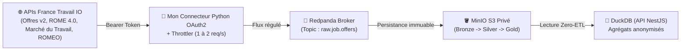

# 🔑 Stratégie & Gouvernance des APIs France Travail (Variable Indépendante $X$)

> **Objectif de ce chapitre :** Documenter ma stratégie d'acquisition des données du marché de l'emploi français via le portail officiel **[francetravail.io](https://francetravail.io/)**, l'accréditation institutionnelle obtenue auprès de la **Direction Générale Adjointe France Travail Tech**, mes engagements de gouvernance (limitation de débit, souveraineté MinIO, conformité IA) et la cartographie des APIs qui alimentent la **Variable Indépendante ($X$)** de mon Système d'Information Décisionnel.

---

## 🗺️ 1. Vision Globale de mon Architecture d'Ingestion & de Traitement

Pour exploiter les flux de France Travail sans saturer les serveurs institutionnels ni alourdir mon backend applicatif, mon Data Lakehouse (`data-skills-radar-lakehouse`) s'appuie sur une stack moderne, légère et orientée haute performance (*LOAD Stack*) :

*   **Ingestion & Streaming Temps Réel :** **Redpanda** (alternative moderne à Apache Kafka écrite en C++, sans JVM, compatible à 100 % avec l'API Kafka) couplé à **Redpanda Console** (`http://localhost:8080`) pour le monitoring visuel de mon topic `raw.job.offers`.
*   **Stockage Objet Souverain (Lakehouse) :** **MinIO** (`http://localhost:9001`, compatible AWS S3) hébergé en privé et structuré selon mon **[Architecture Medallion (Bronze, Silver, Gold)](docs/lakehouse/04.architecture_medallion)**.
*   **Format de Table Transactionnel :** **Apache Iceberg / Apache Parquet** posé sur mes couches **Silver** et **Gold** pour garantir des opérations ACID, du *Time Travel* et une lecture colonnaire ultra-rapide.
*   **Traitement Distribué & NLP :** **PySpark / Python** (nettoyage, déduplication, qualification des compétences et calcul du **Score de Densité *Soft Skills* — SDSS**).
*   **Moteur Analytique (OLAP Zero-ETL) :** **[DuckDB](docs/lakehouse/05.duckdb_zero_etl)** exécuté *in-process* au sein de mon API NestJS pour requêter directement les tables de la couche **Gold**.



---

## 🏛️ 2. Statut des Accès APIs & Gouvernance Institutionnelle

### 2.1. Statut Actuel : Accord Officiel Obtenu ✅

Contrairement aux APIs de nomenclatures ouvertes par défaut, l'accès à l'API **Offres d'emploi v2** fait l'objet d'un contrôle d'usage par France Travail. J'ai donc déposé une demande officielle d'accréditation académique qui a été **instruite et validée par la Direction Générale Adjointe France Travail Tech (Direction SI Plateforme / Département IPAP)** pour mon application :

*   **Nom de l'application recensée :** `DataSkillsRadar`
*   **URL déclarée :** `https://dataskills.thomasnoel.dev`
*   **Cadre d'accréditation :** Projet de recherche académique — Master 2 Big Data & Architecture Logicielle (ESN81 - Bloc BC05).
*   **Périmètre accordé :** Consultation et extraction des offres d'emploi actives pour analyse sémantique (NLP), modélisation Lakehouse et restitution sous forme d'agrégats statistiques anonymisés.

### 2.2. Mes Engagements de Gouvernance & Traduction Technique

Pour respecter scrupuleusement le cadre fixé par la Direction Générale Adjointe France Travail Tech lors de l'ouverture de mes droits, j'ai traduit chaque exigence réglementaire en contrainte technique dans mon code :

1.  **Respect strict des quotas & *Throttling* (`1 à 2 req/s`) :**
    Bien que le plafond technique de l'API *Offres d'emploi v2* tolère généralement de 3 à 10 appels par seconde, j'ai intégré un **limiteur de débit (*Throttler*)** dans mon producteur Python Redpanda bridant volontairement mes appels entre **1 et 2 requêtes par seconde**.
2.  **Conservation sécurisée & Anonymisation :**
    Les payloads JSON bruts des offres (`Bronze`) sont stockés exclusivement sur mon instance **MinIO S3 privée** (jamais exposée publiquement). Seuls les indicateurs statistiques agrégés par région et par code NAF (`Gold`) sont interrogés par DuckDB et transmis au frontend Angular.
3.  **Absence de finalité commerciale & Traçabilité de l'IA :**
    Le traitement algorithmique et NLP appliqué aux offres demeure circonscrit à l'évaluation scientifique de mes deux hypothèses de recherche (calcul du score SDSS et corrélation avec les effectifs URSSAF). Toute évolution majeure de finalité, de volumétrie ou de modalité de diffusion fera l'objet d'une notification préalable via le portail [francetravail.io/contact](https://francetravail.io/contact).

### 2.3. Ressources Institutionnelles Complémentaires Recommandées

Suite aux recommandations de la Direction SI Plateforme de France Travail, j'enrichis également mon socle de données avec :
*   L'API **Marché du Travail** (accessible via le filtre *« Statistiques »* du catalogue `francetravail.io`).
*   Les publications statistiques officielles de France Travail : **[statistiques.francetravail.org/offres/publication](https://statistiques.francetravail.org/offres/publication)**.

---

## 🔐 3. Configuration Technique OAuth2 (`client_credentials`)

L'authentification auprès des serveurs de France Travail repose sur le flux **OAuth2 `client_credentials`**.

### 3.1. Paramètres d'Authentification de mon Application `DataSkillsRadar`

*   **Identifiant Client (`FRANCETRAVAIL_CLIENT_ID`) :** `PAR_dataskillsradar_...` *(stocké dans mon fichier `.env` non versionné et dans HashiCorp Vault)*.
*   **Clé Secrète (`FRANCETRAVAIL_CLIENT_SECRET`) :** Associée à mon application `DataSkillsRadar`.
*   **Endpoint d'obtention du jeton Bearer (`POST`) :**
    ```text
    https://entreprise.francetravail.fr/connexion/oauth2/access_token?realm=%2Fpartenaire
    ```
    *(Le paramètre `?realm=%2Fpartenaire` est impératif pour les comptes partenaires).*
*   **En-tête HTTP :** `Content-Type: application/x-www-form-urlencoded`
*   **Durée de validité du jeton (`expires_in`) :** `1499` secondes (~25 minutes). Mon connecteur Python gère automatiquement le rafraîchissement du jeton avant son expiration.

### 3.2. Tableau des Scopes OAuth2 par API Souscrite

| API France Travail Souscrite | Version | Scope OAuth2 à transmettre | Statut sur `DataSkillsRadar` |
| :--- | :---: | :--- | :---: |
| **Offres d'emploi** | `v2` | `o2dsoffre api_offresdemploiv2` | ✅ Accord Officiel Actif |
| **Marché du travail** | `v1` | `api_stats-offres-demandes-emploiv1 offredemandeemploi` | ✅ Actif |
| **ROME 4.0 — Compétences** | `v1` | `api_rome-competencesv1 nomenclatureRome` | ✅ Actif |
| **ROME 4.0 — Métiers** | `v1` | `api_rome-metiersv1 nomenclatureRome` | ✅ Actif |
| **ROME 4.0 — Fiches métiers** | `v1` | `api_rome-fiches-metiersv1 nomenclatureRome` | ✅ Actif |
| **ROME 4.0 — Contextes de travail** | `v1` | `api_rome-contextes-travailv1 nomenclatureRome` | ✅ Actif |
| **ROMEO (IA Rapprochement)** | `v2` | `api_romeov2` | ✅ Actif |
| **Informations sur un territoire** | `v1` | `api_informations-territoirev1 infoterritoire` | ✅ Actif |
| **Accès à l'emploi des demandeurs** | `v1` | `api_acces-emploiv1 accesemploi` | ✅ Actif |

---

## 🚀 4. Audit & Stratégie d'Intégration des APIs France Travail

J'ai classé l'ensemble des APIs du catalogue `francetravail.io` en **3 niveaux de priorité** au regard des objectifs de mon application (veille des compétences, analyse de la mutation des emplois par code NAF et cartographie prédictive) et de mes **[Énumérations Dynamiques](docs/frontend/07.referentiels_et_enums)**.

### Niveau 1 — Mes APIs ESSENTIELLES (Socle du Réacteur de Données)

Ces APIs constituent le cœur de mon pipeline. Sans elles, je ne peux pas alimenter mes couches **Bronze**, **Silver** et **Gold** :

1.  **Offres d'emploi (`v2`)**
    *   **Pourquoi je l'utilise :** C'est mon flux primaire d'observation empirique du marché du travail. Chaque offre contient l'intitulé, la description complète, le code NAF (`secteurActivite`), la localisation (`lieuTravail`), les compétences techniques (`competences`) et les qualités humaines (`qualitesProfessionnelles`). De plus, ses agrégations natives (`filtresPossibles`) et son en-tête `Content-Range` me donnent instantanément le volume d'offres par région et par secteur.
    *   **Usage dans mon Lakehouse :** Ingestion continue vers la couche **Bronze** via le topic Redpanda `raw.job.offers`, puis calcul du **Score SDSS** en couche **Silver**.
2.  **ROME 4.0 — Compétences (`v1`) & ROME 4.0 — Métiers (`v1`)**
    *   **Pourquoi je les utilise :** Ce sont les dictionnaires officiels de référence en France. Ils me permettent de structurer mon énumération `CategorieCompetence` (`TECHNIQUE`, `COMPORTEMENTALE`, `OUTIL`, `CERTIFICATION`) et de relier chaque compétence extraite des annonces à la nomenclature officielle ROME 4.0 (distinction rigoureuse entre *Savoir-faire* et *Savoir-être professionnels*).
    *   **Usage dans mon Lakehouse :** Alimentation initiale de mes tables de dimensions en couche **Silver / Gold** et synchronisation avec les référentiels de l'application.
3.  **ROME 4.0 — Fiches métiers (`v1`) & ROME 4.0 — Contextes de travail (`v1`)**
    *   **Pourquoi je les utilise :** Indispensables pour qualifier la nature des tâches exercées dans un métier (modèle économique *Task-Based* d'Autor-Levy-Murnane : tâche cognitive complexe vs cognitive routinière ou manuelle).
    *   **Usage dans mon Lakehouse :** Alimentation de mon énumération `TypeTache` (`COGNITIVE_ROUTINIERE`, `COGNITIVE_COMPLEXE`, `MANUELLE_ROUTINIERE`, `MANUELLE_COMPLEXE`) et enrichissement de la matrice d'exposition à l'IA (`NiveauImpactIA`).
4.  **Marché du travail (`v1`)** *(Recommandée par France Travail Tech)*
    *   **Pourquoi je l'utilise :** Fournit les séries statistiques officielles sur la tension de recrutement, les offres collectées et les demandes d'emploi par bassin et par métier.
    *   **Usage dans mon Lakehouse :** Cœur de mon module **Indicateurs Macro** et validation croisée de la tension affichée sur ma **Carte de France**.

---

### Niveau 2 — Mes APIs STRATÉGIQUES (Valeur « Premium » & Enrichissement IA)

Ces APIs apportent toute la valeur ajoutée **Premium (Abonnés `USER`)** à mon application en croisant l'offre d'emploi brute avec des indicateurs territoriaux et l'IA sémantique de France Travail :

1.  **ROMEO (`v2`) — Intelligence Artificielle & Rapprochement de texte**
    *   **Pourquoi je l'utilise :** C'est l'API d'Intelligence Artificielle officielle de France Travail conçue pour rapprocher un texte libre d'une appellation métier ou d'un savoir/savoir-faire ROME.
    *   **Usage dans mon Lakehouse :** Plutôt que de dépendre uniquement d'un parseur NLP maison en Python, je peux déléguer ou croiser l'extraction et la normalisation des compétences textuelles des offres directement avec cet endpoint NLP officiel.
2.  **Informations sur un territoire (`v1`)**
    *   **Pourquoi je l'utilise :** Fournit un portrait socio-économique complet et un indicateur de dynamisme du territoire.
    *   **Usage dans mon Lakehouse :** Alimente mes analyses croisées dans le module **Data Lab** et enrichit la cartographie des régions les plus résilientes face à la mutation des compétences.
3.  **Accès à l'emploi des demandeurs d'emploi (`v1`)**
    *   **Pourquoi je l'utilise :** Permet de mesurer le taux d'accès réel à l'emploi par métier recherché et par territoire.
    *   **Usage dans mon Lakehouse :** Me permet de calculer objectivement mon énumération prédictive `TendanceEmploi` (`EN_CROISSANCE`, `EN_DECLIN`, `EN_MUTATION`, `STABLE`).

---

### Niveau 3 — APIs SECONDAIRES / FUTURES (Écartées du périmètre initial)

Par souci de focalisation architecturale (*KISS / YAGNI*), j'ai volontairement écarté du périmètre initial les APIs suivantes après audit :

*   **La Bonne Boîte (`v2`) :** Cible les entreprises à fort potentiel d'embauche en candidature spontanée (*marché caché*). Pertinent uniquement si j'oriente plus tard la plateforme vers la prospection candidat.
*   **Anotéa (`v1`) & Open Formation (`v1`) :** Catalogue des formations et avis stagiaires. Pourra servir dans une évolution future pour un module de recommandation de reconversion (*« Offre en déclin $\rightarrow$ Formation recommandée »*).
*   **Je Contrôle Mon Offre — JCMO (`v1`) :** Outil de vérification de conformité légale destiné aux rédacteurs d'annonces. Hors périmètre analytique.
*   **Référentiel des agences (`v1`) & Mes évènements emploi (`v1`) :** Géolocalisation des agences physiques et salons. Trop éloigné de mon cœur décisionnel Data & Skills.
*   **Synthèse Pages employeurs (`v1`) :** Widgets orientés marque employeur, non prioritaires pour l'analyse macro-économique.
