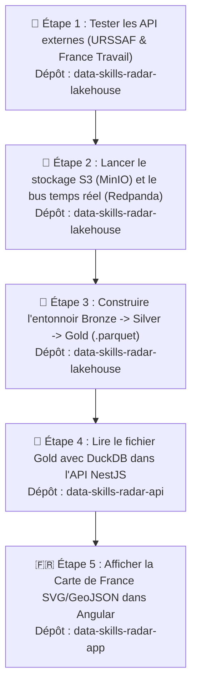
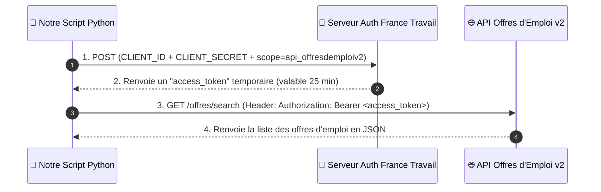
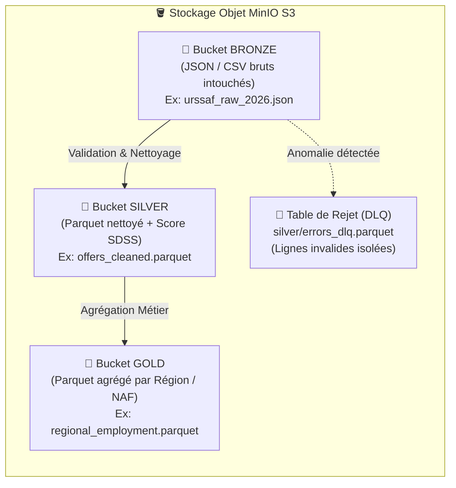
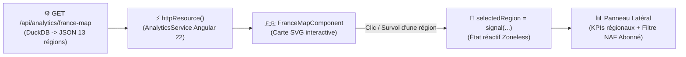

# 🧭 Guide Pratique Étape par Étape : Du Lakehouse à la Carte de France

> **Objectif pédagogique de ce guide :** Ce document est notre **fil conducteur d'apprentissage et de développement**. Plutôt que de coder à l'aveugle, nous suivons une démarche **Bottom-Up (de la source de données jusqu'à l'écran utilisateur)** en **5 étapes progressives**.
> À chaque étape, tu trouveras :
> 1. **🎯 Pourquoi on fait cette étape ?** (Le rôle dans l'architecture)
> 2. **🧠 Le lien avec tes cours** (Les concepts théoriques mobilisés)
> 3. **🛠️ Ce qu'on construit concrètement** (Explications simples et code commenté)
> 4. **🧪 Comment tester et voir le résultat de tes propres yeux** avant de passer à l'étape suivante.

---

## 🗺️ Vue d'ensemble des 5 Étapes

Pourquoi commencer par le **Lakehouse** avant de coder la **Carte de France** dans Angular ?
Parce qu'une carte sans données réelles nous obligerait à inventer du faux code deux fois. En suivant l'ordre ci-dessous, chaque étape nourrit directement la suivante :

---

## 🧪 Étape 1 : Tester et comprendre nos API externes (URSSAF & France Travail)

### 🎯 1.1. Pourquoi fait-on cette étape en premier ?
Avant d'installer Docker, MinIO ou PySpark, un ingénieur Data commence toujours par **vérifier ce que renvoient les sources de données**. Cela permet de voir la structure exacte du JSON renvoyé par l'État (URSSAF et France Travail) et de vérifier que nos appels réseau fonctionnent.

### 🧠 1.2. Deux types d'API à connaître
Dans notre projet, nous interrogeons deux API publiques françaises qui fonctionnent différemment :

| Source | Rôle métier dans Data Skills Radar | Type d'accès | Comment la tester ? |
| :--- | :--- | :--- | :--- |
| **API Open Data URSSAF** (`open.urssaf.fr`) | Récupérer les **effectifs salariés** et la **masse salariale** par région et secteur NAF (notre *Variable Dépendante Y* : la santé économique réelle). | **100 % Ouverte (Sans clé API)** | Directement dans le navigateur ou avec 10 lignes de Python (`requests.get`). |
| **API France Travail v2** (`api.francetravail.io`) | Récupérer en continu les **offres d'emploi** et leurs descriptions textuelles pour calculer le **Score SDSS** (notre *Variable Indépendante X*). | **Protégée par OAuth2 (`client_credentials`)** | Nécessite un `CLIENT_ID` et un `CLIENT_SECRET` gratuits créés sur [francetravail.io](https://francetravail.io/). |

### 🛠️ 1.3. Comment fonctionne l'appel à l'API URSSAF ?
L'URSSAF utilise la plateforme *Opendatasoft* (API v2.1). On peut l'interroger directement via une simple URL HTTP `GET`.

👉 **Test immédiat dans ton navigateur (sans écrire une seule ligne de code) :**
Clique ou colle cette URL dans ton navigateur :
`https://open.urssaf.fr/api/explore/v2.1/catalog/datasets?limit=5`
Tu verras immédiatement le JSON officiel de l'URSSAF s'afficher !

### 🛠️ 1.4. Comment fonctionne l'authentification OAuth2 de France Travail ?
Contrairement à l'URSSAF, France Travail protège son API contre les abus grâce au protocole **OAuth2 (`client_credentials`)** en **2 temps** :

### 🧪 1.5. Comment nous allons tester l'Étape 1 dans `data-skills-radar-lakehouse` :
Nous allons créer un premier petit script pédagogique `src/ingestion/test_apis.py` que tu lanceras dans ton terminal :
* Il appellera **l'API URSSAF en direct** et t'affichera les effectifs par région dans la console.
* Si tu as renseigné tes clés France Travail dans `.env`, il testera ton jeton OAuth2 et affichera 5 vraies offres d'emploi. Sinon, il te préviendra clairement et utilisera un échantillon d'offres réaliste pour ne jamais te bloquer dans ton apprentissage.

---

## 🐳 Étape 2 : Allumer l'infrastructure locale du Lakehouse (`MinIO` & `Redpanda`)

### 🎯 2.1. Pourquoi a-t-on besoin de MinIO et Redpanda ?
Une fois que notre script Python sait récupérer les données de l'URSSAF et de France Travail, **où doit-il les déposer ?**
* Si on les enregistre simplement dans un dossier Windows `C:\MesFichiers`, notre architecture ne ressemble pas à un vrai Cloud Big Data.
* Grâce à **Docker Compose**, nous allons lancer sur ton PC deux briques industrielles légères :
  1. **🪣 MinIO (Stockage Objet S3)** : C'est l'équivalent 100 % compatible et gratuit d'**Amazon S3** qui tourne sur ton PC. Il possède une interface web très visuelle (`http://localhost:9001`) dans laquelle nous verrons nos 3 compartiments (*Buckets*) : **`bronze`**, **`silver`** et **`gold`**.
  2. **🦝 Redpanda (Streaming d'événements)** : Comme vu dans tes cours (*Streaming Data Architecture* & *Évolution du Data Streaming*), Redpanda est le remplaçant moderne d'**Apache Kafka** écrit en C++ (sans machine virtuelle Java lourde). C'est un « tapis roulant » temps réel : le bot France Travail dépose chaque nouvelle offre sur le tapis roulant (`topic: job-offers-raw`) avec une garantie d'écriture (`acks=all`).

### 🧪 2.2. Comment tester et voir le résultat de tes propres yeux ?
Une fois le fichier `docker-compose.yml` lancé avec `docker compose up -d` :
1. Tu ouvres **`http://localhost:9001`** dans ton navigateur : tu te connectes à la console **MinIO** et tu vois visuellement tes 3 buckets **`bronze`**, **`silver`** et **`gold`** déjà créés !
2. Tu ouvres **`http://localhost:8080`** dans ton navigateur : tu accèdes à la **Redpanda Console** où tu peux voir les messages JSON des offres d'emploi défiler en direct.

---

## 🥇 Étape 3 : Construire le Pipeline Médaillon (`Bronze` $\rightarrow$ `Silver` $\rightarrow$ `Gold`)

### 🎯 3.1. Pourquoi découper le traitement en 3 couches (Bronze, Silver, Gold) ?
C'est le cœur de ton cours sur l'**Architecture BI Moderne et Big Data**. Si un script télécharge une donnée et la modifie directement avant de l'enregistrer, la donnée d'origine est perdue à jamais. Avec les 3 couches dans MinIO :

### 🧠 3.2. Les concepts de tes cours que nous appliquons ici :
1. **Programmation fonctionnelle pure** (*Cours `01. Programmation-fonctionnelle.pdf`*) : Nos fonctions de transformation prennent des données en entrée et renvoient de nouvelles données nettoyées sans modifier l'état global (pas d'effets de bord), ce qui garantit que le traitement est **idempotent** (si on le relance 10 fois, on obtient exactement le même résultat).
2. **Contrôle Qualité & Dead-Letter Queue (`errors_dlq`)** (*Cours `01. Architecture_BI_Moderne_et_Big_Data.pdf`*) : En passant de **Bronze** à **Silver**, si une offre d'emploi n'a pas de code région valide ou si une ligne URSSAF a un effectif négatif, **le pipeline ne plante pas** ! La ligne défectueuse est isolée dans `silver/errors_dlq.parquet` avec le motif du rejet, et seules les données 100 % saines entrent dans **Silver**.
3. **Calcul du Score de Densité "Soft Skills" (SDSS)** :
   Pour chaque offre et chaque secteur dans **Silver**, nous comptons les occurrences de compétences humaines (*Soft Skills* : pensée critique, coordination, éthique, négociation, adaptation...) et de compétences techniques d'exécution (*Hard Skills* routiniers), puis nous calculons :
   $$\text{SDSS} = \frac{\text{Volume Soft Skills}}{\max(1, \text{Volume Hard Skills})}$$
4. **Création du fichier Gold `regional_employment.parquet`** :
   En couche **Gold**, nous regroupons toutes les données par **Région administrative française (les 13 régions métropolitaines, codes INSEE `11`, `24`, `27`, `28`, `32`, `44`, `52`, `53`, `75`, `76`, `84`, `93`, `94`)**.

### 📋 3.3. Le schéma exact du fichier Gold `regional_employment.parquet`
Voici les colonnes exactes que contiendra notre fichier Gold (c'est ce contrat qui relie le Lakehouse, l'API et le Frontend Angular) :

| Nom de la colonne | Type Parquet | Exemple | Description métier |
| :--- | :--- | :--- | :--- |
| `code_region` | `VARCHAR` | `"84"` | Code officiel INSEE de la région (ex: `84` = Auvergne-Rhône-Alpes) |
| `nom_region` | `VARCHAR` | `"Auvergne-Rhône-Alpes"` | Nom lisible de la région |
| `total_offres` | `INTEGER` | `42850` | Volume d'offres d'emploi analysées (France Travail) |
| `effectifs_salaries` | `INTEGER` | `2840000` | Effectifs salariés totaux dans la région (Source URSSAF) |
| `evolution_effectifs_pct` | `DOUBLE` | `+1.4` | Évolution annuelle nette de l'emploi salarié en % (URSSAF) |
| `score_exposition_ia` | `DOUBLE` | `0.64` | Score moyen d'exposition à l'IA générative (de `0.0` à `1.0`) |
| `score_sdss_moyen` | `DOUBLE` | `1.18` | Score de Densité *Soft Skills* moyen de la région |
| `niveau_tension_ia` | `VARCHAR` | `"MOYEN"` | Criticité calculée : `"FAIBLE"`, `"MOYEN"` ou `"FORT"` |
| `top_secteur_naf` | `VARCHAR` | `"62.01Z - Programmation informatique"` | Secteur NAF le plus représenté dans la région |

### 🧪 3.4. Comment tester le fichier Gold avant même de toucher à l'API ?
Nous lancerons le script `python src/processing/build_gold_marts.py` :
* Il affichera directement dans ton terminal un tableau récapitulatif des **13 régions françaises** lues depuis le fichier `.parquet` généré !
* Tu verras aussi le fichier `regional_employment.parquet` apparaître dans le bucket **`gold`** sur ton interface web MinIO (`http://localhost:9001`).

---

## 🦆 Étape 4 : Connecter `DuckDB` dans `data-skills-radar-api` (NestJS)

### 🎯 4.1. Pourquoi cette étape est-elle magique ?
Ton dépôt `data-skills-radar-api` a déjà la librairie `"duckdb": "^1.4.4"` installée dans son `package.json` !
Il ne nous reste plus qu'à créer un module `AnalyticsModule` dans NestJS qui utilise DuckDB pour lire le fichier `regional_employment.parquet` généré à l'Étape 3.

### 🛠️ 4.2. Ce que nous allons créer dans `data-skills-radar-api` :
1. **`src/modules/analytics/duckdb.service.ts`** :
   Un service NestJS qui ouvre une instance DuckDB en mémoire (`:memory:`), configure la connexion S3 vers MinIO (ou lit le fichier Parquet local partagé) et exécute des requêtes SQL analytiques ultra-rapides.
2. **`src/modules/analytics/analytics.controller.ts`** :
   Deux routes REST sécurisées selon notre modèle Freemium RBAC :
   * **`GET /api/analytics/france-map`** *(décoré avec `@Public()`)* : Accessible aux visiteurs (`VISITOR`) comme aux abonnés. Renvoie les indicateurs des 13 régions françaises pour colorer la Carte de France et alimenter les 3 cartes KPI du Tableau de bord.
   * **`GET /api/analytics/regions/:code/naf`** *(décoré avec `@Roles(Role.USER, Role.ADMIN)`)* : Réservé aux abonnés et administrateurs. Renvoie le détail par secteur d'activité (**Code NAF**), le score SDSS et les statistiques de distribution (Médiane, Quartiles Q1/Q3 pour les boîtes à moustaches) de la région sélectionnée.

### 🧪 4.3. Comment tester l'API toi-même ?
Une fois l'API NestJS lancée (`npm run start:dev`) :
* Tu ouvres simplement ton navigateur sur **`http://localhost:3000/api/analytics/france-map`** (ou via Swagger sur `http://localhost:3000/docs`).
* Tu vois le JSON des 13 régions françaises arriver en moins de **15 millisecondes**, lu directement depuis le fichier Parquet par DuckDB !

---

## 🇫🇷 Étape 5 : Créer la Carte de France SVG/GeoJSON dans `data-skills-radar-app` (Angular)

### 🎯 5.1. Pourquoi une Carte de France SVG native dans Angular ?
Maintenant que `http://localhost:3000/api/analytics/france-map` renvoie nos vraies données régionales issues du Lakehouse, construire la Carte de France dans Angular devient un plaisir :
* Pas besoin d'inventer de fausses données.
* En utilisant un composant **SVG / GeoJSON natif Angular**, chaque région de France est un élément `<path>` vectoriel que nous pouvons colorer dynamiquement avec nos variables CSS **Electric Teal (`#14b8a6`)** en Light Mode et **Cyber Amber (`#f59e0b`)** en Dark Mode.

### 🛠️ 5.2. Comment les données circulent dans le composant Angular :

1. **Chargement réactif sans `ngOnInit`** : Conformément à notre architecture Angular 22 Zoneless, `AnalyticsService` utilise `httpResource()` pour appeler `/api/analytics/france-map`.
2. **Coloration dynamique (Choroplèthe)** : Plus une région a un score d'exposition IA ou de tension élevé, plus sa teinte *Teal* (ou *Amber* en mode sombre) est intense.
3. **Interactivité & Modèle Freemium (`VISITOR` vs `USER`)** :
   * Quand un **Visiteur (`VISITOR`)** survole ou clique sur une région (ex: *Île-de-France* ou *Auvergne-Rhône-Alpes*), il voit les indicateurs macro de la région (volume d'offres, effectifs salariés URSSAF, score SDSS moyen).
   * S'il tente d'ouvrir le détail par secteur **Code NAF**, un bandeau élégant lui propose de passer au grade **Abonné (`USER`)** (tandis qu'un compte `USER` ou `ADMIN` voit immédiatement le détail sectoriel renvoyé par `GET /api/analytics/regions/:code/naf`).

---

## ✅ Récapitulatif : Par quoi commence-t-on maintenant ?

Pour garder un rythme d'apprentissage clair et maîtrisé, nous allons avancer **une seule étape à la fois** :

- [ ] **Palier 1 (Maintenant)** : Créer les scripts de l'**Étape 1 & 2** dans `data-skills-radar-lakehouse` pour tester ensemble l'API URSSAF et l'API France Travail et voir nos premiers fichiers arriver dans MinIO.
- [ ] **Palier 2** : Générer le fichier `gold/regional_employment.parquet` (**Étape 3**).
- [ ] **Palier 3** : Créer l'endpoint DuckDB `GET /analytics/france-map` dans `data-skills-radar-api` (**Étape 4**).
- [ ] **Palier 4** : Intégrer la Carte de France SVG interactive dans `data-skills-radar-app` (**Étape 5**).
