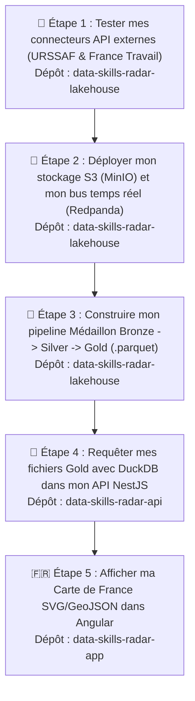
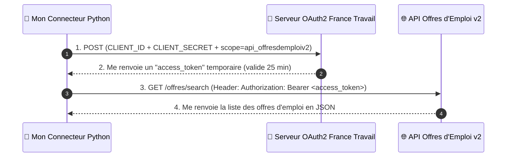
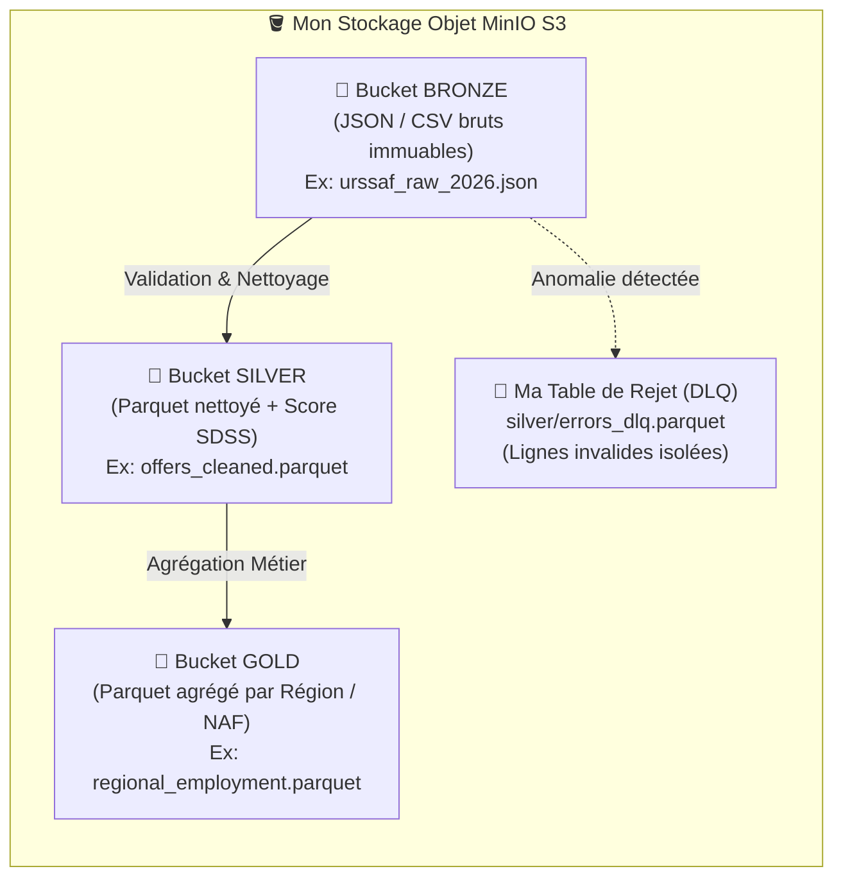
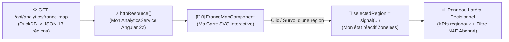

# 🧭 Mon Guide de Développement Étape par Étape : Du Lakehouse à la Carte de France

> **Objectif de ce document :** Ce chapitre constitue mon **carnet de route méthodologique et technique**. Pour construire la chaîne décisionnelle complète de **Data Skills Radar** sans dette technique ni données fictives jetables, j'ai adopté une démarche **Bottom-Up (de la source de données brute jusqu'à l'interface utilisateur)** découpée en **5 étapes progressives**.
>
> Pour chacune de mes étapes, je documente :
> 1. **🎯 Pourquoi je réalise cette étape à ce moment précis** (Son rôle dans mon architecture)
> 2. **🧠 Les concepts théoriques que je mobilise** (Le lien direct avec mes cours d'ingénierie Big Data)
> 3. **🛠️ Ce que je construis concrètement** (Mes choix d'implémentation et contrats de données)
> 4. **🧪 Mon protocole de test et de validation visuelle** avant de passer à l'étape suivante.

---

## 🗺️ Vue d'ensemble de ma démarche en 5 Étapes

Pourquoi ai-je choisi de développer mon **Lakehouse** avant de coder ma **Carte de France** dans Angular ?
Parce que développer un composant cartographique sans données réelles m'obligerait à coder des bouchons temporaires (*mocks*) qui ne refléteraient pas la structure exacte de mes sources officielles. En suivant l'ordre séquentiel ci-dessous, chaque brique que je valide alimente directement la suivante :

---

## 🧪 Étape 1 : Tester et valider mes API externes (URSSAF & France Travail)

### 🎯 1.1. Pourquoi je commence par cette étape ?
Avant même d'orchestrer mes conteneurs Docker (MinIO, Redpanda) ou mes traitements PySpark, ma première responsabilité d'ingénieur Data consiste à **qualifier mes sources de données**. Je dois vérifier la disponibilité des API de l'État, inspecter la structure exacte des payloads JSON renvoyés et valider mes mécanismes d'authentification.

### 🧠 1.2. Mes deux sources API principales et leurs protocoles d'accès
Dans mon architecture, j'interroge deux API publiques françaises aux fonctionnements distincts :

| Source de données | Rôle métier dans mon SID | Mode d'authentification | Ma méthode de vérification |
| :--- | :--- | :--- | :--- |
| **API Open Data URSSAF** (`open.urssaf.fr`) | Récupérer les **effectifs salariés** et la **masse salariale** par région et secteur NAF (ma *Variable Dépendante Y* : la santé économique réelle). | **100 % Ouverte (Sans clé API)** | Appel HTTP `GET` direct dans mon navigateur ou via un script Python (`requests.get`). |
| **API France Travail v2** (`api.francetravail.io`) | Récupérer en flux les **offres d'emploi** et leurs descriptions textuelles afin de calculer mon **Score SDSS** (ma *Variable Indépendante X*). | **Protégée par OAuth2 (`client_credentials`)** | Échange de mes identifiants `CLIENT_ID` et `CLIENT_SECRET` (portail [francetravail.io](https://francetravail.io/)) contre un jeton Bearer. |

### 🛠️ 1.3. Fonctionnement de mon appel à l'API URSSAF
L'URSSAF expose ses jeux de données via l'API *Opendatasoft Explore v2.1*. Je peux donc interroger le catalogue et récupérer les enregistrements par une simple requête HTTP `GET`.

👉 **Vérification rapide que j'effectue dans mon navigateur :**
En ouvrant directement l'URL suivante :
`https://open.urssaf.fr/api/explore/v2.1/catalog/datasets?limit=5`
J'obtiens immédiatement la réponse JSON officielle de l'URSSAF, ce qui me permet de valider la connectivité réseau sans aucune configuration préalable.

### 🛠️ 1.4. Fonctionnement du flux OAuth2 pour l'API France Travail v2
Contrairement à l'URSSAF, France Travail sécurise ses endpoints par le protocole **OAuth2 (`client_credentials`)**. Mon connecteur Python doit donc exécuter une cinématique en **2 temps** :

### 🧪 1.5. Mon protocole de test pour l'Étape 1 (`data-skills-radar-lakehouse`)
Je mets en place un script dédié `src/ingestion/test_apis.py` que j'exécute depuis mon terminal :
* Il interroge **l'API URSSAF en direct** et affiche dans ma console un résumé des effectifs salariés par région.
* Si mes clés France Travail sont renseignées dans mon fichier `.env`, il génère le jeton OAuth2 et récupère un échantillon réel d'offres d'emploi. En l'absence de clés configurées (mode hors-ligne ou environnement de test), mon script bascule proprement sur un jeu d'offres réaliste afin de ne jamais bloquer l'exécution de mon pipeline aval.

---

## 🐳 Étape 2 : Déployer mon infrastructure locale du Lakehouse (`MinIO` & `Redpanda`)

### 🎯 2.1. Pourquoi j'utilise MinIO et Redpanda plutôt que de simples fichiers locaux ?
Une fois que mes scripts Python récupèrent les données de l'URSSAF et de France Travail, je dois les stocker et les transporter selon les standards d'une architecture Big Data industrielle (*LOAD Stack*).
Grâce à **Docker Compose**, je déploie localement deux briques fondamentales :
1. **🪣 MinIO (Stockage Objet compatible S3)** : Il reproduit à l'identique le comportement d'**Amazon S3** sur ma machine. Il m'offre une console d'administration web (`http://localhost:9001`) dans laquelle j'organise mes 3 compartiments (*Buckets*) : **`bronze`**, **`silver`** et **`gold`**.
2. **🦝 Redpanda (Streaming d'événements)** : Pour la collecte temps réel des offres d'emploi France Travail, j'utilise Redpanda en remplacement d'Apache Kafka. Écrit en C++ (architecture *thread-per-core* Seastar sans JVM), il consomme beaucoup moins de mémoire vive tout en conservant une compatibilité 100 % native avec le protocole Kafka (gestion des *Offsets*, partitionnement par hachage *Murmur2* et garantie d'écriture `acks=all`).

### 🧪 2.2. Mon protocole de vérification visuelle pour l'Étape 2
Après avoir démarré mon infrastructure via `docker compose up -d` :
1. J'accède à **`http://localhost:9001`** dans mon navigateur : je me connecte à ma console **MinIO** et je vérifie que mon conteneur d'initialisation (`minio-init`) a bien créé automatiquement mes 3 buckets **`bronze`**, **`silver`** et **`gold`**.
2. J'accède à **`http://localhost:8080`** : j'ouvre ma **Redpanda Console** pour inspecter visuellement mes topics de streaming (`job-offers-raw`) et les messages JSON publiés par mon producteur Python.

---

## 🥇 Étape 3 : Construire mon Pipeline Médaillon (`Bronze` $\rightarrow$ `Silver` $\rightarrow$ `Gold`)

### 🎯 3.1. Pourquoi je structure mes traitements en 3 couches distinctes ?
Si je modifiais directement les données téléchargées avant de les sauvegarder, la moindre erreur dans ma logique de calcul m'obligerait à réinterroger les API externes (avec le risque de perdre l'historique). En appliquant l'architecture Médaillon sur MinIO :

### 🧠 3.2. Les principes d'ingénierie que j'applique dans ce pipeline
1. **Programmation fonctionnelle pure et idempotence** : J'écris mes fonctions de transformation comme des fonctions pures (sans modification d'état global ni effets de bord). Ainsi, si je relance mon job plusieurs fois sur la même partition Bronze, j'obtiens systématiquement le même fichier Parquet en sortie.
2. **Contrôle Qualité (*Gatekeeper*) & Dead-Letter Queue (`errors_dlq`)** : Lors du passage de **Bronze** à **Silver**, je valide chaque enregistrement (présence du code région INSEE, cohérence des effectifs URSSAF). Si une ligne est corrompue ou incomplète, mon pipeline ne s'interrompt pas : j'isole l'enregistrement fautif dans `silver/errors_dlq.parquet` avec l'horodatage et le motif du rejet, garantissant que ma couche **Silver** demeure une *Source Unique de Vérité* 100 % fiable.
3. **Calcul de mon indicateur scientifique SDSS (*Score de Densité Soft Skills*)** :
   En couche **Silver**, j'analyse le texte et les compétences des offres pour dénombrer les compétences humaines/transversales (*Soft Skills* : pensée critique, éthique, coordination, négociation, adaptabilité) face aux compétences techniques d'exécution routinière (*Hard Skills*), selon ma formule :
   $$\text{SDSS} = \frac{\text{Volume des Compétences Humaines \& Transversales}}{\max(1, \text{Volume des Compétences Techniques d'Exécution})}$$
4. **Génération de ma table Gold `regional_employment.parquet`** :
   En couche **Gold**, j'agrège mes données nettoyées par **Région administrative française (les 13 régions métropolitaines, codes INSEE `11`, `24`, `27`, `28`, `32`, `44`, `52`, `53`, `75`, `76`, `84`, `93`, `94`)** afin de produire un fichier Parquet directement exploitable par ma Carte de France.

### 📋 3.3. Contrat de données de mon fichier Gold `regional_employment.parquet`
Pour garantir un alignement strict entre mon Lakehouse Python, mon API NestJS et mon Frontend Angular, j'ai défini le schéma suivant pour `regional_employment.parquet` :

| Nom de la colonne | Type Parquet | Exemple | Description métier dans mon SID |
| :--- | :--- | :--- | :--- |
| `code_region` | `VARCHAR` | `"84"` | Code officiel INSEE de la région (ex: `84` = Auvergne-Rhône-Alpes) |
| `nom_region` | `VARCHAR` | `"Auvergne-Rhône-Alpes"` | Libellé officiel de la région |
| `total_offres` | `INTEGER` | `42850` | Volume d'offres d'emploi analysées (France Travail) |
| `effectifs_salaries` | `INTEGER` | `2840000` | Effectifs salariés totaux dans la région (Source URSSAF) |
| `evolution_effectifs_pct` | `DOUBLE` | `+1.4` | Évolution annuelle nette de l'emploi salarié en % (URSSAF) |
| `score_exposition_ia` | `DOUBLE` | `0.64` | Score moyen d'exposition à l'IA générative (échelle de `0.0` à `1.0`) |
| `score_sdss_moyen` | `DOUBLE` | `1.18` | Score de Densité *Soft Skills* moyen calculé sur la région |
| `niveau_tension_ia` | `VARCHAR` | `"MOYEN"` | Niveau de criticité : `"FAIBLE"`, `"MOYEN"` ou `"FORT"` |
| `top_secteur_naf` | `VARCHAR` | `"62.01Z - Programmation informatique"` | Secteur NAF le plus dynamique ou exposé dans la région |

### 🧪 3.4. Mon protocole de vérification pour l'Étape 3
J'exécute mon script de construction `python src/processing/build_gold_marts.py` :
* Je vérifie dans ma console l'affichage du tableau récapitulatif des **13 régions françaises** relu directement depuis le fichier `.parquet` généré.
* Je vérifie dans ma console MinIO (`http://localhost:9001`) la présence du fichier `regional_employment.parquet` dans le bucket **`gold`**.

---

## 🦆 Étape 4 : Exposer mes données Gold via `DuckDB` dans `data-skills-radar-api` (NestJS)

### 🎯 4.1. Pourquoi j'intègre DuckDB directement dans mon API NestJS ?
Mon dépôt `data-skills-radar-api` embarque déjà le driver Node `"duckdb": "^1.4.4"`. Plutôt que de dupliquer mes agrégats Gold dans PostgreSQL, je crée un module dédié `AnalyticsModule` qui interroge directement `regional_employment.parquet` en SQL à la volée (*Zero-ETL*).

### 🛠️ 4.2. Architecture de mon module analytique dans `data-skills-radar-api`
1. **`src/modules/analytics/duckdb.service.ts`** :
   J'instancie DuckDB en mémoire (`:memory:`), je configure l'accès aux fichiers Parquet de la couche **Gold** (sur MinIO S3 ou sur le volume partagé local) et j'encapsule mes requêtes SQL analytiques dans des méthodes typées.
2. **`src/modules/analytics/analytics.controller.ts`** :
   J'expose mes routes REST en appliquant ma politique de sécurité Freemium RBAC :
   * **`GET /api/analytics/france-map`** *(décoré avec `@Public()`)* : Accessible aux visiteurs (`VISITOR`) comme aux abonnés. Cet endpoint renvoie les indicateurs agrégés des 13 régions françaises pour colorer ma Carte de France et alimenter les 3 cartes KPI de mon Tableau de bord.
   * **`GET /api/analytics/regions/:code/naf`** *(décoré avec `@Roles(Role.USER, Role.ADMIN)`)* : Strictement réservé aux abonnés et administrateurs. Cet endpoint renvoie la ventilation par secteur d'activité (**Code NAF**), le score SDSS sectoriel et les indicateurs de dispersion (médiane, quartiles Q1/Q3 et valeurs extrêmes pour mes graphiques en boîtes à moustaches).

### 🧪 4.3. Mon protocole de vérification pour l'Étape 4
Une fois mon serveur NestJS démarré (`npm run start:dev`) :
* J'appelle **`GET http://localhost:3000/api/analytics/france-map`** depuis mon navigateur ou via mon interface Swagger (`http://localhost:3000/docs`).
* Je valide que le tableau JSON des 13 régions françaises m'est retourné en quelques millisecondes, directement extrait du fichier Parquet par DuckDB.

---

## 🇫🇷 Étape 5 : Développer ma Carte de France SVG/GeoJSON dans `data-skills-radar-app` (Angular)

### 🎯 5.1. Pourquoi j'ai choisi une Carte de France SVG native dans Angular ?
Maintenant que mon endpoint `GET /api/analytics/france-map` me délivre de vraies données issues de mon Lakehouse, je peux construire ma visualisation cartographique dans `data-skills-radar-app`.
J'ai choisi d'implémenter un composant **SVG / GeoJSON natif Angular** plutôt qu'une librairie de tuiles externe lourde (comme Leaflet) afin de pouvoir appliquer directement les variables CSS de mon Design System bimodal (**Electric Teal `#14b8a6`** en Light Mode / **Cyber Amber `#f59e0b`** en Dark Mode) et mes effets de *Glassmorphism* sur chaque polygone régional.

### 🛠️ 5.2. Flux de données réactif dans mon application Angular 22 Zoneless

1. **Récupération déclarative via `httpResource()`** : Conformément à mon architecture Angular 22 *Zoneless*, mon `AnalyticsService` utilise `httpResource()` (sans `ngOnInit` ni souscription manuelle) pour consommer `/api/analytics/france-map`.
2. **Coloration choroplèthe dynamique** : J'associe chaque `<path>` SVG des 13 régions métropolitaines à son `code_region` INSEE et je module son opacité et sa couleur (*Teal* / *Amber*) en fonction de son `score_exposition_ia` ou de son `score_sdss_moyen`.
3. **Expérience Freemium (`VISITOR` vs `USER`)** :
   * Lorsqu'un **Visiteur (`VISITOR`)** survole ou sélectionne une région sur ma carte, je mets à jour mon signal `selectedRegion` et j'affiche les indicateurs macro-économiques de la région (offres analysées, effectifs salariés URSSAF, score SDSS moyen).
   * S'il souhaite explorer la décomposition fine par secteur **Code NAF**, j'affiche un encart incitatif l'invitant à passer au statut **Abonné (`USER`)**, tandis qu'un utilisateur connecté avec le rôle `USER` ou `ADMIN` débloque automatiquement l'appel à `GET /api/analytics/regions/:code/naf`.

---

## ✅ Ma feuille de route d'exécution (Palier par Palier)

Pour maîtriser chaque brique technique et valider la qualité de mes données de bout en bout, j'exécute ce plan dans l'ordre suivant :

- [ ] **Palier 1** : Écriture et exécution de mes scripts d'ingestion et de test (**Étapes 1 & 2**) dans `data-skills-radar-lakehouse` (API URSSAF, API France Travail, Docker MinIO & Redpanda).
- [ ] **Palier 2** : Construction de mon pipeline Médaillon et génération du fichier Gold `regional_employment.parquet` (**Étape 3**).
- [ ] **Palier 3** : Création de mon `DuckDbService` et de l'endpoint `GET /api/analytics/france-map` dans `data-skills-radar-api` (**Étape 4**).
- [ ] **Palier 4** : Création de mon composant `FranceMapComponent` (SVG/GeoJSON) et intégration dans le `DashboardComponent` de `data-skills-radar-app` (**Étape 5**).
