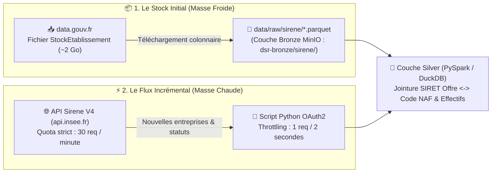

# 🟢 2. Écosystème INSEE (Base SIRENE V4 — Stock Parquet & Flux API)

> **Objectif de ce chapitre :** Documenter le deuxième pilier de mon **« Quintuor Stratégique »** : la **Base SIRENE V4 de l'INSEE**. Elle joue un rôle pivot d'enrichissement dans mon Lakehouse en me permettant de relier chaque offre d'emploi (qui mentionne un numéro **SIRET** d'établissement) à la taille réelle de l'entreprise (tranche d'effectif salarié) et surtout à son **Code NAF / APE exact**.

---

## 🎯 1. Pourquoi j'ai adopté une Stratégie Hybride (Stock Parquet + Flux API)

La base SIRENE française recense plus de **38 millions d'établissements** (actifs et fermés). Interroger l'API de l'INSEE unitairement pour des centaines de milliers d'offres d'emploi se heurterait immédiatement aux quotas sévères du portail `api.insee.fr` (**30 requêtes par minute**).

Pour allier performance Big Data et fraîcheur des données, j'ai conçu une **architecture d'ingestion hybride (Stock + Flux)** :

### 1.1. Le Stock (Initialisation Colonnaire)
*   **Source :** Téléchargement du fichier officiel `StockEtablissement_XXX.parquet` (~2 Go) depuis [data.gouv.fr](https://www.data.gouv.fr/).
*   **Emplacement dans mon Lakehouse :** Stocké localement dans `data-skills-radar-lakehouse/data/raw/sirene/` et répliqué dans ma couche Bronze MinIO (`dsr-bronze/sirene/`).
*   **Avantage d'ingénierie :** Le fichier étant déjà au format colonnaire **Apache Parquet**, **PySpark** et **DuckDB** peuvent appliquer directement le *Column Pruning* (en ne lisant que les colonnes `siret`, `siren`, `activitePrincipaleEtablissement` [Code NAF], `trancheEffectifsEtablissement`, `etatAdministratifEtablissement` et `codeCommuneEtablissement`) et le *Predicate Pushdown* en quelques secondes sans saturer la mémoire vive.

### 1.2. Le Flux (Mises à Jour Incrémentales via API Sirene V4)
*   **Source :** **API Sirene V4** exposée sur le portail officiel **[portail-api.insee.fr](https://portail-api.insee.fr/)**.
*   **Usage ciblé :** Interrogation ciblée uniquement pour les établissements nouvellement créés (absents du fichier Stock mensuel) ou pour vérifier les changements de statut administratif (créations / fermetures récentes d'établissements par secteur NAF).

---

## 🔐 2. Protocole d'Authentification & Gestion des Quotas INSEE

*   **Protocole :** **OAuth2 (`client_credentials`)** / Clé d'intégration Backend-to-Backend (`INSEE_CLIENT_ID` et `INSEE_CLIENT_SECRET` configurés dans mon fichier `.env`).
*   **Rate Limit Critique :** **30 requêtes par minute** (soit au maximum **1 requête toutes les 2 secondes**).
*   **Protection implémentée dans mon code Python :**
    Mon connecteur INSEE impose un délai incompressible `time.sleep(2.1)` entre deux requêtes HTTP et privilégie systématiquement la résolution locale sur le fichier Parquet `data/raw/sirene/` avant tout appel réseau vers `api.insee.fr`.

---

## 📋 3. Colonnes Clés Exploitées dans le Stock SIRENE

Lors de la jointure en couche **Silver**, je sélectionne uniquement les colonnes utiles à mes analyses sectorielles et territoriales :

| Colonne SIRENE (Parquet / API V4) | Rôle dans Data Skills Radar |
| :--- | :--- |
| `siret` | Clé de jointure primaire à 14 chiffres avec l'établissement employeur. |
| `activitePrincipaleEtablissement` | **Code NAF / APE officiel** (ex: `62.01Z`), indispensable pour ventiler l'exposition IA par secteur économique. |
| `nomenclatureActivitePrincipaleEtablissement` | Version de la nomenclature d'activité (`NAFRev2`). |
| `trancheEffectifsEtablissement` | Code tranche d'effectif salarié INSEE (permet de distinguer TPE, PME, ETI et Grandes Entreprises). |
| `etatAdministratifEtablissement` | Statut de l'établissement (`A` = Actif, `F` = Fermé) — alimente ma **Variable Dépendante ($Y$)** sur la démographie des entreprises. |
| `codeCommuneEtablissement` / `codePostalEtablissement` | Permet le rattachement géographique exact au département et aux **13 régions françaises**. |
