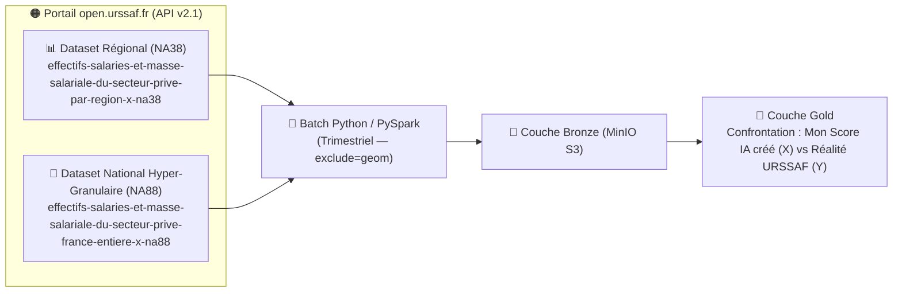

# 🟠 3. Écosystème URSSAF (Open Data — Séries Temporelles Macro-Économiques)

> **Objectif de ce chapitre :** Documenter le troisième pilier de mon **« Quintuor Stratégique »** : le portail Open Data de l'**URSSAF Caisse Nationale (`open.urssaf.fr`)**. Il me fournit la **vérité terrain macro-économique (Variable Dépendante Y : effectifs salariés et masse salariale)** à laquelle je viens confronter **le Score Dynamique d'Exposition / Vulnérabilité IA par secteur NAF et par région que mon Lakehouse a lui-même créé et calculé (Variable Indépendante X)**.

---

## 🎯 1. Rôle Métier & Scientifique dans mon Lakehouse

Aucune source publique (ni l'OCDE, ni l'INSEE, ni l'URSSAF) ne fournit un score d'exposition ou de vulnérabilité à l'IA par secteur d'activité français (`Code NAF`) ou par région :
1. **C'est mon Lakehouse (couches Silver et Gold) qui crée de toutes pièces ce score sectoriel et régional (Variable Indépendante X)** en croisant les offres d'emploi en temps réel (France Travail), le ratio de *Soft Skills* détecté par NLP (**ROMEO v2 / SDSS**), le Code NAF exact de l'entreprise recruteuse (**SIRENE V4**) et le socle théorique par profession de l'**OCDE**.
2. **L'API URSSAF intervient alors comme juge de paix macro-économique (Variable Dépendante Y) :** les déclarations sociales nominatives (**DSN**) collectées chaque trimestre par l'URSSAF constituent la mesure la plus fiable de l'emploi salarié privé en France. En confrontant **mon propre score d'exposition IA créé par le Lakehouse** aux séries temporelles de l'URSSAF, je peux vérifier empiriquement mes deux hypothèses de recherche :
   * **Vérification de mon Hypothèse 1 :** Les secteurs d'activité (`NA38` / `NA88`) auxquels **mon Lakehouse attribue un score élevé de vulnérabilité IA** (car leurs offres restent figées sur des tâches techniques ou routinières à faible `SDSS`) subissent-ils effectivement un **ralentissement ou une contraction de leurs effectifs salariés** dans les relevés URSSAF ?
   * **Vérification de mon Hypothèse 2 (« Le Bouclier Humain ») :** À exposition théorique comparable, les secteurs et régions dont **mon score Lakehouse révèle une forte mutation vers les *Soft Skills*** maintiennent-ils mieux leurs effectifs et voient-ils leur **masse salariale** progresser ?

---

## ⚙️ 2. Protocole Technique (Opendatasoft Explore API v2.1)

*   **Plateforme :** **[open.urssaf.fr](https://open.urssaf.fr/)** (*Opendatasoft API v2.1*).
*   **URL de base :** `https://open.urssaf.fr/api/explore/v2.1`
*   **Authentification :** **Ouvert** (accès public sous *Licence Ouverte Etalab v2.0*, sans jeton OAuth2 obligatoire pour les requêtes d'extraction ou d'export Parquet/JSON).
*   **Format d'ingestion :** Appels API REST (formats JSON / CSV / Export Parquet natif) ingérés via un batch Python / PySpark trimestriel vers ma couche **Bronze**, en appliquant systématiquement le filtre **`exclude=geom`** pour éliminer les polygones géographiques superflus (-96 % de volume réseau).

---

## 🚀 3. Mes Jeux de Données Cibles sur `open.urssaf.fr`

Pour disposer à la fois de la **vision géographique régionale** (Carte de France) et de la **finesse sectorielle maximale** (analyse par sous-secteur économique), j'exploite deux jeux de données complémentaires :

| Identifiant du Dataset (`dataset_id`) | Échelle Géographique | Granularité Sectorielle | Fréquence | Usage dans Data Skills Radar |
| :--- | :---: | :---: | :---: | :--- |
| **`effectifs-salaries-et-masse-salariale-du-secteur-prive-par-region-x-na38`** | **Régionale** (13 régions métropolitaines + DOM) | Nomenclature **NA38 / NA28i** *(81 536 lignes)* | **Trimestrielle** | Confronte le score d'exposition IA régional créé par mon Lakehouse aux effectifs réels sur ma **Carte de France SVG** (`regional_employment.parquet`). |
| **`effectifs-salaries-et-masse-salariale-du-secteur-prive-france-entiere-x-na88`** | **France entière** (Niveau National) | Nomenclature fine **NA88** *(88 divisions NAF)* | **Trimestrielle** | Confronte le score d'exposition IA sectoriel créé par mon Lakehouse aux distributions réelles d'effectifs et de **masse salariale** (**Matrice Compétences & Boxplots**). |
| **`nombre-detablissements-employeurs-et-effectifs-salaries-du-secteur-prive-par-reg`** *(Complément)* | **Régionale** | Code **APE / NAF détaillé** *(16 167 lignes)* | **Annuelle** | Mesure la démographie des établissements employeurs par région et code APE. |

> 💡 **Rappel de mon audit (Étape 1) :** Le jeu de données `od_effectif_cdi_cdd_caissenat` (qui remonte en premier lors d'une recherche textuelle simple sur le catalogue) est explicitement **exclu** de mon pipeline car il ne concerne que les effectifs RH internes de la Caisse Nationale URSSAF.
