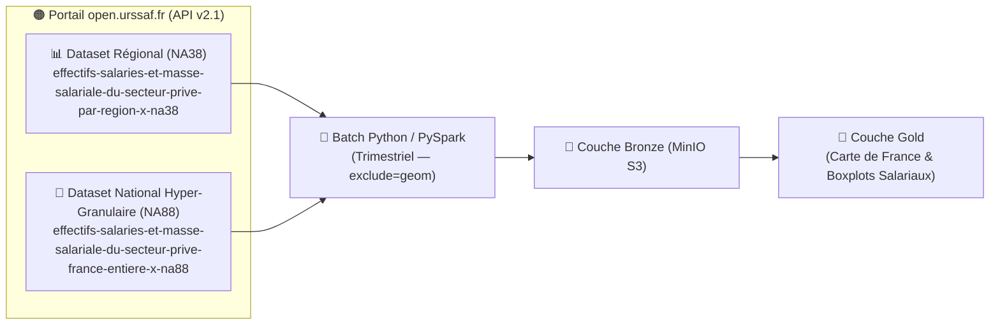

# 🟠 3. Écosystème URSSAF (Open Data — Séries Temporelles Macro-Économiques)

> **Objectif de ce chapitre :** Documenter le troisième pilier de mon **« Quintuor Stratégique »** : le portail Open Data de l'**URSSAF Caisse Nationale (`open.urssaf.fr`)**. Il me permet de confronter la demande en compétences observée sur France Travail (Variable Indépendante $X$) avec la **santé économique réelle des secteurs d'activité français** (Masse salariale et effectifs salariés — Variable Dépendante $Y$).

---

## 🎯 1. Rôle Métier & Scientifique dans mon Lakehouse

Les déclarations sociales nominatives (DSN) collectées chaque mois et chaque trimestre par l'URSSAF constituent la mesure la plus fiable de l'emploi salarié privé en France. En croisant ces séries temporelles avec les offres d'emploi et les scores d'exposition à l'IA, je peux vérifier empiriquement :
*   Si les secteurs à forte exposition aux tâches routinières subissent un **ralentissement ou une contraction de leurs effectifs salariés**.
*   Comment évolue la **masse salariale** par région et par secteur NAF (revalorisation des profils qualifiés / *Soft Skills* vs compression des postes d'exécution).

---

## ⚙️ 2. Protocole Technique (Opendatasoft Explore API v2.1)

*   **Plateforme :** **[open.urssaf.fr](https://open.urssaf.fr/)** (*Opendatasoft API v2.1*).
*   **URL de base :** `https://open.urssaf.fr/api/explore/v2.1`
*   **Authentification :** **Ouvert** (accès public sous *Licence Ouverte Etalab v2.0*, sans jeton OAuth2 obligatoire pour les requêtes d'extraction ou d'export Parquet/JSON).
*   **Format d'ingestion :** Appels API REST (formats JSON / CSV / Export Parquet natif) ingérés via un batch Python / PySpark trimestriel vers ma couche **Bronze**, en appliquant systématiquement le filtre **`exclude=geom`** pour éliminer les polygones géographiques superflus (-96 % de volume réseau).

---

## 🚀 3. Mes Jeux de Données Cibles sur `open.urssaf.fr`

Pour disposer à la fois de la **vision géographique régionale** (Carte de France) et de la **finesse sectorielle maximale** (analyse par sous-secteur économique), j'exploite deux jeux de données complémentaires :

| Identifiant du Dataset (`dataset_id`) | Échelle Géographique | Granularité Sectorielle | Fréquence | Usage dans Data Skills Radar |
| :--- | :---: | :---: | :---: | :--- |
| **`effectifs-salaries-et-masse-salariale-du-secteur-prive-par-region-x-na38`** | **Régionale** (13 régions métropolitaines + DOM) | Nomenclature **NA38 / NA28i** *(81 536 lignes)* | **Trimestrielle** | Alimente directement ma **Carte de France SVG** (`regional_employment.parquet`) et les comparaisons inter-régionales. |
| **`effectifs-salaries-et-masse-salariale-du-secteur-prive-france-entiere-x-na88`** | **France entière** (Niveau National) | Nomenclature fine **NA88** *(88 divisions NAF)* | **Trimestrielle** | Alimente mes analyses sectorielles fines (**Matrice Compétences** et distributions en **Boîtes à moustaches / Boxplots** de la masse salariale). |
| **`nombre-detablissements-employeurs-et-effectifs-salaries-du-secteur-prive-par-reg`** *(Complément)* | **Régionale** | Code **APE / NAF détaillé** *(16 167 lignes)* | **Annuelle** | Mesure la démographie des établissements employeurs par région et code APE. |

> 💡 **Rappel de mon audit (Étape 1) :** Le jeu de données `od_effectif_cdi_cdd_caissenat` (qui remonte en premier lors d'une recherche textuelle simple sur le catalogue) est explicitement **exclu** de mon pipeline car il ne concerne que les effectifs RH internes de la Caisse Nationale URSSAF.
