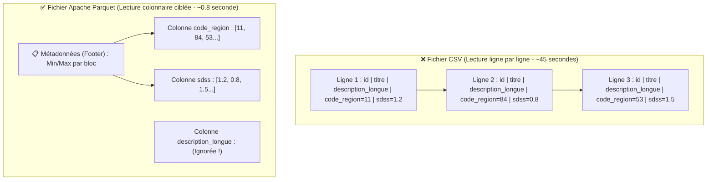
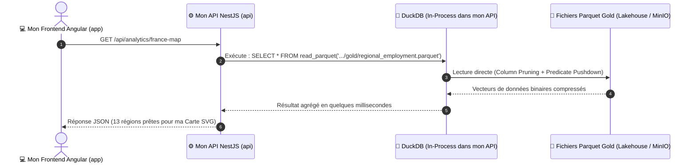

# 🦆 Mon Moteur Analytique DuckDB & Approche Zero-ETL

> **Objectif de ce chapitre :** Documenter pourquoi ma base de données relationnelle PostgreSQL ne suffit plus lorsque j'analyse des centaines de milliers d'offres d'emploi, comment j'exploite le format de fichier colonnaire **Apache Parquet**, et pourquoi j'ai choisi **DuckDB** pour interroger la couche **Gold** de mon Data Lakehouse en quelques millisecondes depuis mon API NestJS sans dupliquer les données (**Zero-ETL**).

---

## 🤔 1. Pourquoi je ne stocke pas tout dans PostgreSQL ? (OLTP vs OLAP)

Dans mon projet **Data Skills Radar**, j'utilise déjà **PostgreSQL 15** (couplé à Prisma 7) dans `data-skills-radar-api` pour gérer mes comptes utilisateurs, leurs adresses et leurs rôles (`VISITOR`, `USER`, `ADMIN`).

Je me suis donc posé la question suivante lors de la conception de mon architecture : *pourquoi ne pas également stocker toutes les offres d'emploi France Travail et toutes les statistiques URSSAF dans PostgreSQL ?*

La réponse tient à la séparation fondamentale, en informatique décisionnelle (*Business Intelligence*), entre **deux mondes aux besoins opposés** :

| Caractéristique | Monde OLTP (*Online Transaction Processing*) | Monde OLAP (*Online Analytical Processing*) |
| :--- | :--- | :--- |
| **Mon moteur retenu** | 🐘 **PostgreSQL 15** | 🦆 **DuckDB** + 📦 **Apache Parquet** |
| **Mon usage métier** | Gérer mes utilisateurs, connexions JWT, mots de passe | Calculer mes moyennes régionales, mon score SDSS, filtrer par code NAF |
| **Requête typique que j'exécute** | `SELECT * FROM users WHERE id = 'uuid-123'` *(Chercher 1 ligne précise)* | `SELECT code_region, AVG(sdss) FROM offres GROUP BY code_region` *(Lire 2 millions de lignes, mais seulement 2 colonnes)* |
| **Organisation sur le disque** | **Orientée Lignes (*Row-oriented*)** : toutes les colonnes d'un utilisateur sont stockées côte à côte. | **Orientée Colonnes (*Column-oriented*)** : toutes les valeurs d'une même colonne sont regroupées ensemble. |

### Mon analogie de synthèse :
* **PostgreSQL (Orienté Lignes)** fonctionne comme un **carnet d'adresses** : si je cherche la fiche d'un utilisateur précis, j'ouvre le carnet à la bonne page et j'obtiens son nom, son email et son adresse d'un seul coup. En revanche, si je veux calculer l'âge moyen de tous les inscrits, je suis contraint de parcourir l'intégralité des pages du carnet.
* **Apache Parquet + DuckDB (Orienté Colonnes)** range toutes les valeurs de la colonne `salaire` ensemble, toutes les valeurs de `code_region` ensemble, etc. Pour calculer une moyenne par région, mon moteur ignore 95 % du fichier et ne lit physiquement que les 2 colonnes demandées.

---

## 📦 2. Le secret d'Apache Parquet : *Column Pruning* & *Predicate Pushdown*

Dans mes couches **Silver** et **Gold**, j'ai fait le choix de ne pas stocker mes données nettoyées en `.csv` ni en `.json`, mais au format **Apache Parquet** (`.parquet`).

Un fichier CSV est « aveugle » : pour trouver les offres d'emploi de la région *Bretagne*, mon serveur devrait lire le fichier texte de la première à la dernière ligne.

À l'inverse, un fichier **Parquet** est découpé en blocs horizontaux (**Row Groups**) et, à l'intérieur de chaque bloc, mes données sont stockées **colonne par colonne** avec un **dictionnaire de statistiques (`Min` / `Max`)** intégré dans le pied de page (*Footer*).

Grâce à cette structure interne, lorsque mon instance DuckDB lit un fichier Parquet de ma couche **Gold**, je bénéficie automatiquement de deux optimisations majeures :

1. **L'Élagage de Colonnes (*Column Pruning*)** :
   Si ma requête SQL demande `SELECT code_region, score_sdss_moyen`, DuckDB ne charge en mémoire vive (RAM) **que** les octets de ces deux colonnes. Les colonnes lourdes (descriptions d'offres, libellés complets) ne sont même pas lues sur le disque.
2. **La Poussée de Prédicats (*Predicate Pushdown*)** :
   Lorsqu'un utilisateur filtre sur la région Bretagne (`WHERE code_region = '53'`), DuckDB consulte d'abord les statistiques `Min/Max` de chaque bloc du fichier Parquet. Si un bloc indique `Min = 75, Max = 93`, DuckDB **saute le bloc entier** sans même le décompresser.

---

## 🦆 3. Pourquoi j'ai choisi DuckDB (« Le SQLite de l'Analytique ») ?

Traditionnellement, pour interroger de gros volumes de données analytiques, il fallait installer et administrer un serveur OLAP lourd fonctionnant en permanence (Snowflake, ClickHouse, cluster Spark permanent).

Pour **Data Skills Radar**, j'ai retenu **DuckDB** pour trois raisons d'ingénierie :
* **Moteur *In-Process* (Embarqué)** : Comme SQLite, DuckDB n'est pas un serveur externe que je dois déployer à part. C'est une bibliothèque (`duckdb` dans mon `package.json`) qui tourne **directement à l'intérieur du processus Node.js de mon API NestJS** (`data-skills-radar-api`).
* **Exécution Vectorisée (SIMD)** : Au lieu de traiter les données ligne par ligne (*Tuple-at-a-time* comme PostgreSQL), le moteur C++ de DuckDB traite mes données par **vecteurs de 1024 ou 2048 valeurs simultanément** directement dans les caches L1/L2 du processeur (CPU).
* **Zone de pertinence (*Sweet Spot*)** : Tant que ma donnée agrégée en couche Gold pèse entre **quelques Mo et 500 Go**, un moteur *Scale-Up* comme DuckDB surpasse un cluster distribué car il n'a aucun coût de sérialisation réseau (*Zero Network Overhead*) ni de temps de démarrage de JVM.

---

## ⚡ 4. Mon Architecture « Zero-ETL » dans Data Skills Radar

En entreprise, un pipeline **ETL** classique impose souvent de copier les données du Data Lake vers une base de données SQL intermédiaire uniquement pour permettre à l'API Backend de les lire.

Avec mon approche **Zero-ETL**, je supprime totalement cette copie redondante :

### Synthèse de la répartition des responsabilités dans mon projet :
1. **Mon Lakehouse (`data-skills-radar-lakehouse`)** exécute les traitements lourds en amont (Python / PySpark) : il interroge l'URSSAF et France Travail, nettoie les données et produit des fichiers `.parquet` propres dans ma couche **Gold**.
2. **Mon API (`data-skills-radar-api`)** ne stocke **aucune table analytique dans PostgreSQL**. Mon service `DuckDbService` exécute directement des requêtes SQL sur les fichiers `.parquet` de la couche **Gold**.
3. **Mon Frontend (`data-skills-radar-app`)** consomme un flux JSON léger et rapide pour colorer ma **Carte de France SVG** et alimenter mes graphiques décisionnels.
