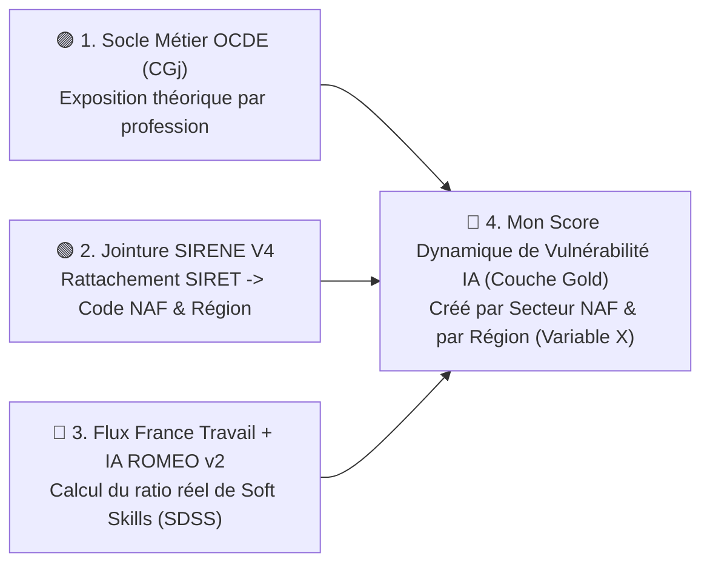

# 🟣 4 & 5. Écosystème OCDE / LinkedIn & Synthèse des Rapports de Référence (IA & Travail)

> **Objectif de ce chapitre :** Documenter les quatrième et cinquième piliers de mon **« Quintuor Stratégique »** : les données d'exposition métier à l'IA de l'**OCDE (partenariat LinkedIn & programme CERI AI-WIPS)** ainsi que la synthèse scientifique des **deux rapports institutionnels de référence** archivés dans mon dépôt (`assets/reports/`). Ces travaux fondent mathématiquement la formule par laquelle **mon Lakehouse crée et calcule en couche Gold notre propre Score Dynamique de Vulnérabilité à l'IA par secteur d'activité (Code NAF) et par région française**.

---

## 🟣 1. Écosystème OCDE & LinkedIn (Le Socle Théorique par Métier)

Cet écosystème me fournit une brique d'entrée fondamentale — l'exposition théorique par profession générique — que mon Lakehouse va ensuite transformer, enrichir et ventiler par secteur NAF et par région française :

### 1.1. L'Offre et la Demande en Compétences IA (*OECD.AI Policy Observatory × LinkedIn*)
*   **Source :** Observatoire des politiques d'IA de l'OCDE (`oecd.ai`), élaboré en partenariat avec le *LinkedIn Economic Graph*.
*   **Métrique clé :** ***AI Skills Penetration*** — mesure la part relative des profils et des offres intégrant des compétences d'IA pure (*Machine Learning*, *Deep Learning*, *NLP*) ou de maîtrise applicative (*AI Literacy*, *Prompt Engineering*, outils génératifs) par pays et par grand secteur.
*   **Intégration dans mon Lakehouse :** Fichiers de référence chargés en couche **Bronze / Silver** pour étalonner la vitesse d'adoption de l'IA en France.

### 1.2. L'Indice d'Écart de Capacités de l'IA (*AI Capability Gap Index* — `CGj`)
*   **Concept :** Au lieu de prédire arbitrairement si un métier va disparaître, l'OCDE mesure l'**écart entre le niveau d'exigence humaine requis par une profession (`H_ji`) et le niveau actuel des capacités de l'IA (`IA_i`)** sur **9 domaines cognitifs et physiques**.
*   **Intégration dans mon Lakehouse (Couche Silver) :**
    *   Le dataset original de l'OCDE est publié uniquement par profession théorique selon la nomenclature américaine **O*NET / SOC** (*Standard Occupational Classification* — 879 professions), sans ventilation par secteur d'entreprise français (`NAF`) ni par région.
    *   Mon traitement **PySpark (Couche Silver)** réalise la table de passage (**Crosswalk `SOC → ISCO-08 → ROME 4.0 France Travail`**) afin de relier cet indice théorique aux offres d'emploi françaises en temps réel, puis de l'agréger par **Code NAF** (grâce à la jointure **SIRENE**) et par **Région**.

---

## 📖 2. Synthèse de mes Rapports de Référence (`assets/reports/`)

Pour justifier scientifiquement l'algorithme de création de score de ma couche **Gold**, je m'appuie sur deux rapports majeurs archivés dans `data-skills-radar-docs/assets/reports/` :

### 2.1. Rapport OCDE (Mai / Juillet 2026) — *« Mesure d'exposition à l'IA de l'OCDE : cartographie des Indicateurs de l'OCDE sur les capacités de l'IA par profession »*
*   **Auteurs :** Stuart Elliott, Margarita Kalamova & Gianluca Risi (CERI — Direction de l'éducation et des compétences de l'OCDE, 69 pages, licence *CC BY 4.0*).
*   **Protocole méthodologique :** Étalonnage humain par méthode Delphi sur 40 professions pilotes, étendu aux **879 professions O*NET** par un ensemble de 4 LLM frontière (*ChatGPT 5.2, Claude 4.6, Gemini 3.1 Pro, Mistral Large 3* — corrélation de Pearson `r = 0,90` avec la norme humaine).
*   **Les 9 Domaines de Capacités de l'OCDE (échelle de 1 à 5) :**
    1. *Langage* (Niveau IA actuel = `3`)
    2. *Créativité* (Niveau IA actuel = `3`)
    3. *Connaissance, apprentissage et mémoire* (Niveau IA actuel = `3`)
    4. *Vision* (Niveau IA actuel = `3`, révisé en juillet 2026)
    5. *Interactions sociales* (Niveau IA actuel = `2`)
    6. *Résolution de problèmes* (Niveau IA actuel = `2`)
    7. *Métacognition et esprit critique* (Niveau IA actuel = `2`)
    8. *Manipulation fine* (Niveau IA actuel = `2`)
    9. *Intelligence robotique* (Niveau IA actuel = `2`)
*   **Formule Mathématique de l'Indice d'Écart (`CGj`, Section 6, pp. 29–32) :**
    > **`CG_ji = max(0, H_ji - IA_i)`**  et  **`CG_j = Somme sur les 9 domaines de [ CG_ji × Importance(H_ji) ]`**
    *   **Interprétation :** Lorsque `CG_j` tend vers `0`, l'IA égale ou surpasse déjà les exigences humaines du métier (**exposition maximale** : ex. *Secrétariat et soutien administratif* = `0,8`, *Agents de facturation / Opérateurs de saisie / Comptabilité d'exécution* = `0,0`). À l'inverse, plus `CG_j` est élevé, plus le métier est protégé par des compétences humaines que l'IA ne maîtrise pas (*Services sociaux* = `6,4`, *Enseignement* = `5,8`, *Juridique* = `5,8`, *Santé* = `5,6`, *Management* = `5,5`).
    *   **Preuve quantitative de mon Hypothèse 2 (Tableau 6.3, p. 33) :** Les trois domaines présentant l'écart moyen humain-IA le plus élevé toutes professions confondues (`1,1`) sont exactement les **Interactions sociales**, la **Résolution de problèmes** et la **Métacognition / esprit critique** (contre seulement `0,1` à `0,4` pour le *Langage* ou la *Vision*).
    *   **Alerte prospective 2030 (Tableau 7.1, p. 45) :** En cas de progression de `+1` niveau des capacités cognitives de l'IA d'ici 2030, l'écart protecteur du groupe **Informatique et mathématique chute brutalement de `3,1` à `0,8`**, confirmant que l'exécution de code standard sans *Soft Skills* ni architecture complexe devient hautement vulnérable.
    *   **Justification directe de la création de score par mon Lakehouse (Section 7, pp. 46–47) :** En conclusion de son rapport, l'OCDE souligne que son indice s'arrête au niveau des professions génériques et recommande explicitement aux chercheurs de construire une extension **(1) au niveau des compétences fines, (2) par secteur économique (NAF) et (3) à l'échelle régionale** — c'est très exactement le score inédit que mon Data Lakehouse construit sur les 13 régions françaises.

---

### 2.2. Rapport France Stratégie (Mars 2018) — *« Intelligence artificielle et travail »*
*   **Auteurs :** Salima Benhamou & Lionel Janin (Rapport au ministère du Travail et au secrétariat d'État au Numérique, en complément de la mission Cédric Villani `#FranceIA`, 86 pages).
*   **Les 3 Postulats Fondateurs pour mon Architecture Data :**
    1.  **L'IA transforme les tâches, pas les métiers entiers (*Task-Based Approach*) :** Contrairement à l'estimation monolithique de Frey & Osborne (47 %), seuls **10 % à 15 %** des emplois en France présentent un risque d'automatisation intégrale, mais **près de 100 % des métiers voient la structure de leurs tâches recomposée**.
    2.  **Intensification cognitive & « Revanche des Soft Skills » (Chap. 3, pp. 66–77) :** Lorsque l'IA absorbe les tâches simples et codifiables (le « tout-venant », comme les chatbots bancaires traitant 80 % des demandes courantes), le travailleur humain se retrouve concentré exclusivement sur les cas complexes, atypiques ou conflictuels. Dès lors, la valeur économique des **compétences transversales et sociales (empathie, écoute, négociation, travail en équipe pluridisciplinaire, esprit critique face aux biais algorithmiques)** explose sur le marché du travail.
    3.  **Fortes disparités sectorielles selon le Code NAF (Chap. 2, pp. 22–64) :** Le rapport démontre par trois monographies sectorielles (**Transports** = 4,8 % du PIB / 800 000 conducteurs ; **Banque de détail** = 4,1 % du PIB / 198 000 salariés ; **Santé** = 9,4 % du PIB / 1,9M de professionnels où la complémentarité Médecin + IA atteint **99,5 %** de réussite diagnostique contre 92 % pour l'IA seule) que la vitesse et la nature de la mutation dépendent directement du secteur NAF.
    4.  **Carence d'outillage décisionnel en France (p. 73) :** Moins de **15 % des entreprises françaises** disposent d'une GPEC capable de mesurer l'écart entre compétences détenues et compétences émergentes, justifiant la création d'un Système d'Information Décisionnel régional et sectoriel comme **Data Skills Radar**.

---

## ⚡ 3. Comment mon Lakehouse Crée le Score Dynamique de Vulnérabilité IA par Secteur NAF et par Région (Couche Gold)

La combinaison de ces deux rapports fonde l'algorithme par lequel **mon Lakehouse construit notre propre score sectoriel et régional (Variable Indépendante X)** avant de le confronter aux données **URSSAF (Variable Dépendante Y)** :

1.  **L'OCDE** me fournit en entrée un **score statique de vulnérabilité théorique** uniquement par profession (`V_statique` compris entre `0` et `1`, dérivé de l'inverse de l'écart `CGj`).
2.  **La jointure SIRENE (`SIRET ↔ Code NAF`) et mon pipeline NLP (ROMEO v2 + ROME 4.0)** rattachent chaque offre d'emploi française à son **secteur d'activité NAF** et à sa **région**, tout en mesurant la **part réelle de *Soft Skills* (Empathie, Négociation, Esprit critique, Coordination)** exigée via mon **Score de Densité *Soft Skills* (`SDSS`)**.
3.  **Ma Couche Gold crée alors notre Score Dynamique de Vulnérabilité IA par secteur NAF et par région :**
    > **`Score_Vulnerabilite_Dynamique = V_statique × ( 1 - α × [ SDSS / (SDSS + 1) ] )`**
    Ainsi, si un secteur d'activité théoriquement très exposé exige soudainement **60 % de *Soft Skills*** dans les offres d'emploi récentes d'une région, le score de vulnérabilité dynamique calculé par mon Lakehouse baisse — démontrant empiriquement que **ce secteur régional est en train de muter avec succès vers le « Bouclier Humain » pour résister à l'automatisation**, ce que je vérifie ensuite en le confrontant aux séries d'effectifs et de masse salariale de l'**URSSAF**.
