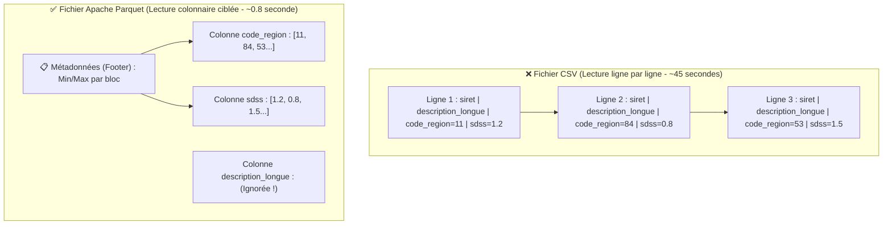
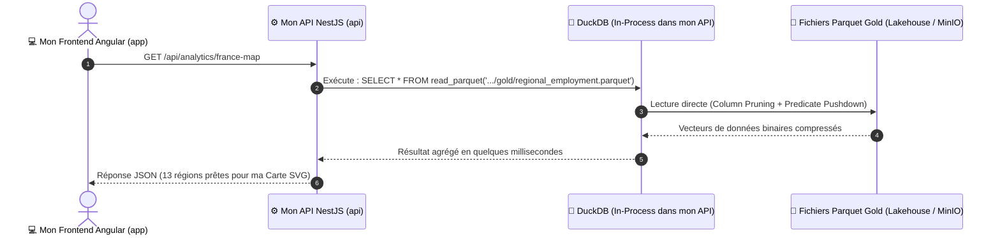

# 🦆 7. Mon Moteur Analytique DuckDB & Approche Zero-ETL

> **Objectif de ce chapitre :** Documenter pourquoi ma base de données relationnelle PostgreSQL ne suffit plus lorsque j'analyse des centaines de milliers d'offres d'emploi et des millions d'établissements SIRENE, comment j'exploite le format de fichier colonnaire **Apache Parquet**, et pourquoi j'ai choisi **DuckDB** pour interroger la couche **Gold** de mon Data Lakehouse en quelques millisecondes depuis mon API NestJS sans dupliquer les données (**Zero-ETL**).

---

## 🤔 1. Pourquoi je ne stocke pas tout dans PostgreSQL ? (OLTP vs OLAP)

Dans mon projet **Data Skills Radar**, j'utilise déjà **PostgreSQL 15** (couplé à Prisma 7) dans `data-skills-radar-api` pour gérer mes comptes utilisateurs, leurs adresses et leurs rôles (`VISITOR`, `USER`, `ADMIN`).

Je me suis donc posé la question suivante lors de la conception de mon architecture : *pourquoi ne pas également stocker toutes les offres d'emploi France Travail, le stock SIRENE et toutes les statistiques URSSAF dans PostgreSQL ?*

La réponse tient à la séparation fondamentale, en informatique décisionnelle (*Business Intelligence*), entre **deux mondes aux besoins opposés** :

| Caractéristique | Monde OLTP (*Online Transaction Processing*) | Monde OLAP (*Online Analytical Processing*) |
| :--- | :--- | :--- |
| **Mon moteur retenu** | 🐘 **PostgreSQL 15** | 🦆 **DuckDB** + 📦 **Apache Parquet** |
| **Mon usage métier** | Gérer mes utilisateurs, connexions JWT, mots de passe | Calculer mes moyennes régionales, mon score SDSS, filtrer par code NAF |
| **Requête typique que j'exécute** | `SELECT * FROM users WHERE id = 'uuid-123'` *(Chercher 1 ligne précise)* | `SELECT code_region, AVG(sdss) FROM offres GROUP BY code_region` *(Lire 2 millions de lignes, mais seulement 2 colonnes)* |
| **Organisation sur le disque** | **Orientée Lignes (*Row-oriented*)** : toutes les colonnes d'un utilisateur sont stockées côte à côte. | **Orientée Colonnes (*Column-oriented*)** : toutes les valeurs d'une même colonne sont regroupées ensemble. |

---

## 📦 2. Le secret d'Apache Parquet : *Column Pruning* & *Predicate Pushdown*

Dans mes couches **Silver** et **Gold** (ainsi que pour le fichier Stock SIRENE de 2 Go en couche **Bronze**), mes données sont stockées au format **Apache Parquet** (`.parquet`).

Un fichier **Parquet** est découpé en blocs horizontaux (**Row Groups**) et, à l'intérieur de chaque bloc, mes données sont stockées **colonne par colonne** avec un **dictionnaire de statistiques (`Min` / `Max`)** intégré dans le pied de page (*Footer*).

Grâce à cette structure interne, lorsque mon instance DuckDB lit un fichier Parquet de ma couche **Gold**, je bénéficie automatiquement de deux optimisations majeures :

1. **L'Élagage de Colonnes (*Column Pruning*)** :
   Si ma requête SQL demande `SELECT code_region, score_sdss_moyen`, DuckDB ne charge en mémoire vive (RAM) **que** les octets de ces deux colonnes.
2. **La Poussée de Prédicats (*Predicate Pushdown*)** :
   Lorsqu'un utilisateur filtre sur la région Bretagne (`WHERE code_region = '53'`), DuckDB consulte d'abord les statistiques `Min/Max` de chaque bloc du fichier Parquet et **saute les blocs entiers** qui ne contiennent pas la valeur recherchée sans même les décompresser.

---

## 🦆 3. Pourquoi j'ai choisi DuckDB (« Le SQLite de l'Analytique ») ?

Pour **Data Skills Radar**, j'ai retenu **DuckDB** pour trois raisons d'ingénierie :
* **Moteur *In-Process* (Embarqué)** : Comme SQLite, DuckDB n'est pas un serveur externe lourd. C'est une bibliothèque (`duckdb` dans mon `package.json`) qui tourne **directement à l'intérieur du processus Node.js de mon API NestJS** (`data-skills-radar-api`).
* **Exécution Vectorisée (SIMD)** : Au lieu de traiter les données ligne par ligne (*Tuple-at-a-time* comme PostgreSQL), le moteur C++ de DuckDB traite mes données par **vecteurs de 1024 ou 2048 valeurs simultanément** dans les caches L1/L2 du processeur (CPU).
* **Zone de pertinence (*Sweet Spot*)** : Tant que ma donnée agrégée en couche Gold pèse entre **quelques Mo et 500 Go**, un moteur *Scale-Up* comme DuckDB surpasse un cluster distribué car il n'a aucun coût de sérialisation réseau (*Zero Network Overhead*) ni de temps de démarrage de JVM.

---

## ⚡ 4. Mon Architecture « Zero-ETL » dans Data Skills Radar

Avec mon approche **Zero-ETL**, je supprime toute copie intermédiaire entre le Data Lakehouse et PostgreSQL :

