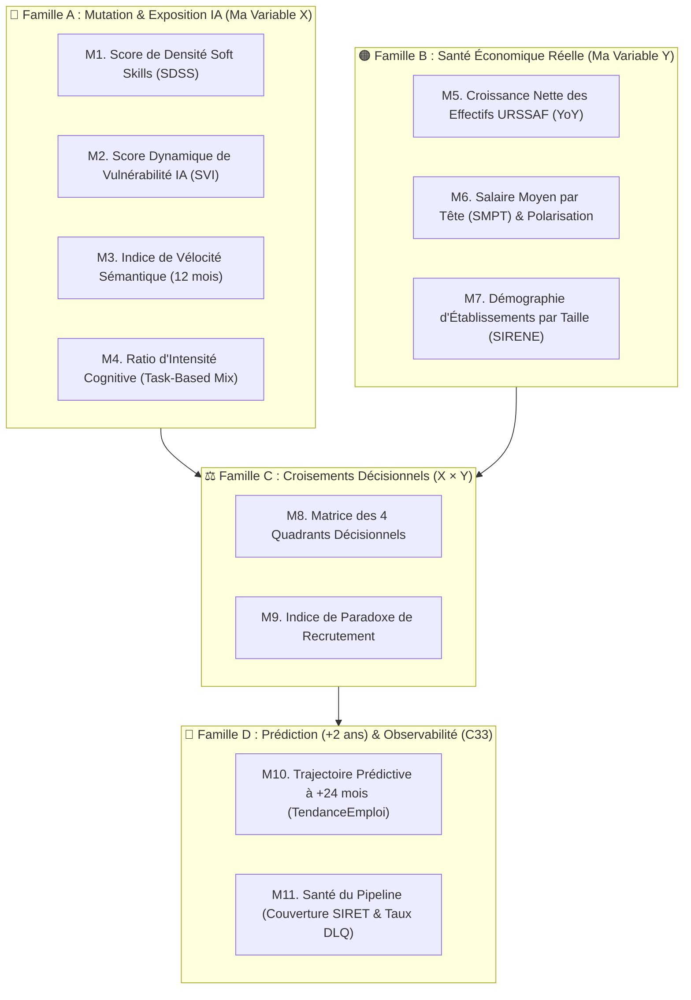

# 📊 8. Catalogue de mes Métriques Décisionnelles, Choix des Graphiques & Pièges à Éviter

> **Objectif de ce chapitre :** Documenter l'ensemble des **11 métriques décisionnelles** que mon Data Lakehouse me permet de faire ressortir en couche **Gold** à partir du croisement de mon **« Quintuor Stratégique »**, la règle de sélection rigoureuse de mes **représentations graphiques** dans Angular 22, ainsi que les **8 pièges méthodologiques, statistiques et techniques** (les « faux amis » de la donnée) que mon pipeline neutralise.

---

## 🎯 Partie 1 — Catalogue des 11 Métriques Décisionnelles de ma Couche Gold

Pour répondre à ma problématique de recherche et outiller les décideurs (Régions, DRH, OPCO), j'ai structuré les indicateurs produits par ma couche **Gold** en **4 grandes familles analytiques** :

---

### 🔵 Famille A — Métriques de Mutation Sémantique & Exposition IA (Ma Variable Indépendante X)

Ces quatre métriques sont **créées par mon Lakehouse** en croisant les offres France Travail, l'API NLP **ROMEO v2**, la nomenclature **ROME 4.0**, le Code NAF **SIRENE** et le socle **OCDE** :

| Code | Nom de la Métrique | Formule / Mode de Calcul dans mon Lakehouse | Ce qu'elle révèle aux décideurs |
| :---: | :--- | :--- | :--- |
| **M1** | **Score de Densité Soft Skills (`SDSS`)** | **`SDSS = Volume Compétences Humaines & Transversales / max(1, Volume Compétences Techniques d'Exécution)`** | Mesure l'intensité du « Bouclier Humain » exigé par les entreprises d'un secteur NAF ou d'une région lors de leurs recrutements. |
| **M2** | **Score Dynamique de Vulnérabilité IA (`SVI_dynamique`)** | **`SVI_dynamique = V_statique_OCDE × (1 - α × [ SDSS / (SDSS + 1) ])`** *(agrégé par Code NAF et par Région)* | Distingue un secteur **passivement exposé** (qui continue de recruter sur des tâches routinières → alerte rouge/ambre) d'un secteur **en mutation active** (qui exige de l'esprit critique, du conseil ou de la négociation → résilience teal). |
| **M3** | **Indice de Vélocité Sémantique** | Taux de renouvellement (%) du Top 10 des compétences exigées au sein d'un même code ROME entre le trimestre `T` et `T-4`. | Mesure la vitesse de transformation interne d'un métier (apparition de compétences d'*AI Literacy* ou de gouvernance face au recul de la saisie manuelle). |
| **M4** | **Ratio d'Intensité Cognitive (*Task-Based Mix*)** | Répartition en `%` des offres selon mon énumération `TypeTache` (`COGNITIVE_ROUTINIERE`, `COGNITIVE_COMPLEXE`, `MANUELLE_ROUTINIERE`, `MANUELLE_COMPLEXE`). | Permet de visualiser immédiatement la part des emplois d'un territoire exposée à la substitution algorithmique vs l'augmentation cognitive. |

---

### 🟠 Famille B — Métriques de Santé Économique & Démographie d'Entreprises (Ma Variable Dépendante Y)

Ces trois métriques sont extraites des séries temporelles **URSSAF (`NA38` régional et `NA88` national)** et de la base **SIRENE V4** pour constituer ma vérité terrain :

| Code | Nom de la Métrique | Formule / Mode de Calcul dans mon Lakehouse | Ce qu'elle révèle aux décideurs |
| :---: | :--- | :--- | :--- |
| **M5** | **Taux de Croissance Net des Effectifs Salariés (`Δ Effectifs YoY`)** | **`((Effectifs_T - Effectifs_T-4) / Effectifs_T-4) × 100`** *(calculé en glissement annuel pour éliminer la saisonnalité)* | Indique objectivement si un secteur économique régional crée ou détruit des postes salariés privés. |
| **M6** | **Salaire Moyen par Tête (`SMPT`) & Polarisation Salariale** | **`SMPT = Masse_Salariale_Trimestrielle_URSSAF / Effectifs_Salariés_URSSAF`** *(suivi en évolution `Δ SMPT YoY`)* | **Métrique pépite :** croisée avec `M5`, elle révèle la polarisation du travail. Si les effectifs baissent (`-5 %`) mais que le `SMPT` grimpe (`+7 %`), cela prouve que l'IA supprime les postes d'exécution bas salaires tout en revalorisant les profils qualifiés restants. |
| **M7** | **Démographie d'Établissements par Tranche d'Effectif** | Ratio d'établissements actifs (`'A'`) vs fermés (`'F'`) ventilé par `trancheEffectifsEtablissement` (TPE < 10 salariés vs PME / ETI / GE). | Vérifie si le choc de l'automatisation fragilise davantage les TPE/PME (dont moins de 15 % disposent d'une GPEC selon le rapport France Stratégie) que les grands groupes. |

---

### ⚖️ Famille C — Métriques Croisées de Corrélation & Aide à la Décision Territoriale (`X × Y`)

C'est dans cette famille que ma couche **Gold** confronte mon score créé **(X)** à la réalité économique **(Y)** :

#### M8 — La Matrice des 4 Quadrants Décisionnels (« Exposition IA × Santé Économique URSSAF »)
Chaque couple `(Région, Secteur NAF)` est positionné dans l'un des **4 quadrants stratégiques** suivants :
1. 🟢 **Quadrant 1 — Pivot Réussi (Fort SDSS + Croissance des Effectifs URSSAF) :** Secteurs moteurs qui utilisent l'IA comme levier d'augmentation humaine et continuent d'embaucher.
2. 🔴 **Quadrant 2 — Zone de Destruction Critique (Forte Exposition IA & Faible SDSS + Chute des Effectifs URSSAF) :** Secteurs figés sur l'exécution routinière qui perdent déjà des emplois. **Cible prioritaire n°1 pour les plans de reconversion des Régions et des OPCO.**
3. 🟠 **Quadrant 3 — Tension Silencieuse / Sursis (Forte Exposition IA & Faible SDSS + Effectifs encore stables) :** Secteurs qui n'ont pas encore entamé leur mue sémantique et risquent un décrochage brutal à horizon 2030 (cas type des métiers du code standard identifié dans le rapport OCDE 2026).
4. 🔵 **Quadrant 4 — Sanctuaire Humain (Faible Exposition IA + Stabilité / Croissance) :** Métiers de terrain, santé, accompagnement social, manipulation fine et artisanat complexe.

#### M9 — L'Indice de Paradoxe de Recrutement (Tension France Travail × Automatisation IA)
*   **Croisement :** Indicateur de tension de recrutement (API `Marché du travail v1`) × `Score Dynamique de Vulnérabilité IA (M2)`.
*   **Intérêt métier :** Identifie les secteurs où les employeurs déclarent une forte difficulté à recruter alors même que les compétences demandées dans leurs annonces sont aujourd'hui automatisables par l'IA (signalant un besoin de modernisation des processus ou de refonte des fiches de poste).

---

### 🔮 Famille D — Métriques Prédictives (+24 mois) & Observabilité du Pipeline (Compétence C33)

*   **M10 — Score Prédictif de Trajectoire Sectorielle à +2 ans (`TendanceEmploi`) :** Modèle de *Forecasting* temporel classant chaque secteur NAF régional en `EN_CROISSANCE`, `EN_MUTATION`, `STABLE` ou `EN_DECLIN`.
*   **M11 — Métriques Techniques deQualité des Données (*Data Observability*) :**
    *   **Taux de résolution `SIRET ↔ SIRENE` (%)** : Part des offres rattachées directement à un établissement SIRENE vs part résolue via la matrice de repli `ROME → NAF`.
    *   **Taux de rejet vers la *Dead-Letter Queue* (`silver/errors_dlq.parquet`)** : Pourcentage d'enregistrements isolés pour anomalie de schéma.

---

## 📈 Partie 2 — Règle de Choix des Graphiques dans Angular 22 (Du Brut au Traité)

Conformément aux principes d'ingénierie statistique de mes cours, je ne choisis jamais un graphique pour des raisons purement esthétiques, mais selon la **nature mathématique de la variable** et la **forme de sa distribution** :

| Type de Représentation Visuelle | Usage Scientifique Strict | Métriques Data Skills Radar Associées | Vue Cible dans `data-skills-radar-app` |
| :--- | :--- | :--- | :--- |
| **🗺️ Carte Choroplèthe SVG** | Comparaison spatiale immédiate d'un indicateur agrégé sur les **13 régions métropolitaines**. | `M2 (SVI_dynamique)`, `M1 (SDSS médian)`, `M5 (Δ Effectifs URSSAF)` | **Tableau de Bord Principal (`/tableau-de-bord`)** |
| **📦 Boîte à Moustaches (*Boxplot*)** | **Obligatoire dès que la distribution est asymétrique ou non normale (`Shapiro-Wilk p < 0.05`)**. Affiche la **Médiane (`P50`)**, l'écart interquartile (`Q1`–`Q3`) et les valeurs extrêmes (*outliers*) sans écraser l'information. | Distribution des salaires `M6 (SMPT)` et des scores `M1 (SDSS)` au sein des 88 secteurs NAF ou des 13 régions. | **Indicateurs Macro & Matrice Compétences** |
| **🔵 Nuage de Points (*Scatter Plot*)** | Exploration de la **corrélation brute** entre deux variables continues (`X` et `Y`) et visualisation des **4 Quadrants Décisionnels**. | Axe X = `M2 (Score Vulnérabilité IA)` / Axe Y = `M5 (Δ Effectifs URSSAF)` / Taille du point = Effectif total du secteur (`M8`). | **Data Lab & Matrice Compétences** |
| **📉 Courbe Temporelle (*Line Chart*)** | Réservée exclusivement aux **séquences ordonnées dans le temps** (interdiction formelle de relier par une ligne des catégories NAF indépendantes !). | Évolution multi-trimestrielle des effectifs `M5`, de la masse salariale `M6`, de la vélocité `M3` et projection `M10 (+2 ans)`. | **Indicateurs Macro & Forecasting** |
| **📊 Diagramme en Barres (*Bar Chart*)** | Comparaison de **modalités qualitatives indépendantes** (classement Top / Flop). | Comparaison des secteurs `NA38` / `NA88`, répartition `M4 (TypeTache)` et démographie TPE vs GE (`M7`). | **Panneau Latéral Régional & Matrice Compétences** |

---

## 🪤 Partie 3 — Les 8 Pièges Majeurs à Éviter (et mes Parades dans le Lakehouse)

Lorsqu'on croise des sources aussi massives et hétérogènes que France Travail, SIRENE, l'URSSAF et l'OCDE, huit pièges majeurs peuvent fausser complètement les conclusions si l'on n'y prend pas garde dès la couche **Silver** :

### 🪤 Piège n°1 — Le « Piège du Siège Social » (Biais d'Hypertrophie de l'Île-de-France)
*   **L'erreur classique :** Géolocaliser une offre d'emploi en prenant l'adresse du **SIREN** (l'entreprise globale) ou du siège social parisien. Si une grande banque ou une ESN dont le siège est à La Défense (`92`) recrute un développeur à Lyon (`69`) ou à Nantes (`44`), un rattachement naïf attribue l'embauche à l'Île-de-France — faisant croire que 60 % des offres françaises sont à Paris !
*   **Ma parade dans le Lakehouse :** Je sépare strictement les deux clés en couche **Silver** :
    1. Pour la **localisation géographique (Région / Département)**, j'utilise toujours le `lieuTravail.codeCommune` de l'offre France Travail (là où le salarié travaillera réellement).
    2. Pour le **secteur économique (Code NAF)**, j'utilise le **SIRET à 14 chiffres de l'établissement** (ou le NAF de l'unité légale).

---

### 🪤 Piège n°2 — Le Biais des Agences d'Intérim (`NAF 78.20Z`), Cabinets RH & SIRET Masqués
*   **L'erreur classique :**
    1. Faire un `INNER JOIN` strict sur le numéro SIRET entre France Travail et SIRENE : comme près de **40 % à 50 % des offres** anonymisent le nom/SIRET de l'employeur, un `INNER JOIN` détruit silencieusement la moitié du volume d'annonces !
    2. Lorsqu'une agence d'intérim (Manpower, Adecco, Randstad...) ou un cabinet de recrutement publie une offre pour un client industriel, le SIRET de l'annonce est celui de l'agence d'intérim, dont le Code NAF est **`78.20Z` (*Activités des agences de travail temporaire*)** ou **`78.10Z`**. Sans correction, le secteur de l'intérim apparaît artificiellement comme le 1er recruteur de France dans tous les métiers !
*   **Ma parade dans le Lakehouse :**
    *   J'utilise exclusivement un **`LEFT JOIN`** en couche Silver.
    *   Si le SIRET est absent **ou** si le Code NAF retourné par SIRENE appartient à la division `78` (*Activités liées à l'emploi / intérim*), mon algorithme bascule automatiquement sur le champ `secteurActivite` de l'offre ou sur la **table de passage probabiliste `Code ROME 4.0 → Code NAF`** (DARES) pour imputer le véritable secteur économique du métier.

---

### 🪤 Piège n°3 — Le Paradoxe du Salaire Moyen URSSAF (« L'Illusion d'Enrichissement » / Effet de Structure)
*   **L'erreur classique :** Observer que le Salaire Moyen par Tête (`SMPT = Masse Salariale / Effectifs`) augmente de `+6 %` dans un secteur très exposé à l'IA et en conclure naïvement : *« L'IA fait monter les salaires de tout le monde dans ce secteur ! »*.
*   **Le piège statistique (Effet de composition) :** Si une entreprise licencie ou cesse de recruter ses 20 opérateurs de saisie ou développeurs juniors (payés 2 000 €/mois) à cause de l'IA et ne garde que ses 10 architectes seniors (payés 4 500 €/mois), **le salaire moyen mathématique du secteur explose à la hausse alors que le secteur détruit des emplois !**
*   **Ma parade dans le Lakehouse :** Je n'analyse jamais le salaire moyen (`M6`) isolément. Mon modèle croise systématiquement le signe de **`Δ Effectifs (M5)`** et de **`Δ SMPT (M6)`** :
    *   `Δ Effectifs > 0` **et** `Δ SMPT > 0` = **Vraie croissance qualitative** (création d'emplois à haute valeur ajoutée).
    *   `Δ Effectifs < 0` **et** `Δ SMPT > 0` = **Alerte Polarisation / Éviction des juniors** (destruction des postes d'entrée de gamme par l'automatisation).

---

### 🪤 Piège n°4 — Le Biais de Saisonnalité dans les Séries URSSAF (`T4` / 13e Mois et Été `T3`)
*   **L'erreur classique :** Calculer l'évolution économique en comparant un trimestre au trimestre immédiatement précédent (`T` vs `T-1`). En France, la masse salariale bondit systématiquement au **4e trimestre (`T4`)** à cause du versement des primes de fin d'année et du 13e mois, puis rechute au `T1`. De même, les effectifs de l'hébergement-restauration bondissent chaque été (`T3`).
*   **Ma parade dans le Lakehouse :** J'exploite en priorité les colonnes **CVS (*Corrigées des Variations Saisonnières*)** fournies par l'URSSAF, et je calcule toutes mes variations en **glissement annuel (`Trimestre T` comparé au `Trimestre T-4` de l'année précédente — *Year-over-Year*)**.

---

### 🪤 Piège n°5 — L'Écrasement des Extrêmes par la Moyenne Simple (Paradoxe de Simpson)
*   **L'erreur classique :** Calculer le score d'exposition IA d'une région avec un simple `AVG()` non pondéré sur ses 38 secteurs NAF, donnant le même poids à un petit secteur de 200 salariés qu'à un secteur géant de 150 000 salariés. Résultat : les 13 régions françaises affichent toutes un score moyen tiède quasi identique (~`0,48`), rendant la Carte de France illisible.
*   **Ma parade dans le Lakehouse :**
    1. En couche **Gold**, mes scores régionaux sont **pondérés par le volume réel d'effectifs salariés URSSAF (ou d'offres actives)** de chaque secteur.
    2. Je calcule systématiquement la **Médiane (`P50`)** et les **Quartiles (`P10`, `P25`, `P75`, `P90`)** pour alimenter mes **Boîtes à moustaches (*Boxplots*)** conformément à mon [Protocole de Tests Statistiques (Chapitre 09)](docs/lakehouse/09.protocole_tests_statistiques).

---

### 🪤 Piège n°6 — Les « Buzzwords RH » dans le NLP (Inflation Artificielle du Score SDSS)
*   **L'erreur classique :** Détecter des *Soft Skills* par simple recherche de mots-clés génériques (« dynamique », « rigoureux », « autonome », « bon relationnel », « esprit d'équipe ») présents dans le texte standardisé de 95 % des offres d'emploi. Cela gonfle artificiellement le score `SDSS` de métiers pourtant purement routiniers.
*   **Ma parade dans le Lakehouse :** Mon pipeline **Silver** applique une *Stop-List RH* qui élimine ces formules de politesse génériques et ne comptabilise dans le **SDSS** que les compétences comportementales et cognitives complexes qualifiées par l'API **ROMEO v2 / ROME 4.0** et alignées sur les domaines à fort avantage humain du rapport OCDE 2026 (*Négociation complexe, Médiation, Résolution de problèmes non structurés, Esprit critique, Éthique*).

---

### 🪤 Piège n°7 — Les Offres « Fantômes » ou Republiées en Boucle
*   **L'erreur classique :** Compter 12 fois la même offre d'emploi parce qu'un employeur la republie chaque semaine sur France Travail pour remonter en tête des résultats, faussant le calcul de tension sectorielle.
*   **Ma parade dans le Lakehouse :** En couche **Silver**, j'applique un dédoublonnage par **empreinte composite** (`SHA-256` sur `intitulé normalisé + codeCommune + codeROME + SIRET`) sur une fenêtre glissante de 30 jours.

---

### 🪤 Piège n°8 — Le « Piège de Décompression Parquet » (`2 Go` sur disque = `~39 millions de lignes` = `>15 Go` en RAM !)
*   **Le piège technique contre-intuitif :** En voyant que le fichier `StockEtablissement.parquet` téléchargé depuis `data.gouv.fr` ne pèse « que » **~2 Go** sur le disque dur, on pourrait penser qu'il contient peu de lignes et exécuter un `pandas.read_parquet()` complet.
*   **Pourquoi c'est fatal :** Au format CSV brut, ce fichier pèse **plus de 10 Go** car il contient **l'intégralité des ~38 à 40 millions d'établissements enregistrés en France depuis 1973** (~14 millions d'actifs `'A'` + ~25 millions de fermés `'F'` sur ~50 colonnes). S'il ne pèse que 2 Go en `.parquet`, c'est grâce à la compression colonnaire extrême (*Dictionary Encoding* + *RLE*). Mais dès qu'on le lit sans filtre en mémoire vive, Python **décompresse** ces 39 millions de lignes et fait bondir la consommation RAM à **plus de 15 à 18 Go**, provoquant un crash immédiat (`Out-Of-Memory` / `OOMKilled`).
*   **Ma parade dans le Lakehouse :**
    1. J'inspecte toujours d'abord le pied de page (*Footer*) en `0,01 s` via `pyarrow.parquet.read_metadata()` sans charger les données.
    2. J'applique systématiquement le **Column Pruning** (lecture des 6 colonnes utiles sur 50) et le **Predicate Pushdown** (`etatAdministratifEtablissement == 'A'`) via **PyArrow / PySpark / DuckDB**.
    3. Sur l'API **URSSAF**, j'ajoute systématiquement le paramètre `exclude=geom` pour ne jamais télécharger les polygones géographiques GeoJSON (-96 % de taille JSON).
