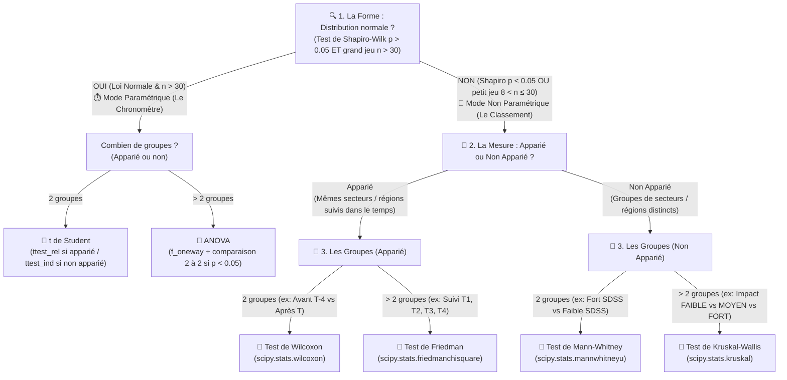

# 🧪 9. Mon Protocole de Tests Statistiques & Preuve Scientifique (`SciPy`)

> **Objectif de ce chapitre :** Documenter comment je transpose la méthodologie de mon cours **« Tests statistiques : choisir le bon test — Des données brutes à la décision scientifique »** au sein de la couche **Gold** de mon Data Lakehouse (`scipy.stats`) et de mon Dashboard Angular. Plutôt que de me contenter d'observer visuellement des écarts sur un graphique, j'applique un protocole rigoureux avec une **marge d'erreur `alpha = 0.05` (5 %)** pour **prouver scientifiquement que les mutations observées sur le marché du travail face à l'IA ne sont pas dues au hasard (`p-value < 0.05`)**.

---

## 🎯 1. Pourquoi intégrer des Tests Statistiques dans mon Data Lakehouse ?

Lorsqu'un décideur (Région, DRH, OPCO) observe sur mon tableau de bord que les secteurs à fort score de *Soft Skills* (**SDSS**) semblent perdre moins d'emplois que les secteurs figés sur l'exécution routinière, une question scientifique fondamentale se pose :

> **« Cette différence est-elle réelle (effet significatif du Bouclier Humain), ou est-elle simplement due au hasard de l'échantillonnage ? »**

Pour répondre à cette question de manière incontestable, mon pipeline Python (en couche **Gold**) évalue chaque comparaison selon la règle de la **`p-value`** avec un seuil de risque **`alpha = 0.05` (5 %)** :

1. **Mon point de départ (L'Hypothèse Nulle `H0`) :** Je suppose d'abord par prudence qu'il n'y a **aucune vraie différence** entre les groupes comparés et que seul le hasard agit.
2. **Le calcul de la `p-value` :** C'est la probabilité d'observer un écart au moins aussi grand que celui mesuré dans mon Lakehouse si seul le hasard agissait.
3. **Ma règle de décision automatique (`alpha = 0.05`) :**
   * 🟢 **Si `p < 0.05` :** L'écart observé a moins de 5 % de chances d'être produit par le hasard. Je rejette `H0` et je déclare la **différence statistiquement significative**.
   * 🩷 **Si `p > 0.05` :** L'écart n'est pas suffisamment marqué ; **aucune différence n'est démontrée** (elle peut être due au hasard).

---

## 🔍 2. Étape 1 de ma Méthode : « L'Arbitre de la Forme » (Test de Normalité de Shapiro-Wilk)

Avant de choisir un test de comparaison (et avant même de choisir entre une Moyenne et une Médiane !), mon script Python inspecte la **forme de la distribution** de mes données parmi trois grands profils :

1. **Distribution Normale (Courbe de Gauss en cloche) :** Symétrique autour de la moyenne. Autorise les **tests paramétriques** uniquement si l'échantillon dépasse **30 individus (`n > 30`)**.
2. **Distribution de Poisson :** Événements rares ou petits comptages (paramétrique sous condition).
3. **Distribution Bimodale ou Asymétrique (`ln(x)`) :** Deux populations mélangées ou présence de valeurs extrêmes (*outliers*, comme le poids économique hors-norme de l'Île-de-France ou des hauts salaires). Exige impérativement des **tests non paramétriques**.

### ⚖️ Mon Aiguilleur Automatique en Python : `scipy.stats.shapiro(data)`

En couche **Gold**, j'exécute systématiquement le **test de Shapiro-Wilk** :

```python
from scipy import stats

stat, p_shapiro = stats.shapiro(serie_valeurs)
```

> [!WARNING]
> **Le Piège d'Interprétation de Shapiro-Wilk (à ne jamais inverser !) :**
> Dans le test de Shapiro-Wilk, l'hypothèse de départ (`H0`) est : *« Les données suivent une loi normale »*.
> * 🟢 **Si `p_shapiro > 0.05` (et `n > 30`) :** Bonne nouvelle pour le paramétrique, **la distribution est normale** !
> * 🩷 **Si `p_shapiro < 0.05` (ex : `p = 0.02`) :** Le test est significatif, ce qui signifie que **les données ne suivent PAS une loi normale** → Mon pipeline bascule immédiatement vers un **test non paramétrique** !

---

## ⏱️ 3. « Le Chronomètre » (Paramétrique) vs « Le Classement » (Non Paramétrique)

Pourquoi cette distinction issue de mon cours est-elle vitale pour **Data Skills Radar** ?

| Critère | ⏱️ Tests Paramétriques (« Le Chronomètre ») | 🏅 Tests Non Paramétriques (« Le Classement ») |
| :--- | :--- | :--- |
| **Principe mathématique** | Utilisent les **vraies valeurs** brutes (Moyenne & Écart-type). | Utilisent uniquement **l'ordre d'arrivée** (les rangs, la Médiane et les Quartiles). |
| **Sensibilité aux anomalies** | ⚠️ **Très sensibles aux anomalies extrêmes** (ex: l'Île-de-France écrase la moyenne nationale). | ✅ **Insensibles aux anomalies extrêmes** (*Outlier-proof*). |
| **Conditions d'utilisation** | Exigent une **Loi Normale (`Shapiro p > 0.05`)** **ET** un grand jeu (**`n > 30`**). | Valables pour **toute distribution** ou dès que le jeu est petit (**`8 < n ≤ 30`**). |
| **Graphique Angular associé** | Barres de Moyenne ± Écart-type. | **Boîtes à moustaches (*Boxplots* : Médiane `P50` + Quartiles `Q1`/`Q3`)**. |

> [!IMPORTANT]
> **Pourquoi Data Skills Radar utilise majoritairement les tests Non Paramétriques (« Le Classement ») :**
> 1. **À l'échelle régionale (`n = 13 régions métropolitaines`) :** Comme `13 ≤ 30` (*petit jeu > 8*), la condition `n > 30` n'est jamais remplie. Toute comparaison statistique entre régions françaises passe donc obligatoirement par les tests **Non Paramétriques** !
> 2. **À l'échelle sectorielle (`n = 38` en `NA38` ou `n = 88` en `NA88`) :** Les effectifs salariés et les masses salariales URSSAF suivent des lois très asymétriques (`ln(x)`). Dès que `Shapiro-Wilk` renvoie `p < 0.05`, utiliser « le classement » (Médiane, Wilcoxon, Mann-Whitney, Kruskal-Wallis, Friedman) empêche les grands secteurs de fausser mes conclusions scientifiques.

---

## 🔗 4. Étape 2 & 3 : Mesure Appariée vs Non Appariée & Arbre de Décision

Après avoir testé la normalité avec Shapiro-Wilk, mon pipeline répond aux deux questions suivantes :

1. **La mesure est-elle Appariée ou Non Appariée ?**
   * **Mesure Appariée (*Paired*) :** Les **mêmes entités** (les mêmes 88 secteurs NAF ou les mêmes 13 régions) sont mesurées dans plusieurs conditions (ex : **Avant l'IA en `T-4`** puis **Après en `T`**). *Chaque secteur a deux (ou plusieurs) valeurs et est comparé à lui-même, ce qui rend le test beaucoup plus sensible aux vraies évolutions.*
   * **Mesure Non Appariée (*Unpaired / Indépendante*) :** Des **groupes différents** sont comparés entre eux à un instant donné (ex : le groupe des secteurs à **Fort SDSS** comparé au groupe des secteurs à **Faible SDSS**). *Chaque secteur n'appartient qu'à un seul groupe.*
2. **Combien de groupes est-ce que je compare ?**
   * Exactement **2 groupes** ou **plus de 2 groupes (`> 2 groupes`)** ?

### 🌳 Mon Arbre de Décision Statistique Complet



---

## 🗺️ 5. Matrices de Décision Appliquées aux 4 Scénarios de Data Skills Radar

Voici comment chacun des **6 tests statistiques** de mon cours s'applique concrètement aux problématiques métiers de mon projet :

### A. Matrice pour 2 Groupes

| Type de Mesure | ⏱️ Normale (`Shapiro p > 0.05` & `n > 30`) | 🏅 Autre (`Shapiro p < 0.05`) ou Petit Jeu (`8 < n ≤ 30`) | Application Concrète dans Data Skills Radar |
| :--- | :---: | :---: | :--- |
| **Apparié** *(Mêmes entités Avant / Après)* | **t de Student** *(apparié `ttest_rel`)* | **Wilcoxon** (`wilcoxon`) | **Scénario 1 (Choc Temporel Avant / Après) :** Comparer pour les **mêmes 88 secteurs NAF** (ou les **mêmes 13 régions**) le score `SDSS` ou les effectifs salariés URSSAF entre l'année `N-1` et l'année `N`. |
| **Non Apparié** *(2 groupes distincts)* | **t de Student** *(indépendant `ttest_ind`)* | **Mann-Whitney** (`mannwhitneyu`) | **Scénario 2 (Preuve de l'Hypothèse 2 — « Le Bouclier Humain ») :** Comparer la croissance d'effectifs URSSAF du groupe des secteurs à **Fort SDSS** face au groupe des secteurs à **Faible SDSS**. Si **`p < 0.05`**, mon Hypothèse 2 est scientifiquement démontrée ! |

### B. Matrice pour Plus de 2 Groupes (`> 2 groupes`)

| Type de Mesure | ⏱️ Normale (`Shapiro p > 0.05` & `n > 30`) | 🏅 Autre (`Shapiro p < 0.05`) ou Petit Jeu (`8 < n ≤ 30`) | Application Concrète dans Data Skills Radar |
| :--- | :---: | :---: | :--- |
| **Apparié** *(Mêmes entités sur > 2 dates)* | **ANOVA** *(mesures répétées)* | **Friedman** (`friedmanchisquare`) | **Scénario 3 (Trajectoire Multi-Trimestrielle) :** Suivre l'évolution de la masse salariale URSSAF des **mêmes secteurs NAF** sur 4 ou 8 trimestres consécutifs (`T1`, `T2`, `T3`, `T4`...) pour détecter une rupture de tendance significative. |
| **Non Apparié** *(> 2 groupes distincts)* | **ANOVA** (`f_oneway`) | **Kruskal-Wallis** (`kruskal`) | **Scénario 4 (Comparaison Multi-Catégories) :** Comparer l'évolution salariale (`SMPT`) entre les **3 niveaux de `NiveauImpactIA`** (`FAIBLE`, `MOYEN`, `FORT`) ou comparer la distribution des scores d'offres entre les **13 régions françaises**. |

> 💡 **Règle d'or Post-ANOVA / Post-Kruskal-Wallis :** Lorsqu'une **ANOVA** ou un test de **Kruskal-Wallis** renvoie **`p < 0.05`** sur 3 groupes (`FAIBLE`, `MOYEN`, `FORT`), cela prouve qu'**au moins un groupe diffère significativement des autres**, mais cela ne dit pas lequel ! Mon script exécute alors des comparaisons **deux à deux** (`FAIBLE vs MOYEN`, `MOYEN vs FORT`, `FAIBLE vs FORT`) pour identifier exactement où se situe la rupture.

---

## 🐍 6. Implémentation Python Automatisée dans ma Couche Gold (`scipy.stats`)

Pour industrialiser cette méthode en **3 questions**, j'intègre dans mon pipeline Gold (`data-skills-radar-lakehouse`) une fonction d'arbitrage statistique universelle qui enrichit mes tables Parquet avec le verdict scientifique :

```python
from typing import Sequence
from scipy import stats


def run_scientific_test(
    groups: Sequence[Sequence[float]],
    paired: bool = False,
    alpha: float = 0.05,
) -> dict:
    """
    Implémente la méthode en 3 questions du cours de Tests Statistiques :
    1. La Forme : Test de Shapiro-Wilk (p > 0.05 ET n > 30 => Normale / Paramétrique)
    2. La Mesure : Apparié (mêmes individus) ou Non Apparié (groupes indépendants)
    3. Les Groupes : 2 groupes ou > 2 groupes
    4. Le Verdict : p < 0.05 => Différence statistiquement significative
    """
    k = len(groups)
    min_n = min(len(g) for g in groups)

    # 1. Question 1 : La Forme (Shapiro-Wilk + taille d'échantillon > 30)
    shapiro_p_values = [
        float(stats.shapiro(g).pvalue) if len(g) >= 3 else 0.0
        for g in groups
    ]
    is_normal = (min_n > 30) and all(p > alpha for p in shapiro_p_values)

    # 2 & 3. Questions 2 et 3 : Choix du test selon Apparié/Non Apparié et Nombre de groupes
    if k == 2:
        g1, g2 = groups[0], groups[1]
        if is_normal:
            test_name = "t de Student (apparié)" if paired else "t de Student (indépendant)"
            res = stats.ttest_rel(g1, g2) if paired else stats.ttest_ind(g1, g2)
        else:
            test_name = "Wilcoxon" if paired else "Mann-Whitney"
            res = stats.wilcoxon(g1, g2) if paired else stats.mannwhitneyu(g1, g2)
    else:
        if is_normal:
            test_name = "ANOVA"
            res = stats.f_oneway(*groups)
        else:
            test_name = "Friedman" if paired else "Kruskal-Wallis"
            res = stats.friedmanchisquare(*groups) if paired else stats.kruskal(*groups)

    p_val = float(res.pvalue)
    return {
        "mode": "PARAMETRIQUE_CHRONOMETRE" if is_normal else "NON_PARAMETRIQUE_CLASSEMENT",
        "is_normal": is_normal,
        "min_sample_size": min_n,
        "shapiro_min_p": round(min(shapiro_p_values), 4),
        "test_used": test_name,
        "p_value": round(p_val, 4),
        "alpha": alpha,
        "is_significant": p_val < alpha,
        "verdict_label": (
            f"{test_name} : p = {p_val:.3f} < 0.05 · Différence significative"
            if p_val < alpha
            else f"{test_name} : p = {p_val:.3f} > 0.05 · Pas de différence démontrée (hasard possible)"
        ),
    }
```

---

## 🖥️ 7. Restitution Visuelle sur mon Dashboard Angular 22

Grâce à ce pré-calcul stocké dans mes fichiers Parquet **Gold** et servi par **DuckDB**, mon interface Angular n'affiche pas de simples graphiques muets. Chaque panneau d'analyse (`Matrice Compétences`, `Indicateurs Macro`, `Data Lab`) affiche un **Badge de Verdict Scientifique** :

*   🟢 **Quand `p < 0.05` (Badge Émeraude / Electric Teal) :**
    *   `Mann-Whitney · p = 0.012 (p < 0.05) — Effet significatif prouvé`
    *   *Interprétation affichée en infobulle :* « L'écart de résilience observé entre les secteurs à fort Bouclier Humain (SDSS) et les secteurs routiniers a moins de 1,2 % de chances d'être dû au hasard. »
*   🩷 **Quand `p > 0.05` (Badge Rose / Ambre) :**
    *   `Wilcoxon · p = 0.097 (p > 0.05) — Pas de différence démontrée`
    *   *Interprétation affichée en infobulle :* « L'écart observé sur cette période n'est pas statistiquement significatif au seuil alpha = 5 % et peut résulter de fluctuations aléatoires. »
